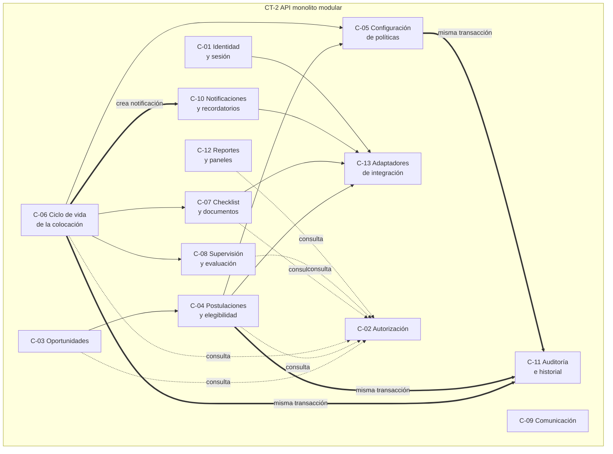

# V-COMP — Vista de componentes (módulos críticos)

| Campo | Valor |
|---|---|
| **ID** | V-COMP |
| **Propósito** | Mostrar los módulos del monolito, sus dependencias permitidas y sus responsabilidades |
| **Requisitos** | RF-05..RF-09, RF-13, RF-15, RF-17..RF-20, RNF-03..RNF-05, RNF-08 |
| **ADRs** | ADR-001..ADR-006 |

*Flechas continuas: dependencia de llamada. Punteadas: toda operación pasa por C-02. Dobles: escritura en la misma transacción.*

## Responsabilidades

| ID | Componente | Responsabilidad | **No** es responsable de | Requisitos | Reglas |
|---|---|---|---|---|---|
| C-01 | Identidad y sesión | Autenticar vía `IdentityPort`; mapear identidad externa a usuario y roles; emitir sesión | Decidir qué puede hacer un usuario | RNF-07 | — |
| C-02 | Autorización | Decidir por **rol + relación**; filtrar consultas; proyección mínima para externos | Autenticar; guardar el historial | RF-20, RNF-04 | BR-03, BR-13 |
| C-03 | Oportunidades | Registrar organizaciones y oportunidades; revisión y publicación; búsqueda y filtro | Evaluar elegibilidad | RF-01..RF-04 | BR-09 |
| C-04 | Postulaciones y elegibilidad | Postular; evaluar elegibilidad con la política vigente; guardar motivos y entradas | Definir las reglas; decidir selección | RF-05, RF-06 | BR-08, BR-10, BR-12 |
| C-05 | Configuración de políticas | Crear versiones validadas (vocabulario cerrado); consultar vigentes | Ejecutar transiciones | RNF-03, RF-08 | BR-12 |
| C-06 | **Ciclo de vida de la colocación** | Agregado `Placement`: selección, aprobación, activación, finalización, cierre, cancelación; versiones y cambios; **compuertas** | Autorización; contenido de documentos | RF-06, RF-07, RF-09, RF-13, RF-17 | BR-01, 02, 04, 05, 11, 17 |
| C-07 | Checklist y documentos | Instanciar requisitos desde la política; estados Required→Submitted→Approved/Rejected; metadatos y referencia | Almacenar archivos | RF-08, RF-09 | BR-01, BR-14 |
| C-08 | Supervisión y evaluación | Plan de trabajo, avance, horas, evaluaciones, incidentes | Cambiar el estado de la colocación por sí mismo | RF-10..RF-12, RF-14, RF-17 | BR-02, BR-05 |
| C-09 | Comunicación | Mensajes registrados entre participantes de una colocación | Notificaciones del sistema | RF-16 | BR-03 |
| C-10 | Notificaciones y recordatorios | Persistir notificaciones; detectar plazos; reintentos de entrega | Decidir reglas de negocio | RF-15 | — |
| C-11 | Auditoría e historial | Registrar eventos append-only; consultar línea de tiempo | Modificar o borrar eventos | RF-19, RNF-05 | BR-06, BR-07 |
| C-12 | Reportes y paneles | Modelos de lectura: retrasadas, en riesgo, interrumpidas, incompletas; reportes por programa/período | Modificar estado | RF-18 | BR-03 |
| C-13 | Adaptadores | Puertos + simuladores de identidad, registros, documentos, notificación (y calendario opcional) | Lógica de negocio | RNF-08 | — |

## Reglas de dependencia (propuestas, sin verificación automática aún)
1. Un módulo solo usa la **interfaz de aplicación** de otro; no lee sus tablas.
2. **Nada importa adaptadores**; el dominio depende de los puertos.
3. **Toda lectura o comando pasa por C-02**; no hay rutas sin acción declarada.
4. Cambios de estado en C-06 y escritura en C-11 ocurren en **la misma transacción** (ADR-005).
5. C-12 es de **solo lectura**.

## Qué se dejó fuera a propósito
No hay componente para pagos, RR. HH., reclutamiento ni selección automática (fuera de alcance, RFP sec. 10). El calendario es solo un puerto opcional.
