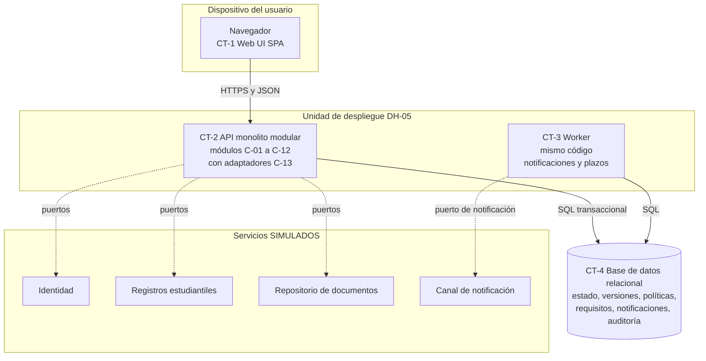

# V-CONT — Vista de contenedores

| Campo | Valor |
|---|---|
| **ID** | V-CONT |
| **Propósito** | Mostrar la estructura lógica de ejecución y qué dato posee cada contenedor |
| **Requisitos** | RF-09, RF-15, RF-17, RF-19, RNF-02, RNF-08, RNF-09 |
| **ADRs** | ADR-002, ADR-003, ADR-006 |

## Contenedores

| ID | Contenedor | Responsabilidad | No hace | Dato que posee |
|---|---|---|---|---|
| CT-1 | Web UI (SPA) | Interfaz por rol, estados derivados "siguiente paso" (RNF-11) | **No decide autorización ni reglas**; solo presenta | Ninguno (estado de sesión) |
| CT-2 | API monolito modular | Casos de uso, dominio, guardas, autorización, auditoría, lectura de paneles | No envía notificaciones por sí mismo; no guarda archivos | Lógica; usa CT-4 |
| CT-3 | Worker | Entrega de notificaciones pendientes; detección de plazos vencidos/próximos | No ejecuta comandos de ciclo de vida de usuarios | Nada propio; lee/escribe notificaciones |
| CT-4 | Base de datos relacional | **Única fuente de verdad** de estado, versiones, políticas, requisitos materializados, notificaciones y auditoría; red de seguridad (triggers, permisos) | No contiene archivos | Todo el estado persistente |
| — | Servicios simulados | Imitan identidad, registros, documentos y canal | No representan sistemas reales | Datos **sintéticos** |

## Decisiones visibles en la figura
1. **Un solo proceso transaccional (CT-2 + CT-4)** protege activación, cierre y auditoría como unidad (ADR-002/003).
2. **El worker no es un servicio aparte**: reutiliza el código y evita sagas (ADR-002).
3. **Ningún módulo habla con un simulador directamente**: solo por puertos (ADR-006).
4. **No hay caché, cola externa ni servicio de búsqueda**: el volumen del RFP no los justifica (AD-07).

## Qué es supuesto
La separación SPA/API, el worker y el uso de contenedores son **supuestos de despliegue** (ver V-DEP); no hay infraestructura implementada.
