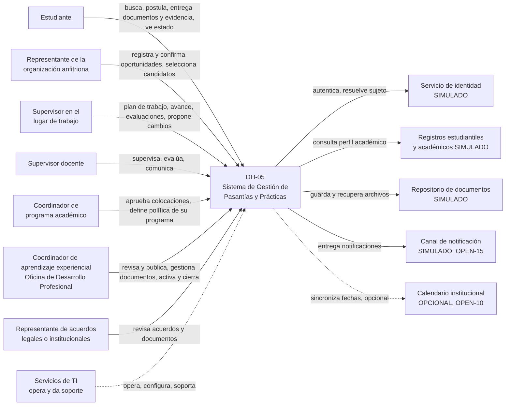

# V-CTX — Contexto del sistema

| Campo | Valor |
|---|---|
| **ID** | V-CTX |
| **Propósito** | Mostrar quién interactúa con DH-05 y con qué sistemas externos (todos simulados) |
| **Requisitos** | RF-20, RNF-07, RNF-08 · RFP sec. 4, 7 y 10 |
| **ADRs** | ADR-004, ADR-006 |

**Lectura.** Los siete actores humanos de la izquierda interactúan con una sola aplicación; **cada uno ve solo lo que su rol y su relación con la colocación permiten** (ADR-004). A la derecha están los únicos sistemas externos justificados por el RFP o por un requisito acordado. **Ninguno es real en esta entrega.**

## Relaciones principales

| Relación | Dirección | Dato | Justificación |
|---|---|---|---|
| Estudiante → DH-05 | entrada/salida | Postulaciones, documentos, horas, estado | RFP sec. 4 |
| Anfitrión → DH-05 | entrada/salida (limitada) | Oportunidades, selección, evaluación | RF-20: sin acceso innecesario |
| DH-05 → Identidad | salida | Credenciales, sujeto | RNF-07; usuarios **externos**: OPEN-21 |
| DH-05 → Registros estudiantiles | salida | Programa, nivel, créditos, cursos | Necesario para RF-05 |
| DH-05 → Repositorio de documentos | salida | Archivos; el sistema guarda metadatos y referencia | RFP sec. 7/10; OPEN-20 |
| DH-05 → Canal de notificación | salida | Avisos y recordatorios | RF-15 |
| DH-05 → Calendario | salida | Fechas | **No está en el RFP**; solo opcional |

## Fuera del contexto (a propósito)
Nómina, RR. HH. del empleador, LMS, verificación de antecedentes, seguros reales, contratos reales (RFP sec. 10).
