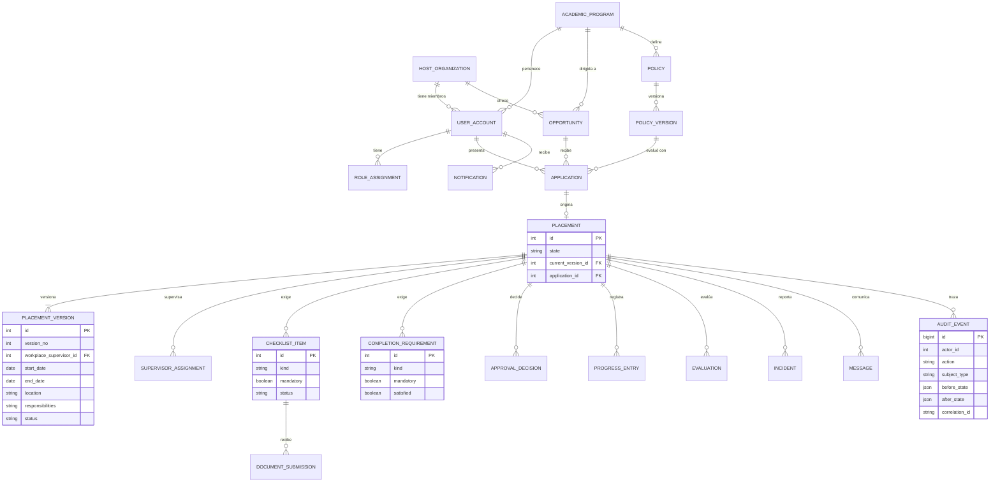
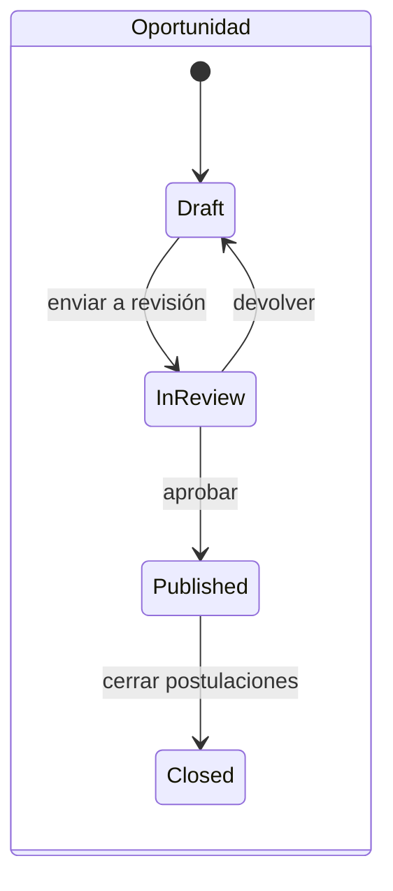
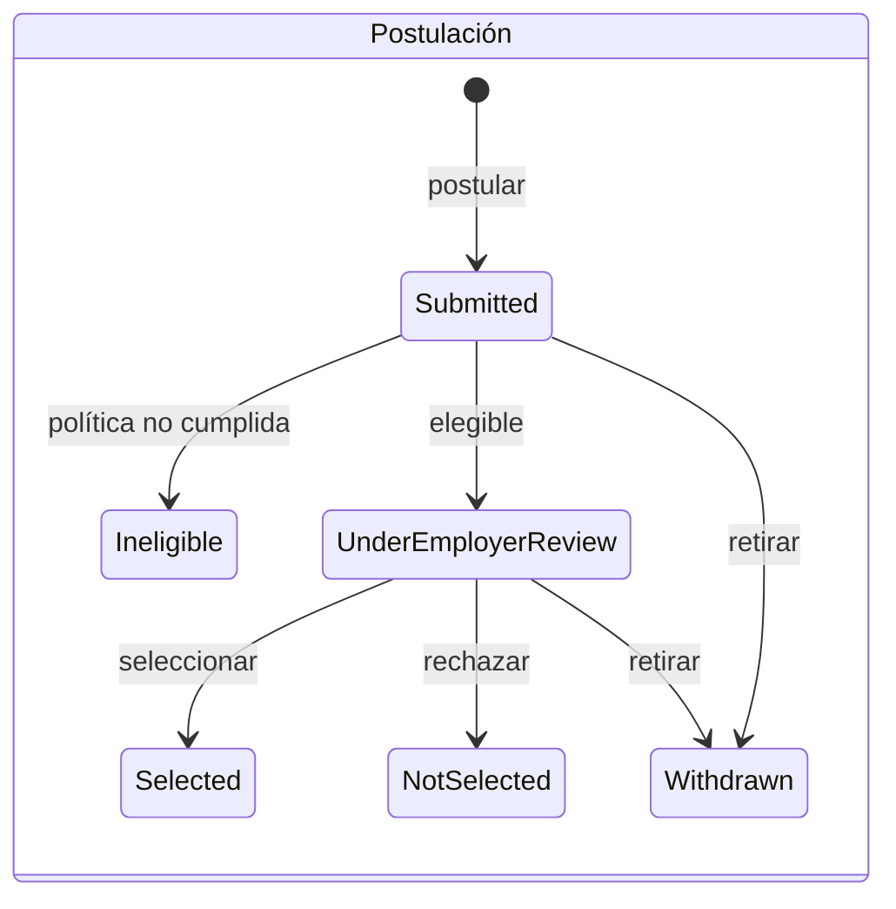

# Modelo de dominio y de datos

> **Aviso (OPEN-17):** este modelo se construyó desde el RFP y la Evaluación 1. El `domain-model.md` y el andamiaje existentes del equipo (citados en ASM-003B) **no estaban disponibles**. Debe reconciliarse antes de entregar.
> El PoC usa un esquema **simplificado** (un rol por usuario, sin `ApprovalDecision` genérico, sin tablas de mensajes ni de evaluaciones). El modelo completo es solo diseño.

| Campo | Valor |
|---|---|
| **ID** | V-DOM |
| **Propósito** | Mostrar entidades, relaciones, propiedad, ciclo de vida e invariantes |
| **Requisitos** | RF-01..RF-20, RNF-03, RNF-05 |
| **ADRs** | ADR-001, ADR-003, ADR-004, ADR-005 |

## Decisiones de agrupación (qué NO es una entidad separada)

| Candidata del enunciado | Decisión | Justificación |
|---|---|---|
| Student | **No** separada: `UserAccount` + perfil académico leído por `StudentRecordsPort` (instantánea guardada con la elegibilidad) | La fuente es externa (simulada); no se replica entera |
| Role | `RoleAssignment` (usuario, rol, alcance: programa u organización) | Un usuario puede tener varios roles/alcances |
| WorkplaceSupervisor / FacultySupervisor | **Roles** de `UserAccount`; el supervisor del lugar de trabajo es un campo de `PlacementVersion`; el docente es `SupervisorAssignment` | El cambio de supervisor del lugar de trabajo es un cambio **versionado** (RFP); el docente no |
| EligibilityRule / Policy | `Policy` + `PolicyVersion` con condiciones del vocabulario cerrado | ADR-001 |
| RequiredDocument | **No** entidad: es una *condición* de política que se materializa en `ChecklistItem` | Una sola mecánica para activación y cierre |
| Approval | `ApprovalDecision` genérica (sujeto, decisión, actor, instante) | Selección, aprobación académica, aprobación de versión, revisión de oportunidad comparten forma |
| Activity / Progress / HoursRecord | `ProgressEntry` con tipo (horas, actividad, informe) | Misma vida y mismos permisos |
| Change | **`PlacementVersion`** (con tipo de cambio) | RF-13: cambio = versión |
| Incident | Entidad propia con resolución | No versiona la colocación (RF-14) |
| Communication | `Message` (usuarios); `Notification` (sistema), separadas | Orígenes, permisos y reintentos distintos |

## Cardinalidades, propiedad y ciclo de vida

| Entidad | Propietario (módulo) | Cardinalidad clave | Ciclo de vida |
|---|---|---|---|
| Opportunity | C-03 | Organización 1—N Oportunidad | `Draft → InReview → Published → Closed`; ver abajo |
| Application | C-04 | Oportunidad 1—N; Estudiante 1—N | `Submitted → …`; ver abajo |
| **Placement** | **C-06** | Postulación 1—0..1 Colocación | V-STATE-PLC |
| PlacementVersion | C-06 | Colocación 1—N (≥1) | `PROPOSED → APPROVED/REJECTED`, contenido inmutable |
| ChecklistItem | C-07 | Colocación 1—N | `REQUIRED → SUBMITTED → APPROVED/REJECTED` |
| DocumentSubmission | C-07 | Ítem 1—N | Cada entrega se conserva |
| CompletionRequirement | C-08 | Colocación 1—N | `satisfied` falso → verdadero (recalculable desde el origen) |
| PolicyVersion | C-05 | Política 1—N | Inmutable |
| AuditEvent | C-11 | Colocación 1—N | **Append-only** |

### Ciclos de vida de apoyo

*Un estado `EligibilityReview` (revisión humana de elegibilidad) queda fuera hasta resolver OPEN-04.*

## Invariantes

| ID | Invariante | Aplicación |
|---|---|---|
| INV-01 | Una colocación solo es `ACTIVE` si sus requisitos de activación obligatorios están aprobados | ADR-003, BR-01 |
| INV-02 | Una colocación solo es `COMPLETED`/`CLOSED` con requisitos de cierre obligatorios cumplidos | ADR-003, BR-05 |
| INV-03 | Horas y progreso solo existen para colocaciones `ACTIVE` | Trigger, BR-02 |
| INV-04 | `current_version_id` apunta a una versión `APPROVED` de la misma colocación | C-06 |
| INV-05 | El contenido de una versión y los eventos de auditoría nunca cambian | ADR-005, BR-06 |
| INV-06 | Una postulación conserva la versión de política con la que se evaluó | BR-12 |
| INV-07 | Una colocación en estado terminal no cambia de estado | BR-17 |
| INV-08 | Toda mutación aceptada tiene su evento de auditoría en la misma transacción | BR-07 |

## Restricción de datos
No existen campos de nómina, impuestos ni transacciones financieras (RNF-10). Que una colocación sea remunerada o no es, a lo sumo, un indicador informativo (RFP sec. 8; **OPEN**).
