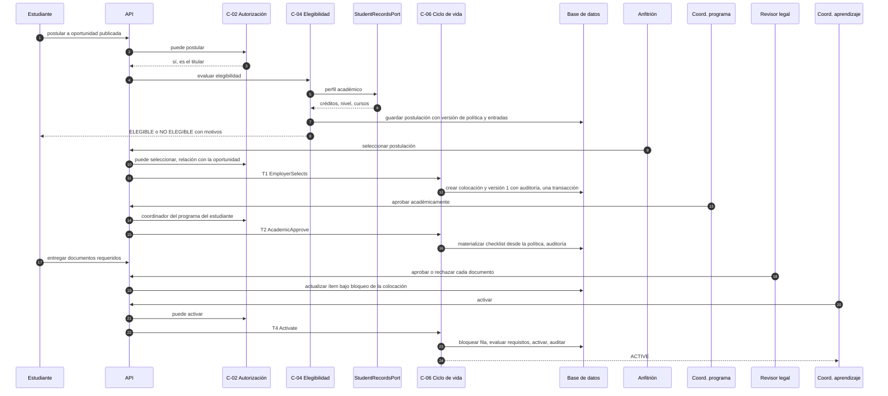
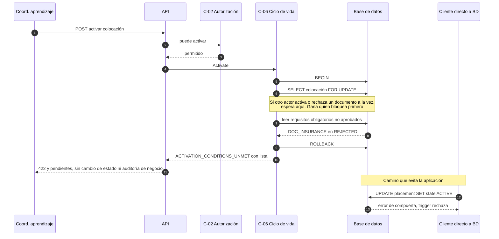
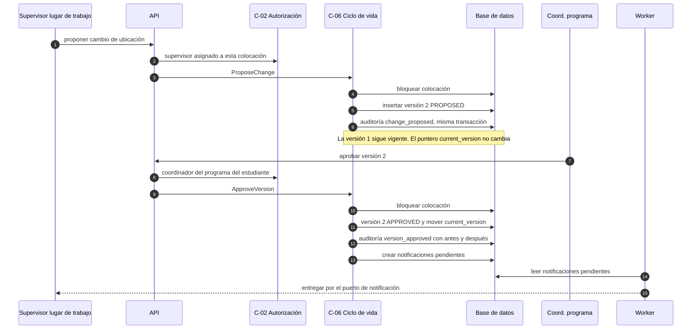
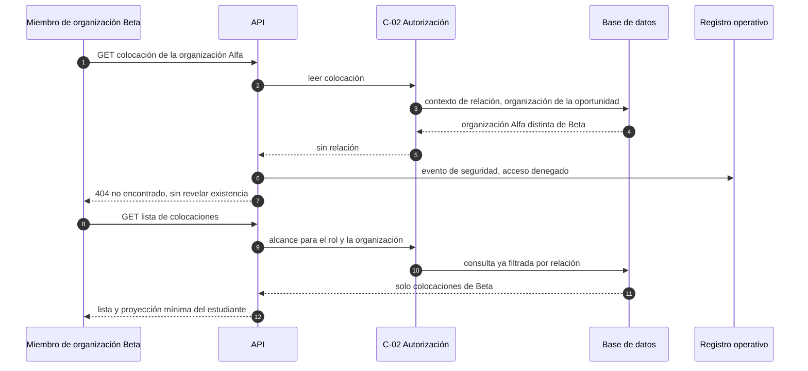

# Secuencias críticas

Cuatro interacciones. Cada una relaciona requisitos, reglas, componentes, ADR y prueba.

| Secuencia | Requisitos | Reglas | Componentes | ADR | Validación |
|---|---|---|---|---|---|
| SEQ-01 flujo extremo a extremo | RF-05..RF-09 | BR-08..BR-11, BR-14 | C-02..C-07, C-10, C-11 | ADR-001, 003, 004 | Diseño; **NOT EXECUTED** como flujo completo (el PoC cubre T2/T4) |
| SEQ-02 activación denegada | RF-09 | BR-01, BR-02 | C-06, C-07, DB | ADR-003 | T-01, T-02, T-02b |
| SEQ-03 cambio → versión → re-aprobación | RF-13, RF-19 | BR-04, BR-06, BR-07 | C-06, C-11, C-10 | ADR-005 | T-05 |
| SEQ-04 acceso externo no autorizado | RF-20 | BR-03, BR-13 | C-02, C-12 | ADR-004 | T-03 |

---

## SEQ-01 — De la postulación a la activación

*Propósito: mostrar el camino feliz y **dónde está cada decisión y cada guarda**. Requisitos: RF-05..RF-09. ADR: 001, 003, 004.*

*Nota: el estado "listo para activar" no existe como estado; la UI lo deriva de los ítems.*

---

## SEQ-02 — Intento de activación con un requisito pendiente

*Propósito: mostrar **exactamente dónde se rechaza**. Requisitos: RF-09. ADR-003. Prueba: T-01, T-02, T-02b.*

**Dónde se rechaza:** primera línea = guarda del comando bajo bloqueo (paso 7–9); última línea de defensa = trigger de BD (paso 12). Ambas fueron ejercitadas en el PoC.

---

## SEQ-03 — Cambio relevante → nueva versión → re-aprobación

*Propósito: mostrar la diferencia entre estado vigente, versión y auditoría. Requisitos: RF-13, RF-19. ADR-005. Prueba: T-05. **OPEN-03:** qué cambios requieren esto y quién aprueba.*

---

## SEQ-04 — Acceso externo no autorizado

*Propósito: mostrar que la denegación ocurre por **relación**, no por rol. Requisitos: RF-20. ADR-004. Prueba: T-03.*

**Observación:** la denegación se registra en el **registro operativo** (seguridad), no en la auditoría de negocio, que solo contiene mutaciones aceptadas.
