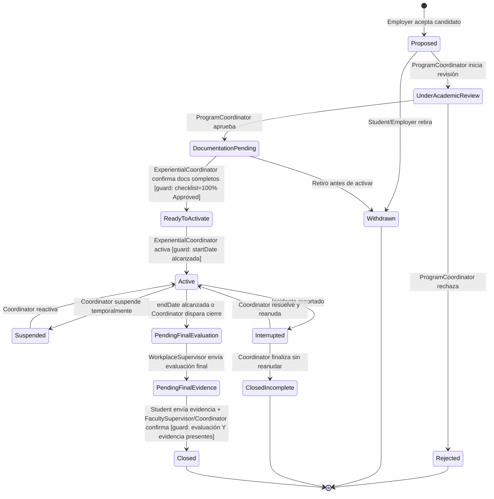

# Modelo de Dominio — Internship & Practicum Management System
### RFP DH-05 · Horizon University · Fase 1: Discovery & Domain Modeling

---

## 1. Bounded Contexts

| Context | Responsabilidad |
|---|---|
| **Opportunity Management** | Registro, revisión institucional y publicación de oportunidades de práctica. |
| **Application & Eligibility** | Postulación de estudiantes, validación de elegibilidad académica, decisión del empleador. |
| **Agreement & Document Management** | Checklist de documentos obligatorios (convenios, seguros, confidencialidad) previos a activación. |
| **Placement Lifecycle** *(core domain)* | El agregado central: activación, cambios, incidentes, cierre. Orquesta a los demás contexts vía eventos. |
| **Supervision & Evaluation** | Plan de trabajo, reportes de progreso, horas, evaluaciones midterm/final. |
| **Notifications & Deadlines** | Recordatorios, detección de placements en riesgo (at-risk). |
| **Reporting & Analytics** | Proyecciones de solo lectura (CQRS-lite) construidas desde el event log, para dashboards e informes institucionales. |
| **Identity & Access** *(soporte, compartido)* | Autenticación (SSO simulado), roles, políticas de autorización por relación (row-level). |

**Regla de dependencia:** todos los contexts publican eventos hacia el event bus interno; ningún context llama directamente a los métodos internos de otro. `Placement Lifecycle` es el único que puede leer estado de los demás para decidir transiciones (vía interfaces/ports, no acoplamiento directo).

---

## 2. Entidades, Value Objects e Invariantes por Context

### 2.1 Opportunity Management
- **HostOrganization** (entidad): id, nombre, tipo, estado de verificación institucional.
- **InternshipOpportunity** (entidad): id, hostOrgId, título, modalidad (remote/hybrid/onsite), tipo de compensación, cupo, programas elegibles, estado (Draft → UnderReview → Published → Closed/Cancelled).
- VO: `EligibilityCriteria`, `Modality`, `CompensationType`.

**Invariantes:**
- No se puede publicar sin revisión institucional aprobada.
- Se cierra automáticamente al llenar cupo o vencer fecha límite.

### 2.2 Application & Eligibility
- **Application** (entidad): id, studentId, opportunityId, estado, submittedAt.
- **EligibilityCheck** (VO): criterios evaluados, resultado, evaluador, fecha.

**Invariantes:**
- Un estudiante no puede tener dos aplicaciones activas a la misma oportunidad.
- No puede enviarse al empleador sin elegibilidad validada.

### 2.3 Agreement & Document Management
- **DocumentRequirement** (VO): tipo (agreement/insurance/confidentiality/other), obligatorio (bool).
- **DocumentChecklist** (entidad, 1:1 con Placement): lista de `DocumentStatus`.
- **DocumentStatus** (VO): requirementId, estado (Pending/Submitted/UnderLegalReview/Approved/Rejected).

**Invariante crítica:** el Placement **no puede** entrar a `ReadyToActivate` mientras exista un documento obligatorio sin `Approved`.

### 2.4 Placement Lifecycle *(agregado raíz)*
- **Placement**: id, studentId, opportunityId, hostOrgId, workplaceSupervisorId, facultySupervisorId, programCoordinatorId, fechas, estado (máquina de estados — ver sección 3).
- **PlacementChange / Incident** (entidad): tipo (SupervisorChange/ScheduleChange/LocationChange/ResponsibilityChange/Incident), descripción, reportado por, estado de resolución.

**Invariantes (mapean directo a los problemas del RFP):**
- No se activa sin: aprobación académica + documentos completos + selección del empleador confirmada.
- No se cierra (`Closed`) sin evaluación final **y** evidencia final del estudiante — esto es lo que hoy falla ("*Final completion may be recorded even when required evidence is missing*").

### 2.5 Supervision & Evaluation
- **WorkPlan** (entidad): placementId, objetivos, responsabilidades, aprobado por.
- **ProgressReport** (entidad): placementId, periodo, horas, evidencia, aprobado por.
- **Evaluation** (entidad): placementId, tipo (Midterm/Final), evaluador, rúbrica, comentarios.
- **HoursLog** (VO): fecha, horas, descripción, estado de aprobación.

**Invariante:** solo se contabilizan horas si el programa académico del estudiante las exige (regla configurable, no hardcodeada).

### 2.6 Notifications & Deadlines
- **Deadline** (entidad): entidad relacionada, fecha límite, tipo, estado.
- **RiskFlag** (VO): placementId, tipo de riesgo (DelayedActivation/OverdueEvaluation/MissingHours), fecha.

### 2.7 Identity & Access
- **User**: id, rol(es), identidad SSO simulada.
- **Roles**: Student, HostOrgRep, WorkplaceSupervisor, FacultySupervisor, ProgramCoordinator, ExperientialCoordinator, LegalRep, ITAdmin.
- **Policy**: reglas de autorización por relación (ej. un WorkplaceSupervisor solo accede a los Placements donde es supervisor asignado).

---

## 3. Máquina de Estados — Placement (entidad core)

**Nota de diseño:** la transición a `Closed` tiene guard doble (evaluación + evidencia) porque ese es exactamente el defecto que el RFP identifica en el proceso actual. Esta transición debe implementarse como validación explícita en el dominio, no en la UI.

**Guards adicionales confirmados (agregados en implementación, ratificados aquí):**
- `UnderAcademicReview → DocumentationPending`: requiere `academic_approval = true`.
- `DocumentationPending → ReadyToActivate`: requiere `documents_complete = true` (calculado desde `DocumentChecklist`, no un flag manual) **y** `employer_selection_confirmed = true`.
- `PendingFinalEvaluation → PendingFinalEvidence`: requiere `final_evaluation_present = true`.

Estos guards son válidos y quedan ratificados como parte del modelo — cualquier guard nuevo que se agregue después debe documentarse aquí primero, no solo en el código.

---

## 4. Domain Events (por context)

| Context | Eventos |
|---|---|
| Opportunity | `OpportunityPublished`, `OpportunityClosed` |
| Application | `ApplicationSubmitted`, `EligibilityValidated`, `EligibilityRejected`, `ApplicationForwardedToEmployer`, `EmployerAccepted`, `EmployerRejected` |
| Documents | `DocumentSubmitted`, `DocumentApproved`, `DocumentRejected` |
| Placement | `PlacementProposed`, `AcademicReviewStarted`, `PlacementApproved`, `PlacementRejected`, `PlacementActivated`, `PlacementSuspended`, `PlacementResumed`, `PlacementInterrupted`, `PlacementClosed`, `PlacementClosedIncomplete`, `PlacementWithdrawn`, `SupervisorChanged`, `ScheduleChanged`, `LocationChanged`, `IncidentReported` |
| Supervision | `WorkPlanApproved`, `ProgressReportSubmitted`, `HoursLogged`, `MidtermEvaluationSubmitted`, `FinalEvaluationSubmitted`, `FinalEvidenceSubmitted` |
| Notifications | `DeadlineMissed`, `RiskFlagRaised` |

Todo evento se persiste en la tabla `domain_events` (audit log) — esto resuelve gratis el requisito de trazabilidad institucional (sección 6 del RFP) y alimenta el context de Reporting.

---

## 5. Matriz de Roles × Acciones

| Acción | Student | HostOrgRep | WorkplaceSupervisor | FacultySupervisor | ProgramCoordinator | ExperientialCoordinator | LegalRep |
|---|:---:|:---:|:---:|:---:|:---:|:---:|:---:|
| Publicar oportunidad | | ✔ (propone) | | | | ✔ (aprueba) | |
| Postular | ✔ | | | | | | |
| Validar elegibilidad | | | | | ✔ | | |
| Seleccionar/rechazar candidato | | ✔ | | | | | |
| Aprobar ajuste académico | | | | | ✔ | | |
| Subir/revisar documentos | ✔ (sube) | ✔ (sube) | | | | ✔ | ✔ (revisa) |
| Activar placement | | | | | | ✔ | |
| Reportar cambio/incidente | ✔ | ✔ | ✔ | ✔ | | ✔ | |
| Enviar progreso/horas | ✔ | | ✔ (aprueba) | | | | |
| Evaluación midterm/final | | | ✔ | ✔ (revisa) | | | |
| Enviar evidencia final | ✔ | | | | | | |
| Confirmar cierre | | | | ✔ | ✔ | | |
| Ver reportes institucionales | | | | ✔ (limitado) | ✔ | ✔ | |

La autorización real no es solo "rol permitido" — es **rol + relación con el recurso** para los roles con relación directa a un placement específico (Student, HostOrgRep, WorkplaceSupervisor, FacultySupervisor). Esto se implementa como policy layer, no como chequeo de rol plano.

**Excepción explícita — roles institucionales globales:** `ExperientialCoordinator` y `LegalRep` NO se limitan por relación. Son oficinas centralizadas (8-12 personas para toda la universidad según sección 8 del RFP) que coordinan y revisan sobre el total de placements, no por facultad/programa. Para estos dos roles, chequeo de rol plano es la implementación correcta — no es un defecto de autorización. `ProgramCoordinator` sí se limita por relación (su programa académico).

Si en el futuro la universidad requiere coordinadores por facultad, esta decisión se revisa aquí primero.

---

