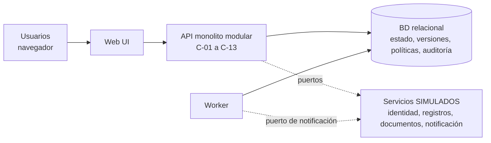

# DH-05 — Sistema de Gestión de Pasantías y Prácticas Profesionales
## Evaluación 2 — Architecture and Design Review

> **Pregunta central:** ¿puede el equipo justificar cómo debe estructurarse el sistema propuesto?

**Versión revisada:** `E2-draft-1` · 2026-10-08 · **Commit fuente:** ninguno (el PoC es un paquete independiente; el equipo aún no tiene código del producto) · **Estado:** paquete de **diseño** + un PoC pequeño de base de datos ejecutado en sandbox (no ejecutado aún por el equipo).

Cadena de evidencia de todo el documento:

*Figura F-01. Los IDs de esta cadena se leen en ambos sentidos en [`traceability.md`](traceability.md).*

**Mapa de archivos:** [auditoría de Evaluación 1](evaluation-1-audit.md) · [ADRs](adr/) · [Contexto](views/V-CTX-context.md) · [Contenedores](views/V-CONT-container.md) · [Componentes](views/V-COMP-components.md) · [Despliegue](views/V-DEP-deployment.md) · [Dominio y datos](views/domain-model.md) · [Máquina de estados](views/placement-state-machine.md) · [Secuencias](views/sequences.md) · [Reglas](design/business-rules.md) · [Interfaces](design/interfaces.md) · [Seguridad](design/security.md) · [Plan de validación](validation/validation-plan.md) · [Resultados](validation/validation-results.md) · [PoC](validation/poc.md) · [Estado del proyecto](project-status.md) · [Trazabilidad](traceability.md)

---

## 1. Propósito

Esta evaluación documenta **cómo debería estructurarse** el sistema y por qué, a partir del alcance acordado en la Evaluación 1. No es una implementación completa. Distingue siempre cuatro niveles de certeza:

| Nivel | Significado | Cómo se marca |
|---|---|---|
| **Establecido** | Lo exige el RFP o fue acordado en la Evaluación 1 | RFP, RF-xx, RNF-xx |
| **Propuesta del equipo** | Decisión de diseño razonada, no validada con el cliente | *Design Proposal* / ADR con estado `propuesta` |
| **Supuesto** | Algo que se asume hasta validar | ASM-xx |
| **Abierto** | No definido por las fuentes | `OPEN-xx` / TO VALIDATE |
| **Ejecutado** | Resultado real de una prueba | T-xx con evidencia; si no se corrió: `NOT EXECUTED` |

**Qué está diseñado:** estructura (contexto, contenedores, componentes, despliegue), dominio y datos, ciclo de vida de la colocación, secuencias críticas, reglas de negocio, interfaces, seguridad.
**Qué sigue provisional:** todas las reglas institucionales (listas de documentos, evidencia de cierre, aprobaciones de cambios, elegibilidad humana), la tecnología concreta y el mecanismo de autenticación de usuarios externos. Ver el registro `OPEN` en §11.

---

## 2. Alcance acordado (DH-05)

**Problema.** La coordinación de pasantías y prácticas depende de correo, hojas de cálculo, formularios, carpetas y registros independientes de cada programa. La universidad no tiene una fuente consistente para saber el estado de una postulación, colocación, supervisión o evaluación final, y puede registrar una finalización aunque falte evidencia (RFP sec. 2).

**Objetivo.** Una solución que acompañe el ciclo de vida de la colocación, desde la publicación de la oportunidad hasta el cierre, con proceso auditable (Visión y Alcance; RFP sec. 3).

**Actores.** Estudiante · Organización anfitriona · Supervisor en el lugar de trabajo · Supervisor docente · Coordinador de programa académico · Coordinador de aprendizaje experiencial (Oficina de Desarrollo Profesional) · Representante de acuerdos legales/institucionales · Servicios de TI (opera y da soporte).

**Capacidades dentro del alcance** (Visión y Alcance): registro de organizaciones y oportunidades · revisión y publicación · postulación y validación de elegibilidad · selección del empleador y aprobación académica · checklist de documentos y activación controlada · supervisores y plan de trabajo · progreso, horas y evaluaciones · cambios e incidentes · recordatorios y notificaciones · búsqueda, paneles e historial · integraciones **simuladas**.

**Fuera de alcance** (RFP sec. 10; Visión): plataforma comercial de reclutamiento, nómina/impuestos/beneficios, RR. HH. del empleador, garantía de empleo y verificación de antecedentes, reemplazo del LMS o calificaciones oficiales, licencias clínicas y reclamaciones de seguros, contratos reales y monitoreo de ubicación, selección de candidatos con IA, servicios para egresados, integración con sistemas reales de producción.

**Restricciones del RFP** (sec. 7): solo datos sintéticos · autenticación institucional por el servicio de identidad o equivalente simulado · acceso externo controlado y limitado, dependiente de rol y relación · evaluaciones y datos de empleadores protegidos · aprobaciones, evaluaciones y cambios trazables · operar de forma independiente de otros proyectos · integraciones simulables · personal técnico limitado → solución mantenible · remoto/híbrido · viable en un semestre · reglas por programa cambiables · sin nómina ni transacciones reales · **un estudiante no puede comenzar antes de cumplir las condiciones obligatorias de activación**.

---

## 3. Requisitos arquitectónicamente significativos

Un requisito es *significativo* si cambia la estructura, las fronteras o las responsabilidades. Se revisó la lista candidata contra la Evaluación 1 (ver [auditoría](evaluation-1-audit.md)).

| ID | Descripción (Evaluación 1) | Significancia | Por qué importa a la arquitectura | Elemento de diseño que lo satisface |
|---|---|---|---|---|
| RF-05 | Validar elegibilidad contra reglas configurables del programa | **Alta** | Exige reglas como datos con versión, y un registro de resultado reproducible (AUD-11) | C-04, C-05, ADR-001, BR-08/BR-12 |
| RF-06 / RF-07 | Selección del empleador y aprobación académica | **Alta** (conjunta) | Dos decisiones de actores distintos sobre un mismo agregado; definen el inicio del ciclo de vida | C-06, V-STATE-PLC (T1–T3), BR-10/BR-11 |
| RF-08 | Checklist de documentos configurable por tipo | **Alta** | Los requisitos se **materializan** como instancias por colocación, base de la compuerta | C-07, ADR-001/003, BR-14 |
| RF-09 | Bloquear activación con condiciones pendientes | **Alta (crítica)** | Invariante central; obliga a transacción, bloqueo y red de seguridad en BD | C-06, ADR-003, BR-01/BR-02, SEQ-02 |
| RF-13 | Cambios relevantes como nueva versión con aprobación | **Alta** | Separa estado vigente, datos versionados e historial | C-06, ADR-005, BR-04, SEQ-03 |
| RF-15 | Notificaciones automáticas ante estados y plazos | Media | Requiere disparador temporal y entrega desacoplada del comando | C-10, worker, ADR-006 |
| RF-17 | Bloquear cierre sin evidencia obligatoria | **Alta (crítica)** | Misma familia que RF-09 para `Completed` y `Closed` | C-06, C-08, ADR-003, BR-05 |
| RF-18 | Paneles operativos | Media | Lecturas agregadas; no fuerzan nuevos contenedores a este volumen | C-12 (modelos de lectura) |
| RF-19 | Historial auditable de cada colocación | **Alta** | Auditoría atómica con cada mutación aceptada | C-11, ADR-005, BR-06/BR-07 |
| RF-20 | Acceso según rol y relación con la colocación | **Alta (crítica)** | Rol solo no basta; hay que evaluar relación en cada lectura y listado | C-02, ADR-004, BR-03/BR-13, SEQ-04 |
| RNF-01 / RNF-02 | Capacidad (12 000 estudiantes, 600–900 colocaciones/año) y estacionalidad | **Baja** como driver estructural | A este volumen **no obliga a distribuir**; sustenta ADR-002 (ver AD-07) | ADR-002, QS-05 |
| RNF-03 | Reglas cambiables por programa | **Alta** | Es el origen del vocabulario cerrado de políticas (el RFP no exige "sin redeploy") | ADR-001, C-05 |
| RNF-04 | Seguridad y privacidad por rol y relación | **Alta** | Define la capa de autorización y la proyección mínima | ADR-004, [security](design/security.md) |
| RNF-05 | Auditabilidad | **Alta** | Define el historial append-only | ADR-005, T-07 |
| RNF-07 | Autenticación institucional (o simulada) | Media | Identidad ≠ autorización; el IdP queda detrás de un puerto | ADR-006, IF-ID |
| RNF-08 | Integraciones simulables | Media | Puertos y adaptadores con simuladores | ADR-006, C-13 |
| RNF-09 | Mantenibilidad, viable en un semestre | **Alta** como filtro | Penaliza microservicios y motores de reglas genéricos | ADR-001, ADR-002 |
| RNF-11 | El estudiante ve estado y siguiente paso | Media | Obliga a un **estado derivado** de "listo para activar" y a tres dimensiones de estado visibles | V-STATE-PLC (§ estados descartados), QS-08 |
| RNF-12 | Disponibilidad en picos | **Baja** | Sin umbrales validados; solo condiciona supuestos de despliegue | V-DEP, QS-05 |

**No significativos estructuralmente** (se resuelven con módulos CRUD/flujo estándar): RF-01..RF-04, RF-10..RF-12, RF-14, RF-16. RNF-06 (datos sintéticos) y RNF-10 (sin finanzas) son **restricciones** que se respetan, no generan estructura.

---

## 4. Escenarios de calidad

Todos los valores son **objetivos propuestos (*proposed targets*)**. Donde no hay datos institucionales, así se indica. **Ninguno es un resultado medido** salvo que la fila de evidencia diga `EJECUTADO` y cite la prueba.

### QS-01 — Integridad de activación

| Campo | Valor |
|---|---|
| Source | Coordinador de aprendizaje experiencial (o cualquier actor que intente saltarse la aplicación) |
| Stimulus | Solicita activar una colocación con ≥1 requisito de activación obligatorio no aprobado. Variantes: (a) ítem pendiente; (b) ítem rechazado en paralelo; (c) dos activaciones simultáneas; (d) `UPDATE` directo a la BD |
| Environment | Operación normal, BD sana, política de activación ya vinculada a la colocación |
| Artifact | Ciclo de vida de colocación (C-06), checklist (C-07), compuerta en BD |
| Response | Rechazo con error de negocio que lista lo pendiente; estado sin cambios; sin evento de activación; con dos activaciones válidas, una sola prevalece y la otra recibe conflicto; el bypass directo lo rechaza la BD |
| Measure *(propuesto)* | 0 colocaciones activadas con requisitos pendientes en ≥100 ensayos por variante; 100/100 carreras con exactamente 1 éxito, 1 conflicto y 1 evento de auditoría; 100 % de intentos de bypass rechazados |
| Evidencia | **EJECUTADO (PoC, sandbox, 2026-10-22):** T-01, T-02, T-02b (T-02 A 55 activación primero / 45 rechazo primero, 0 prohibidos; B 25/40; C 0/40 con 21 `GATE_VIOLATION`). T-08 para BR-02. T-16a/e: PASS. Ver [resultados](validation/validation-results.md) |

### QS-02 — Aislamiento de autorización

| Campo | Valor |
|---|---|
| Source | Usuario externo autenticado (miembro de la organización B, o supervisor del lugar de trabajo no asignado) |
| Stimulus | Consulta por identificador, listado o búsqueda datos de colocaciones, postulantes o evaluaciones con las que no tiene relación |
| Environment | Operación normal; datos sintéticos con ≥2 organizaciones y ≥3 colocaciones |
| Artifact | Autorización (C-02) y filtrado de consultas en cada módulo |
| Response | Se responde "no encontrado" (sin revelar existencia); los listados incluyen solo recursos relacionados; las respuestas permitidas usan proyección mínima del estudiante |
| Measure *(propuesto)* | 100 % de casos negativos denegados; 0 filas o campos protegidos devueltos; para cada par (sujeto, colocación), el listado y la lectura directa coinciden |
| Evidencia | **EJECUTADO (PoC, sandbox):** T-03, 66 aserciones. Falta: capa HTTP real (NOT EXECUTED) |

### QS-03 — Cambio de una regla de elegibilidad

| Campo | Valor |
|---|---|
| Source | Coordinador de programa académico |
| Stimulus | Cambia el umbral de créditos de la política de elegibilidad de su programa |
| Environment | Sistema en operación con postulaciones ya evaluadas |
| Artifact | Configuración de políticas (C-05), postulaciones y elegibilidad (C-04) |
| Response | Se crea una nueva versión validada contra el vocabulario y auditada; las nuevas evaluaciones la usan; las postulaciones ya evaluadas conservan su versión y resultado; condiciones no soportadas se rechazan |
| Measure *(propuesto)* | La nueva versión rige en la siguiente evaluación sin reinicio ni cambio de código (objetivo de latencia ≤ 1 min: **no medido**); 100 % de muestras inválidas rechazadas; regresión vieja/nueva en verde |
| Evidencia | **EJECUTADO parcial (PoC):** T-06 verifica el comportamiento funcional. La latencia no se midió |

### QS-04 — Auditabilidad de un cambio

| Campo | Valor |
|---|---|
| Source | Supervisor del lugar de trabajo propone; coordinador de programa aprueba |
| Stimulus | Cambio relevante (ubicación, horario, supervisor, responsabilidades) en una colocación activa |
| Environment | Operación normal |
| Artifact | Versionado de colocación (C-06) y auditoría (C-11) |
| Response | Nueva versión `PROPOSED`; la vigente no cambia hasta aprobar; cada mutación aceptada produce un evento en la misma transacción con actor, tiempo, acción, antes/después y correlación; la versión previa se conserva; la aplicación no puede modificar ni borrar eventos |
| Measure *(propuesto)* | 100 % de mutaciones aceptadas del catálogo con evento completo; 0 `UPDATE/DELETE` exitosos sobre auditoría; reconstrucción de la línea de tiempo ≤ 2 s con ≤ 500 eventos (**no medido**) |
| Evidencia | **EJECUTADO (PoC):** T-05, T-07. Latencia de reconstrucción: NOT EXECUTED |

### QS-05 — Operación en pico de inicio de período

| Campo | Valor |
|---|---|
| Source | Estudiantes, coordinadores y usuarios externos al inicio del período |
| Stimulus | Carga **sintética propuesta** (no hay datos institucionales; ASM-009/011): 150 usuarios concurrentes (120 estudiantes que buscan y postulan, 20 de staff que aprueban y activan, 10 externos que seleccionan), ráfaga de 10 min con 20 comandos de ciclo de vida por minuto |
| Environment | Supuesto de despliegue de demostración (un host, 1 proceso API, 1 worker, 1 BD); conjunto sintético: 12 000 estudiantes, 250 organizaciones, 900 colocaciones, 2 000 postulaciones |
| Artifact | API y BD |
| Response | Se atienden las solicitudes; los invariantes de ciclo de vida se mantienen; ningún comando se pierde |
| Measure *(propuesto)* | p95 de lecturas < 800 ms; p95 de escrituras < 1 500 ms; errores < 1 %; 0 violaciones de invariantes |
| Evidencia | **NOT EXECUTED.** Falta implementación de API y generador de carga |

### QS-06 — Integridad de finalización y cierre

| Campo | Valor |
|---|---|
| Source | Coordinador de programa (confirma) / coordinador de aprendizaje experiencial (cierra) |
| Stimulus | Confirma o cierra una colocación con evidencia obligatoria faltante (informe final, evaluación final, horas si la política las exige). Variantes: bandera "satisfecho" desactualizada; `UPDATE` directo |
| Environment | Operación normal |
| Artifact | C-06, C-08 y compuerta en BD |
| Response | Rechazo con lista de evidencia faltante; sin cambio de estado; las horas se **recalculan desde las filas de origen**; el bypass lo rechaza la BD |
| Measure *(propuesto)* | 100 % de ≥5 variantes de evidencia faltante denegadas; 0 colocaciones `Completed`/`Closed` con requisitos obligatorios insatisfechos |
| Evidencia | **EJECUTADO (PoC):** T-04. La variante de concurrencia (retirar evidencia durante la confirmación) es **NOT EXECUTED** |

**Calidades de apoyo** (definición operacional pendiente de ejecución): **QS-07** (RNF-08, AD-05): con el adaptador de registros estudiantiles caído, la postulación queda sin evaluar con mensaje explícito, **nunca** se asume elegible, y las notificaciones en cola se entregan al recuperarse (objetivo propuesto ≤ 5 min) — *NOT EXECUTED*. **QS-08** (RNF-11): en un estudio de tareas planificado con 5 personas, ≥4 identifican estado y siguiente paso — *NOT EXECUTED*.

---

## 5. Drivers de arquitectura

Se evaluaron los siete candidatos. Un driver es selectivo: explica una consecuencia estructural, no copia el backlog.

| Driver | ¿Se mantiene? | Evidencia | Implicación estructural |
|---|---|---|---|
| **AD-01** Integridad del ciclo de vida | **Sí — dominante** | RF-09, RF-17, ASM-007, QS-01, QS-06, RFP sec. 7 | Un solo límite transaccional sobre el agregado `Placement`; requisitos materializados; compuerta en aplicación **y** en BD |
| **AD-02** Reglas configurables por programa/tipo | **Sí** | RNF-03, RF-05, RF-08, R-001, QS-03 | Políticas como datos versionados con vocabulario cerrado |
| **AD-03** Autorización por rol **y** relación | **Sí — dominante** | RF-20, RNF-04, RFP sec. 2 y 7, QS-02 | Componente de autorización central, consultas filtradas, proyecciones |
| **AD-04** Auditabilidad y trazabilidad | **Sí** | RF-13, RF-19, RNF-05, QS-04 | Versiones inmutables + auditoría append-only en la misma transacción |
| **AD-05** Aislamiento de integraciones | **Sí, moderado** | RNF-08, R-002, ASM-005, QS-07 | Puertos y adaptadores con simuladores |
| **AD-06** Mantenibilidad y semestre | **Sí — filtro de decisión** | RNF-09, ASM-012 | Pocos contenedores; sin motores genéricos |
| **AD-07** Carga en picos | **Degradado a restricción secundaria** | RNF-01/02/12, ASM-009/011 | A 600–900 colocaciones/año **no fuerza distribución**; lo relevante es la *concurrencia de comandos* sobre un mismo agregado, no el volumen. Justifica *no* usar microservicios |

---

## 6. Tensiones y compromisos (lo que empeora)

| Tensión | Resolución propuesta | Costo aceptado |
|---|---|---|
| Flexibilidad de reglas vs. simplicidad | Vocabulario **cerrado** y política versionada (ADR-001) | Reglas complejas (OR, excepciones) exigen rediseño; nuevos tipos de condición requieren release; hay que validar y versionar configuración |
| Consistencia fuerte vs. servicios independientes | Monolito modular con una BD transaccional (ADR-002) | Sin escalado independiente; mayor unidad de despliegue; riesgo de acoplamiento si no se vigilan los límites; extracción futura costosa |
| Seguridad de la compuerta vs. lógica única | Guardas en aplicación **y** en BD (ADR-003) | Lógica duplicada que debe mantenerse sincronizada; triggers más difíciles de probar y migrar |
| Aislamiento fuerte vs. complejidad de autorización | Autorización por relación en aplicación + consultas filtradas (ADR-004) | Más lógica, más *joins*, matriz de pruebas más grande; RLS en BD queda como defensa opcional |
| Trazabilidad vs. almacenamiento y lectura | Versiones + auditoría append-only (ADR-005) | Más almacenamiento, lecturas más complejas, riesgo de divergencia estado/auditoría si se evade el servicio; un superusuario de BD puede deshabilitar el trigger |
| Integración real vs. entrega en un semestre | Adaptadores simulados (ADR-006) | La integración real queda sin probar (R-002); los simuladores deben mantenerse fieles |
| Diseño rico vs. viabilidad | Probar solo la rebanada crítica | No toda la funcionalidad está implementada en esta evaluación |

---

## 7. Decisiones de arquitectura (índice)

| ADR | Decisión | Estado | Drivers | Requisitos | QS |
|---|---|---|---|---|---|
| [ADR-001](adr/ADR-001-configurable-policies.md) | Políticas versionadas con **vocabulario cerrado** (no un motor con scripts) | propuesta | AD-02, AD-06 | RF-05, RF-08, RF-17, RNF-03 | QS-03 |
| [ADR-002](adr/ADR-002-modular-monolith.md) | **Monolito modular** + worker en el mismo código | propuesta | AD-01, AD-06, AD-07 | RNF-01/02/09 | QS-05 |
| [ADR-003](adr/ADR-003-activation-closure-gates.md) | Compuertas de activación y cierre: **transacción + bloqueo de fila + requisitos materializados + trigger de seguridad** | propuesta (parcialmente verificada en PoC) | AD-01 | RF-09, RF-17 | QS-01, QS-06 |
| [ADR-004](adr/ADR-004-relationship-authorization.md) | Autorización por **rol y relación** en la aplicación; RLS como defensa opcional | propuesta (parcialmente verificada en PoC) | AD-03 | RF-20, RNF-04 | QS-02 |
| [ADR-005](adr/ADR-005-versioning-audit.md) | Estado vigente ≠ datos versionados ≠ auditoría append-only | propuesta (parcialmente verificada en PoC) | AD-04 | RF-13, RF-19, RNF-05 | QS-04 |
| [ADR-006](adr/ADR-006-integration-adapters.md) | Puertos y adaptadores con simuladores | propuesta | AD-05 | RNF-07, RNF-08, RF-15 | QS-07 |

Todas las decisiones son **propuestas del equipo**: ninguna está validada con el cliente ni con Servicios de TI.

---

## 8. Arquitectura en una página

**Estructura:** un navegador (SPA) habla con un **monolito modular** (API) que organiza 13 componentes; un **worker** (mismo código, otro proceso) envía notificaciones y detecta plazos; una **base de datos relacional transaccional** es la fuente de verdad de estado, versiones, políticas y auditoría; los servicios externos (identidad, registros estudiantiles, documentos, notificaciones) existen **solo como simuladores** detrás de puertos.

*Figura F-02 (resumen). Detalle en [V-CONT](views/V-CONT-container.md).*

**Por qué esta forma** (cadena resumida): *una colocación no puede activarse ni cerrarse con requisitos pendientes* (RF-09/17) → *requiere consistencia fuerte y concurrencia correcta sobre un agregado* (AD-01) → *una BD transaccional y un solo límite de despliegue* (ADR-002) → *compuerta con bloqueo + trigger* (ADR-003) → *validada en el PoC con carreras reales y un control negativo* (T-01/T-02).

**Tecnología.** El RFP pide no comprometer la arquitectura sin descubrimiento suficiente. Este diseño exige **una BD relacional con transacciones, bloqueo de filas y triggers** (el PoC usó PostgreSQL 16.2). Lenguaje, framework y librería de UI **no se fijan aquí** y deben decidirse al iniciar la implementación, porque el equipo aún no tiene código ni modelo previo (`OPEN-17`).

---

## 9. Estado: diseñado, implementado, verificado

| Aspecto | Diseño | Implementación | Validación |
|---|---|---|---|
| Compuerta de activación | Documentado (ADR-003, SEQ-02) | **Rebanada de BD + comandos en el PoC**; no está en el producto | **Ejecutado en sandbox (2026-10-22):** T-01, T-02, T-02b (T-02 A 55/45, 0 prohibidos; B 25/40; C 0/40 con 21 `GATE_VIOLATION`) |
| Compuerta de cierre | Documentado | Rebanada de BD + comandos en el PoC | **Ejecutado en sandbox:** T-04. Variante concurrente: NOT EXECUTED |
| No conformidad posterior a la activación (BR-18) | Documentado (ADR-003, BR-18) | Vista derivada + comandos + trigger en el PoC | T-16a..T-16e: **14 PASS** (2026-10-22) |
| Autorización por relación | Documentado (ADR-004) | Módulo `authz` del PoC (sin HTTP) | **Ejecutado en sandbox:** T-03 (66 aserciones) |
| Versionado y auditoría | Documentado (ADR-005) | Tablas y triggers del PoC | **Ejecutado en sandbox:** T-05, T-07 |
| Políticas configurables | Documentado (ADR-001) | Evaluador con 4 condiciones en el PoC | **Ejecutado en sandbox:** T-06 (sin medir latencia) |
| Adaptadores/puertos | Documentado (ADR-006) | **No implementado** | NOT EXECUTED |
| API HTTP, UI, worker, notificaciones | Documentado | **No implementado** | NOT EXECUTED |
| Despliegue (V-DEP) | Supuesto | **No implementado** | NOT EXECUTED |
| Pico (QS-05), usabilidad (QS-08) | Objetivos propuestos | — | NOT EXECUTED |

**Importante:** "Ejecutado en sandbox" significa que lo corrió el asistente en un entorno aislado a pedido del equipo, con comandos reproducibles (`prototype/`). **El equipo debe volver a ejecutarlo** y registrar su propia evidencia antes de afirmarlo como suyo.

---

## 10. Reconciliación de la Evaluación 1

Las 34 inconsistencias están en la [auditoría](evaluation-1-audit.md). Resumen de las más determinantes: **RF-20 sin historia** (AUD-02) · **RF-13 vs US-019** (AUD-05) · **activación y cierre sin lista de condiciones** (AUD-07/09/10) · **ASM-005 con justificación copiada** (AUD-20) · **ASM-006B/RNF-03 con un mecanismo dentro de un requisito** (AUD-21) · **calendario no respaldado por el RFP** (AUD-18/19) · **backlog con auditoría y autorización demasiado tarde** (AUD-24) · **ASM-003B cita un `domain-model.md` inexistente** (AUD-34).

---

## 11. Registro de elementos abiertos (`OPEN / TO VALIDATE`)

| ID | Pregunta abierta | Origen | Efecto en el diseño si cambia |
|---|---|---|---|
| OPEN-01 | Condiciones obligatorias de activación por tipo (incl. `SUPERVISORS_ASSIGNED`) | CL-005, PT-002 | Contenido de la política de activación |
| OPEN-02 | Evidencia de cierre por tipo; quién confirma finalización y quién cierra | CL-009, PT-007, RFP paso 15–16 | Política de finalización; actores de T7/T8 |
| OPEN-03 | Qué cambios requieren re-aprobación, quién aprueba, estado durante la espera, cambio urgente | CL-007, RF-13 | Política de cambios; estado de la colocación |
| OPEN-04 | Elegibilidad: ¿revisión humana?, reevaluación de postulaciones en curso, vigencias futuras | CL-003, PT-004 | Estado `EligibilityReview`; migración de políticas |
| OPEN-05 | Quién publica; revisión de oportunidades creadas por el coordinador | CL-002, PT-001, US-003 | Roles y transición `InReview → Published` |
| OPEN-06 | Campos del estudiante visibles para la organización anfitriona | CL-008, PT-003 | Proyección externa |
| OPEN-07 | Prácticas gestionadas por el estudiante | RFP sec. 8 y 12 | Origen de la colocación; modelo |
| OPEN-08 | Colocaciones interrumpidas o canceladas | RFP sec. 2 | Estados `Interrupted`/`Cancelled`, US-035 |
| OPEN-09 | Alcance de visibilidad del coordinador de aprendizaje experiencial y del representante legal (¿todo o por programa?) | nuevo | Predicados de autorización |
| OPEN-10 | ¿Se necesita integración con calendario? | US-030, SC-10 | Puerto opcional |
| OPEN-11 | Horas por programa | CL-011 | Requisito `MIN_HOURS` por política |
| OPEN-12 | Visibilidad de evaluaciones (¿las ve el estudiante? ¿cuándo?) | RFP sec. 4 | Matriz de seguridad |
| OPEN-13 | Tope de cupos al seleccionar | RF-01 | Regla BR-10 |
| OPEN-14 | Documento rechazado **después** de activar: **propuesta, pendiente de cliente** (la colocación sigue `Active`, indicador derivado `activation_noncompliant` y compuerta de cierre; incluye la revocación `APPROVED → REJECTED`; T-02 variante A: 55 activación primero / 45 rechazo primero, 0 prohibidos; los conteos de orden varían entre corridas) | hallazgo de T-02 | Indicador derivado y compuerta de cierre, sin estado nuevo |
| OPEN-15 | Canal y cadencia de notificaciones | RF-15 | Adaptador de notificación |
| OPEN-16 | Umbrales de disponibilidad y capacidad | RNF-12, ASM-009 | QS-05, despliegue |
| OPEN-17 | Tecnología concreta (lenguaje, framework, BD) aún no elegida; **no existe** modelo de dominio ni código previo, así que este paquete contiene la primera versión del modelo | ASM-003B (cita un documento inexistente) | Todo el modelo; el equipo debe revisarlo y adoptarlo |
| OPEN-18 | Rol "Administrador": ¿quién configura políticas y administra? | US-027/029 | Roles |
| OPEN-19 | Conflicto de recursos entre colocaciones | CL-013, PT-005 | Excluido del diseño |
| OPEN-20 | Qué se almacena de cada documento (metadatos + referencia) | RFP sec. 10 | Modelo de datos |
| OPEN-21 | Autenticación de usuarios **externos** (el RFP solo fija la de institucionales) | RFP sec. 7 | Puerto de identidad externo |

**Elementos `NOT EXECUTED`:** QS-05 (pico), QS-07 (indisponibilidad de integración), QS-08 (comprensión de estado), T-09..T-14 del [plan](validation/validation-plan.md), la variante concurrente de T-04, medición de latencia de T-06 y reconstrucción de historial, pruebas de adaptadores y de arquitectura, humo de despliegue.

---

## 12. Glosario

| Término | Significado en este proyecto |
|---|---|
| **Colocación (Placement)** | Pasantía o práctica concreta de un estudiante en una organización. Equivale a "práctica/pasantía" en los artefactos de la Evaluación 1 |
| **Oportunidad (Opportunity)** | Oferta publicada por una organización anfitriona |
| **Postulación (Application)** | Solicitud de un estudiante a una oportunidad |
| **Política (Policy) / versión** | Conjunto versionado de condiciones del vocabulario cerrado |
| **Requisito materializado** | Instancia por colocación (`checklist_item`, `completion_requirement`) generada desde una versión de política |
| **Compuerta (gate)** | Guarda que impide una transición mientras haya requisitos obligatorios pendientes |
| **Versión de colocación** | Instantánea inmutable de supervisor, horario, ubicación y responsabilidades |
| **Evento de auditoría** | Registro append-only de una mutación aceptada |
| **Supervisor docente** | Faculty supervisor (el xlsx usa también "supervisor académico" en SC-06; se normaliza) |
| **Coordinador de aprendizaje experiencial** | Rol operativo de la Oficina de Desarrollo Profesional y Aprendizaje Experiencial |

---

## 13. Revisión final de coherencia (lectura como profesor)

| # | Pregunta | Respuesta y dónde verificar |
|---|---|---|
| 1 | ¿Cada elemento importante tiene razón? | Sí: cada componente figura en `traceability.md` §D.4 con su responsabilidad y su porqué |
| 2 | ¿Cada driver viene de una necesidad real? | Sí, y AD-07 se **degradó** porque el volumen no la sustenta (§5) |
| 3 | ¿Cada ADR tiene alternativas? | Sí, ≥3 por ADR |
| 4 | ¿Cada ADR explica qué empeora? | Sí, sección "Qué empeora" |
| 5 | ¿Los diagramas son consistentes con los ADR? | Se revisó: nombres de componentes C-01..C-13 y estados T1..T9 coinciden entre V-COMP, V-STATE-PLC, secuencias e interfaces |
| 6 | ¿Los componentes tienen responsabilidades claras? | Sí: tabla de responsabilidades y no-responsabilidades en V-COMP |
| 7 | ¿Las reglas aparecen en el diseño? | Sí: cada BR indica punto de aplicación y prueba |
| 8 | ¿La autorización considera relación + rol? | Sí: ADR-004 y T-03 prueban pares (sujeto, recurso) |
| 9 | ¿Activación y cierre tienen guardas claras? | Sí: ADR-003; T1–T9 con guarda explícita |
| 10 | ¿Versionado y auditoría están diferenciados? | Sí: ADR-005 distingue estado vigente, datos versionados y auditoría |
| 11 | ¿Los escenarios son medibles? | Sí, con medida propuesta; los umbrales de tiempo están marcados como no medidos |
| 12 | ¿Los valores propuestos están marcados como objetivos? | Sí |
| 13 | ¿La validación distingue planeado/ejecutado/no ejecutado? | Sí: `validation-plan.md` y `validation-results.md` |
| 14 | ¿El PoC demuestra un riesgo real? | Sí: carreras de concurrencia con control negativo y bypass directo a BD; **alcance limitado** (ver poc.md) |
| 15 | ¿Existe trazabilidad? | `traceability.md` |
| 16 | ¿Contradice la Evaluación 1? | No; las diferencias están registradas como decisiones de reconciliación |
| 17 | ¿Se inventó funcionalidad? | Las adiciones están etiquetadas *(propuesta)* y no entran al alcance acordado: US-032..036, estados `Interrupted/Cancelled`, calendario opcional |
| 18 | ¿Algo "diseñado" se presenta como implementado? | No: §9 separa los tres estados |
| 19 | ¿Es razonable para un semestre? | Sí: un monolito modular, un worker, una BD, simuladores |
| 20 | ¿Responde a "¿puede justificar cómo estructurarse?" | Sí, mediante la cadena F-01 y los hallazgos reales del PoC |

**Brechas que esta revisión no puede cerrar:** aún no existe código ni stack elegido (`OPEN-17`), por lo que el modelo de este paquete es una primera versión que el equipo debe revisar y adoptar; ninguna decisión está validada con el cliente; la evidencia ejecutada proviene del sandbox del asistente y no de la máquina del equipo; `OPEN-14` queda cubierto por una **propuesta** (BR-18) **pendiente de validar con el cliente**; T-02 y T-16a..e se ejecutaron en la corrida 2026-10-22 (14 PASS; T-02 A 55/45, 0 prohibidos) y los conteos de orden varían entre corridas.
