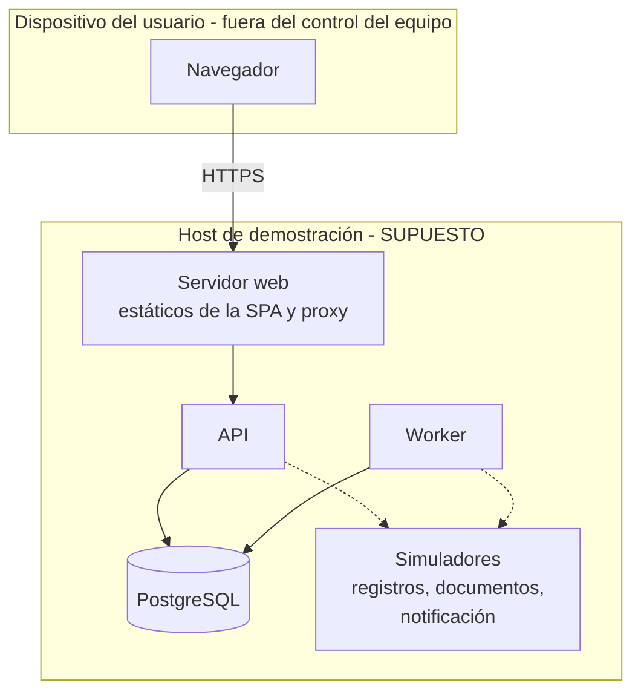

# V-DEP — Supuestos de despliegue

> **Un supuesto de despliegue no es infraestructura implementada.** En esta entrega **no existe** ninguna infraestructura de despliegue. El único entorno ejecutado fue una instancia local de PostgreSQL (pgserver) en la máquina de un integrante del equipo, para el PoC.

| Campo | Valor |
|---|---|
| **ID** | V-DEP |
| **Propósito** | Explicitar dónde correrían los contenedores y qué se asume de cada entorno |
| **Requisitos** | RNF-02, RNF-06, RNF-07, RNF-09, RNF-12 · RFP sec. 7 (remoto/híbrido, datos sintéticos) |
| **ADRs** | ADR-002, ADR-006 |

**Fronteras de despliegue:** (1) el navegador del usuario, no controlado; (2) el host de la aplicación, controlado por el equipo; (3) los servicios simulados, que **en esta entrega viven dentro del mismo host** para no depender de nadie (RFP: operar de forma independiente).

## Entornos

| Entorno | Supuesto | Datos | Estado |
|---|---|---|---|
| Desarrollo | Contenedores locales (API, worker, BD, simuladores) | Sintéticos | **Supuesto** |
| Pruebas / CI | BD efímera por ejecución; simuladores con fallo a pedido (QS-07) | Sintéticos | **Supuesto**; el PoC usó una BD efímera local |
| Demostración | Un host, 1 proceso API, 1 worker, 1 BD | Sintéticos | **Supuesto** |
| Producción real | Fuera del alcance de este semestre | — | **No considerado** |

## Supuestos operativos

| Tema | Supuesto | Estado |
|---|---|---|
| Configuración y secretos | Variables de entorno o gestor de secretos del host; **nada embebido en el código** | Supuesto |
| Datos | Solo sintéticos (RNF-06); sin datos reales de estudiantes ni empleadores | Restricción del RFP |
| Respaldo | Volcado periódico de la BD en demo; frecuencia y retención sin definir | **OPEN-16** |
| Disponibilidad | Una sola instancia, sin alta disponibilidad; umbral sin definir (RNF-12) | **OPEN-16** |
| Escalabilidad | Vertical; el worker puede ejecutarse en varios procesos; no hay escalado automático | Supuesto |
| Observabilidad | Registro operativo estructurado, con eventos de seguridad (denegaciones) separados de la auditoría de negocio | Supuesto |
| Autenticación | Cuentas locales: Argon2id y sesión corta en cookie `HttpOnly`; SSO institucional: **OPEN-21** | Implementado local; IdP no configurado |
| Red | Acceso remoto por HTTPS; sin VPN | Supuesto |

## Qué no se debe afirmar
Que el sistema "está desplegado", que "soporta N usuarios" o que "se respalda": nada de eso se implementó ni se midió (QS-05: NOT EXECUTED).
