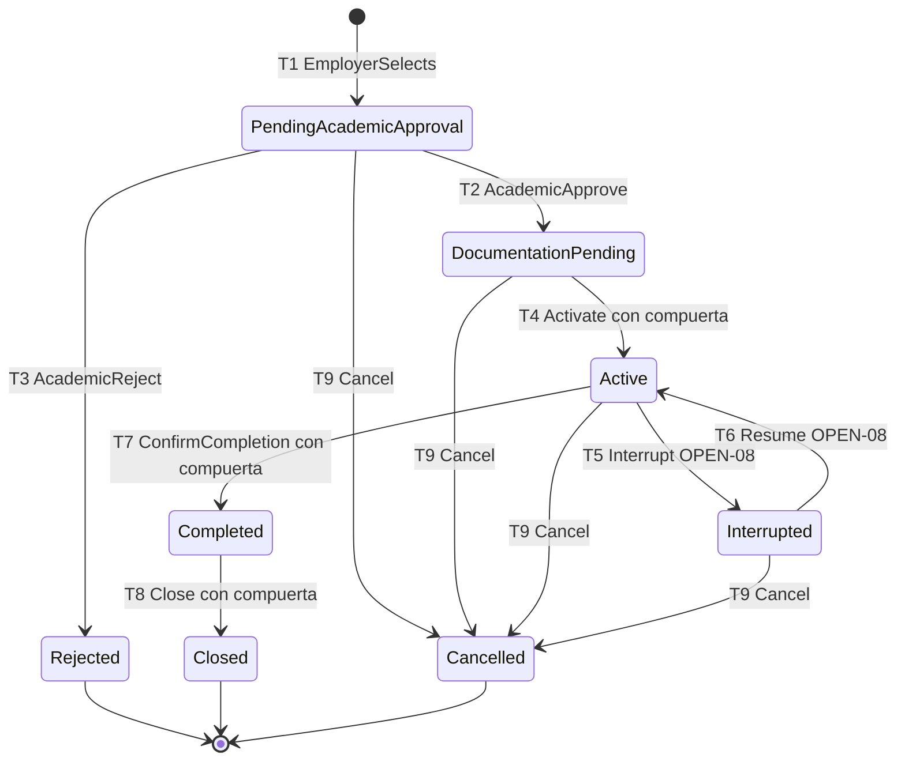

# V-STATE-PLC — Máquina de estados de la colocación

| Campo | Valor |
|---|---|
| **ID** | V-STATE-PLC |
| **Propósito** | Definir los estados reales de la colocación, sus transiciones y quién puede producirlas, con la guarda de cada una |
| **Requisitos** | RF-06, RF-07, RF-09, RF-13, RF-17 · RFP sec. 5 (pasos 7–16) |
| **ADRs** | ADR-003, ADR-005 |

Los estados se derivaron del **RFP + Evaluación 1**, no de la lista candidata del enunciado. El estado `Placement.state` es **una** de tres dimensiones independientes: (1) estado del ciclo de vida (esta vista), (2) estado de la versión vigente/propuesta (ADR-005) y (3) estado de cada requisito (checklist/evidencia).

## Transiciones

| ID | Origen | Evento | Guarda | Resultado | Actor responsable | Requisitos / reglas |
|---|---|---|---|---|---|---|
| T1 | *(nuevo)* | `EmployerSelects(postulación)` | Postulación elegible y en revisión del empleador; oportunidad publicada; cupo disponible *(OPEN-13)* | `PendingAcademicApproval` (se crea la colocación y su versión 1 `PROPOSED`) | Organización anfitriona | RF-06 · BR-09, BR-10 |
| T2 | `PendingAcademicApproval` | `AcademicApprove` | El coordinador es **del programa del estudiante**; la colocación cumple los requisitos del programa | `DocumentationPending`; versión 1 → `APPROVED`; se **materializa el checklist** desde la política | Coordinador de programa | RF-07 · BR-11, BR-14 |
| T3 | `PendingAcademicApproval` | `AcademicReject` | Mismo actor; motivo obligatorio | `Rejected` (terminal) | Coordinador de programa | RF-07 · BR-17 |
| T4 | `DocumentationPending` | `Activate` | **Todos los requisitos de activación obligatorios están `APPROVED`** (documentos y condiciones como `SUPERVISORS_ASSIGNED`, OPEN-01); estado de origen válido; se evalúa bajo bloqueo de la fila | `Active`; se **materializan los requisitos de cierre** | Coordinador de aprendizaje experiencial | **RF-09** · BR-01, BR-02 · ADR-003 |
| T5 | `Active` | `Interrupt` | Motivo obligatorio | `Interrupted` | Coordinador de aprendizaje experiencial *(OPEN-08)* | RFP sec. 2 |
| T6 | `Interrupted` | `Resume` | Motivo y fecha | `Active` | Ídem *(OPEN-08)* | RFP sec. 2 |
| T7 | `Active` | `ConfirmCompletion` | **Todos los requisitos de cierre obligatorios cumplidos**, recalculando desde las filas de origen (p. ej. horas), **y todos los ítems de activación obligatorios `APPROVED`** (BR-18) | `Completed` | Coordinador de programa *(o supervisor docente, OPEN-02)* | **RF-17** · BR-05, BR-18 |
| T8 | `Completed` | `Close` | Origen `Completed`, requisitos de cierre reverificados **y activación conforme** (BR-18) | `Closed` (terminal) | Coordinador de aprendizaje experiencial *(OPEN-02)* | RF-17 · BR-05, BR-17, BR-18 |
| T9 | `PendingAcademicApproval`, `DocumentationPending`, `Active`, `Interrupted` | `Cancel` | Motivo obligatorio | `Cancelled` (terminal) | Coordinador de aprendizaje experiencial | RFP sec. 2 · BR-17 |

**Cualquier otra transición es inválida** y produce `INVALID_TRANSITION`. Los estados terminales (`Rejected`, `Closed`, `Cancelled`) no admiten cambios (BR-17).

## Estados de la lista candidata que **no** se adoptaron, y por qué

| Candidato | Decisión | Razón |
|---|---|---|
| Draft, Published | Pertenecen a la **oportunidad** | Son el ciclo de vida de la oferta, no de la colocación |
| Applied, Selected | Pertenecen a la **postulación** | Ver V-DOM; la colocación nace al seleccionar |
| **ReadyForActivation** | **Derivado, no almacenado** | Un estado guardado podría quedar obsoleto si un documento se rechaza después (T-02); se calcula como "ningún requisito obligatorio pendiente" para la UI y los paneles |
| OnHold / Changed | **No** es un estado de la colocación | Un cambio crea una **versión** (`PROPOSED`) y la colocación sigue su curso; solo una interrupción real usa `Interrupted` |
| Cancelled, Interrupted | **Adoptados con reserva** | Respaldados por el RFP (sec. 2: colocaciones interrumpidas) pero sin historia en la Evaluación 1 (OPEN-08) |

## Decisión sobre el hallazgo del PoC (OPEN-14, propuesta pendiente de cliente)
En T-02, cuando la activación ganó la carrera, un documento pudo rechazarse **después**, dejando una colocación `Active` con un requisito `REJECTED`. La decisión propuesta (**BR-18**) es:

1. La colocación **sigue `Active`**; no se suspende automáticamente.
2. Se expone un indicador **derivado** (no almacenado) `activation_noncompliant` = `Active` **y** algún ítem de activación obligatorio distinto de `APPROVED`.
3. `Active → Completed` (T7) y `Completed → Closed` (T8) exigen además que **todos** los ítems de activación obligatorios estén `APPROVED`; la aplicación devuelve `ACTIVATION_NONCOMPLIANT` y el trigger de BD responde con `GATE`.
4. Revisar un documento se hace desde `SUBMITTED` (aprobar o rechazar) y se permite la **revocación `APPROVED → REJECTED`**; desde `REQUIRED` o `REJECTED` es `INVALID_TRANSITION` (BR-14). Si la colocación está `Active`, el rechazo se audita como `checklist_item.rejected_after_activation`.

**No se agrega ningún estado ni transición a la máquina.** `activation_noncompliant` es una bandera calculada, no un estado; `ReadyForActivation` sigue siendo derivado y tampoco se almacena. La propuesta está pendiente de validar con el cliente (plazo de corrección y aprobador de excepciones abiertos).

## Qué prueba esta vista hoy
T-01, T-02, T-02b (T4); T-16a..T-16e (BR-18: T4, T7, T8; 14 PASS en la corrida 2026-10-22); T-04 (T7, T8); T-08 (BR-02). No se probaron T1, T3, T5, T6, T9.
