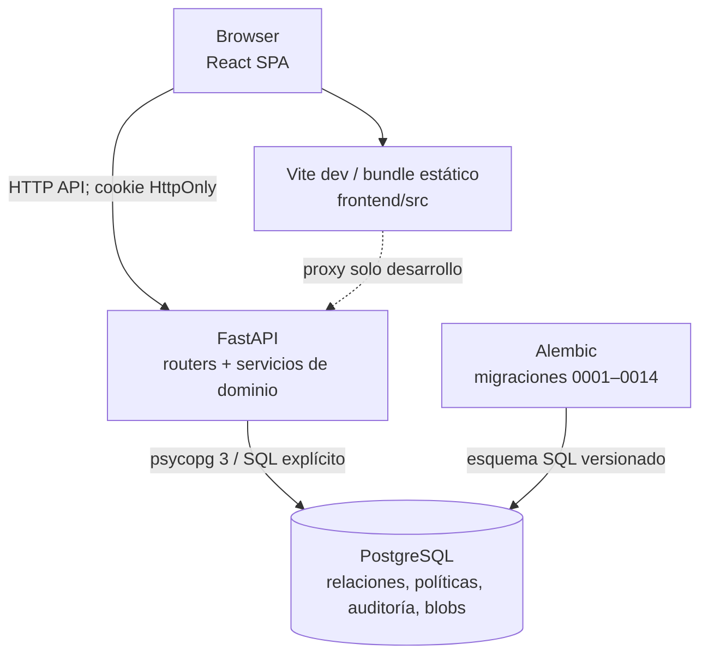
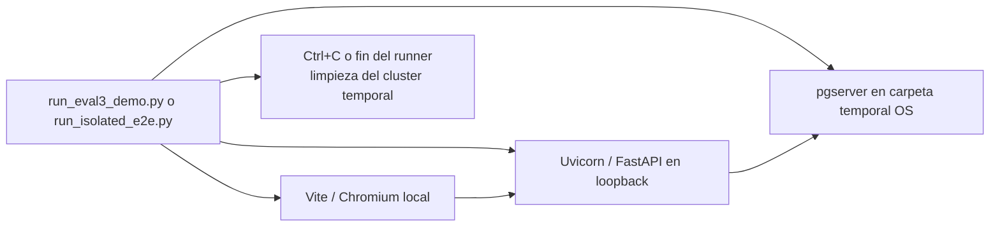

# Contenedores y despliegue observado

## Contenedores de aplicación

## Despliegue para la evaluación

El launcher interactivo aplica Alembic a `0014`; el E2E crea el esquema temporal actual y ejecuta pruebas de navegador. Las salidas de esta evaluación verificaron ambas rutas separadamente. La ruta de despliegue objetivo Render + Neon + Vercel no se verifica mediante estas capturas; no se aportó una URL pública comprobada en este paquete. Docker Compose es un entorno local con volumen persistente y no se utiliza para esta evaluación.
