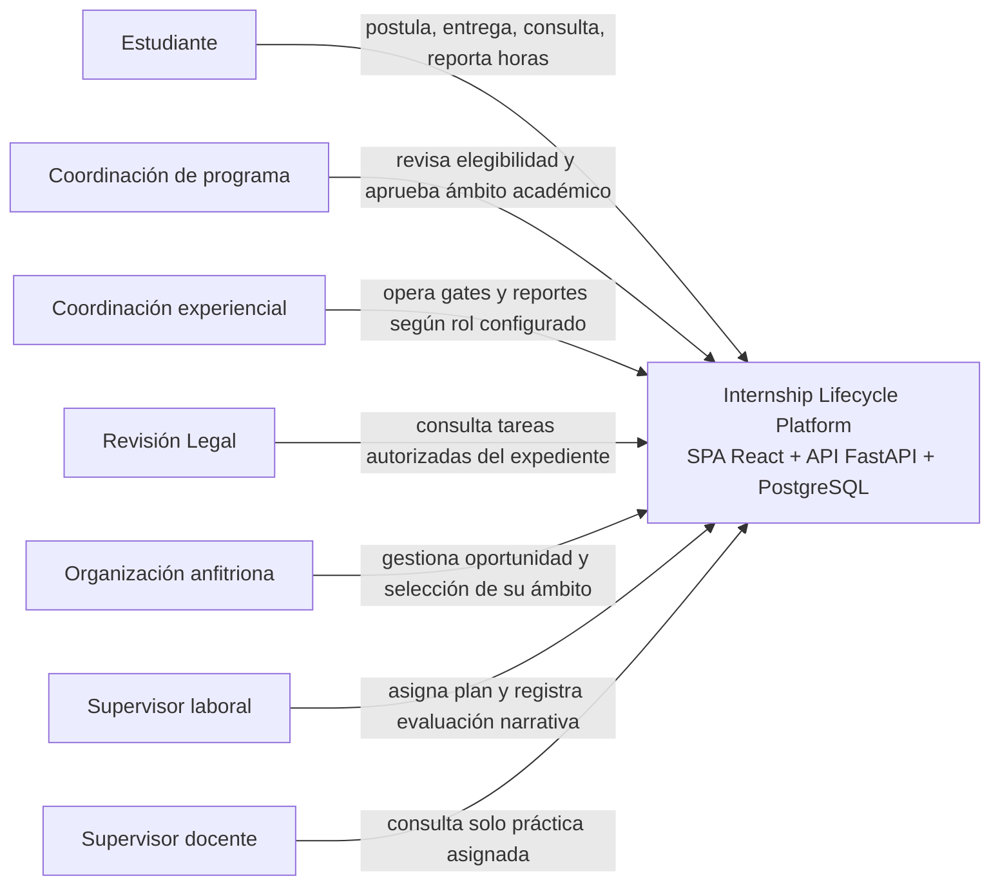

# Vista de contexto

Las relaciones del sujeto con programa, organización y colocación condicionan la lectura/escritura. La app ofrece identidad local; no se identificó un IdP institucional. No hay SIS real, correo, calendario ni repositorio documental externo conectados. Las notificaciones se persisten en una bandeja interna y el contenido de documentos se guarda en PostgreSQL.
