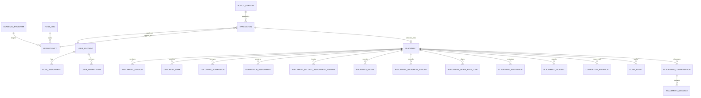

# Modelo de datos persistido

Esquema PostgreSQL; SQL detallado y constraints están en `src/backend/migrations/schema_sql.py` y revisiones Alembic `src/backend/migrations/versions/0001_initial.py`–`0014_manual_eligibility_review.py`.

Las postulaciones fijan la versión de política y entradas usadas. Los documentos, reportes, evaluaciones, cambios reportados y evidencia se asocian a la práctica y mantienen revisión/historial según el tipo. `placement.state` registra estado de ciclo; `placement.current_version_id` apunta a la versión vigente. `audit_event` es append-only y su proyección web se minimiza. El almacenamiento binario de documentos/evidencia está en PostgreSQL en el demo.

Los registros de demostración pueden establecer explícitamente umbrales o escenarios sintéticos. El esquema no equivale a una política institucional aprobada ni convierte cada número del fixture en requisito universal.
