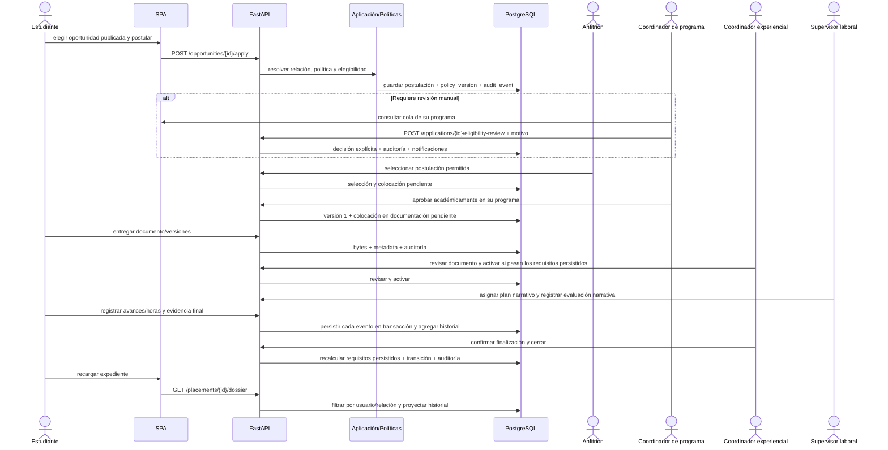

# Secuencia del incremento ejecutable

La revisión y las transiciones son acciones de un actor autorizado, no efectos automáticos. El E2E ejecuta actores sintéticos en un PostgreSQL temporal; no son aprobaciones ni datos institucionales.
