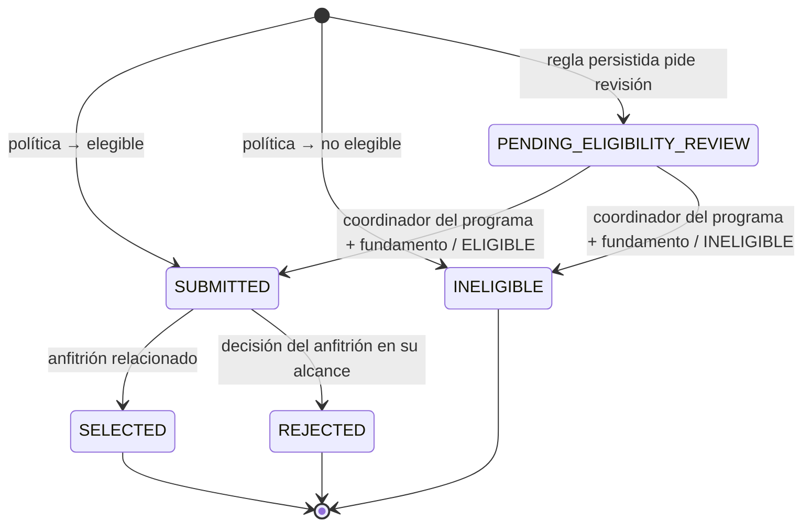

# Estados y transiciones observados

## Aplicación

## Práctica

```mermaid
stateDiagram-v2
  [*] --> PENDING_ACADEMIC_APPROVAL: selección crea práctica
  PENDING_ACADEMIC_APPROVAL --> DOCUMENTATION_PENDING: coordinador académico aprueba
  PENDING_ACADEMIC_APPROVAL --> REJECTED: rechazo permitido
  DOCUMENTATION_PENDING --> ACTIVE: requisitos de activación aprobados + actor autorizado
  ACTIVE --> COMPLETED: requisitos de cierre persistidos satisfechos
  COMPLETED --> CLOSED: acción de cierre autorizada
  ACTIVE --> ACTIVE: nuevas horas/seguimiento mientras el dominio lo permite
  CLOSED --> CLOSED: solo consulta histórica; escrituras de seguimiento rechazadas
```

Los nombres se verificaron en `backend/app/modules/applications/service.py`, `backend/app/modules/lifecycle/service.py`, rutas y pruebas. Los requisitos de activación/cierre se copian de la versión de política asociada; la máquina no inventa mínimos globales. En escenarios E2E se puede cargar una política sintética reemplazable. No se modelan aquí versiones formales pendientes, escalamiento/resolución de incidentes ni calendarios, pues no están completos.
