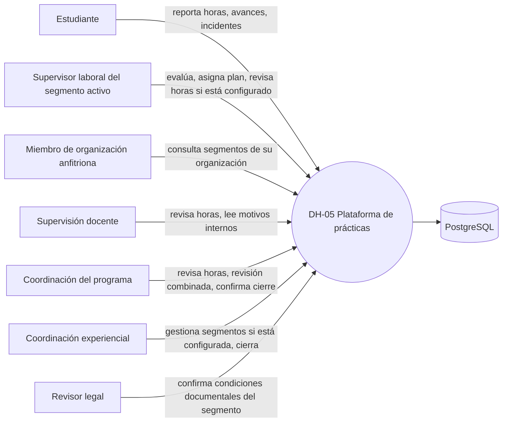
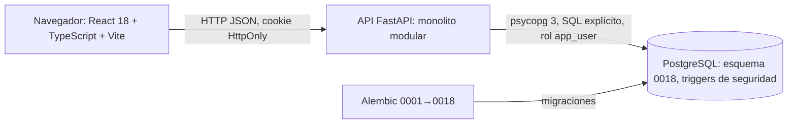
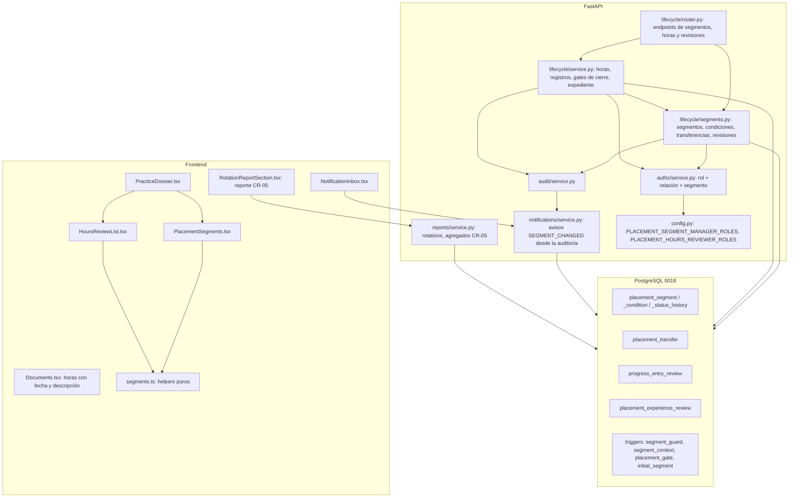

# Arquitectura final (as-built, Evaluación 4)

Los diagramas describen el código de este repositorio en la revisión de esquema **0018** (0016: segmentos; 0017: categoría de aviso `SEGMENT_CHANGED`; 0018: historial de cambios de periodo de segmento). Reemplazan a los de E3 solo en lo que CR-05 cambia; los de E3 siguen en `evaluacion-3/docs/architecture/`.

## Contexto

No hay sistemas externos nuevos: IdP, correo y almacenamiento externo siguen pendientes (ADR-006).

## Contenedores

## Componentes afectados por CR-05

## Patrón de comando (sin cambios, aplicado a CR-05)

Cada mutación de segmento sigue el mismo orden que en E3: `db.command(actor)` → autorizar → `SELECT ... FOR UPDATE` sobre la práctica → evaluar guardas desde filas persistidas → mutar → `audit.write`, todo en una transacción. Los triggers repiten las guardas críticas como red de seguridad, incluso contra SQL directo.

Las vistas de estados y de secuencia están en `../diagramas-y-trazabilidad/diagramas.md`. El modelo de datos está en `modelo-de-datos.md`.
