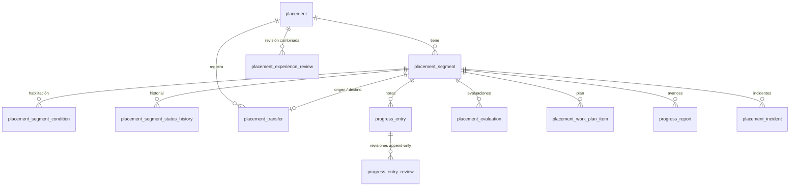

# Modelo de datos CR-05 (migraciones 0016 a 0019)

La migración 0017 no cambia tablas: solo amplía la restricción de categorías de `user_notification` con `SEGMENT_CHANGED` (ADR-013). La migración 0018 añade `placement_segment_schedule_change` (append-only: periodo anterior y nuevo, motivo compartido, autor, hora y `txid`). También reemplaza `trg_placement_segment_guard`: las fechas de un segmento `PLANNED` o `ACTIVE` solo cambian junto con un registro de la misma transacción, y un segmento activo conserva su inicio (ADR-014). La migración 0019 añade `placement_segment_revision`: append-only, con campos cambiados, valores anterior y nuevo en `jsonb`, estado del segmento, motivo compartido, autor, hora y `txid`. También añade `checklist_item.segment_condition_id`: es único, referencia `placement_segment_condition` y una restricción impide que el ítem sea obligatorio. El trigger de segmento acepta cambios de unidad, supervisor, modalidad, responsabilidades y horas esperadas solo con una revisión de la misma transacción y según el estado (ADR-015). El trigger de condiciones permite volver de `SATISFIED` a `REQUIRED` solo si la evidencia enlazada fue rechazada. El resto de este documento describe 0016.

## Tablas nuevas

| Tabla | Columnas clave | Restricciones |
|---|---|---|
| `placement_segment` | `placement_id`, `sequence_no`, `host_org_id`, `unit`, `workplace_supervisor_id`, `start_date`, `end_date`, `modality`, `responsibilities`, `expected_hours`, `origin`, `status`, `activated_at/by`, `ended_on/at/by`, `end_reason_shared`, `end_reason_internal`, `work_recognition`, `recognition_note` | `UNIQUE(placement_id, sequence_no)`; índice único parcial `placement_one_active_segment` (`status='ACTIVE'`); `unit`/`modality` nulos solo para `PLACEMENT_ACTIVATION`/`MIGRATED_SINGLE`; contenido inmutable; transiciones controladas por trigger |
| `placement_segment_condition` | `segment_id`, `kind`, `source_policy_version_id`, `status` (`REQUIRED`/`SATISFIED`), `confirmed_by/at`, `reference` | Solo `REQUIRED → SATISFIED` |
| `placement_segment_status_history` | `segment_id`, `from_status`, `to_status`, `actor_id`, `changed_at` | Append-only, escrito por trigger |
| `placement_transfer` | `from_segment_id`, `to_segment_id`, `effective_date`, `reason_shared`, `reason_internal`, `prior_work_treatment`, `approved_by`, `approved_at` | FK compuestas a la misma práctica; inmutable |
| `progress_entry_review` | `entry_id`, `decision`, `accepted_hours`, `reason_code`, `reason`, `reviewer_id`, `reviewed_at` | `accepted_hours ≤ hours`; requiere práctica activa; inmutable |
| `placement_experience_review` | `placement_id`, `decision`, `rationale`, `reviewer_id`, `reviewed_at` | Inmutable |

## Columnas nuevas

`segment_id` en `progress_entry`, `placement_evaluation`, `placement_work_plan_item`, `progress_report` y `placement_incident`, con FK compuesta `(segment_id, placement_id)` para impedir que un registro apunte a otra práctica. `progress_entry` también recibe `work_date` y `description`.

## Funciones SQL

- `placement_operational_supervisor(pid)`: supervisor del segmento activo, o de la versión vigente si aún no hay segmentos.
- `placement_accepted_hours(pid)`: horas aceptadas (última revisión), excluyendo segmentos `NOT_RECOGNIZED`.
- `placement_pending_hour_entries(pid)`: entradas sin revisión o cuya última revisión no es definitiva.

## Datos sensibles

`end_reason_internal` y `reason_internal` solo salen en las proyecciones para roles con `segment:read_internal` y nunca se copian a `audit_event`.
