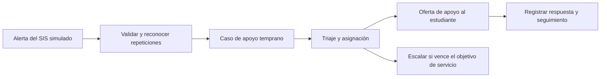
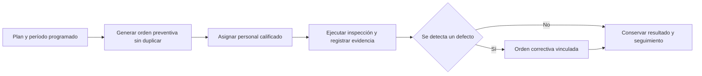
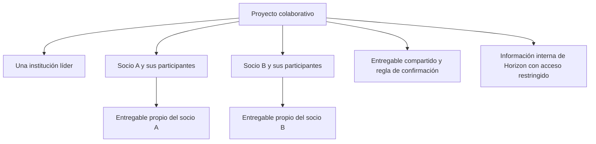
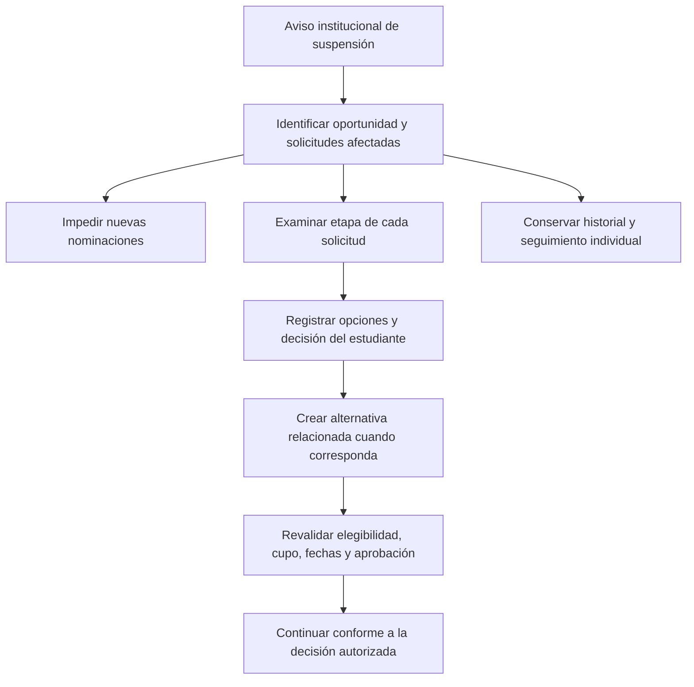
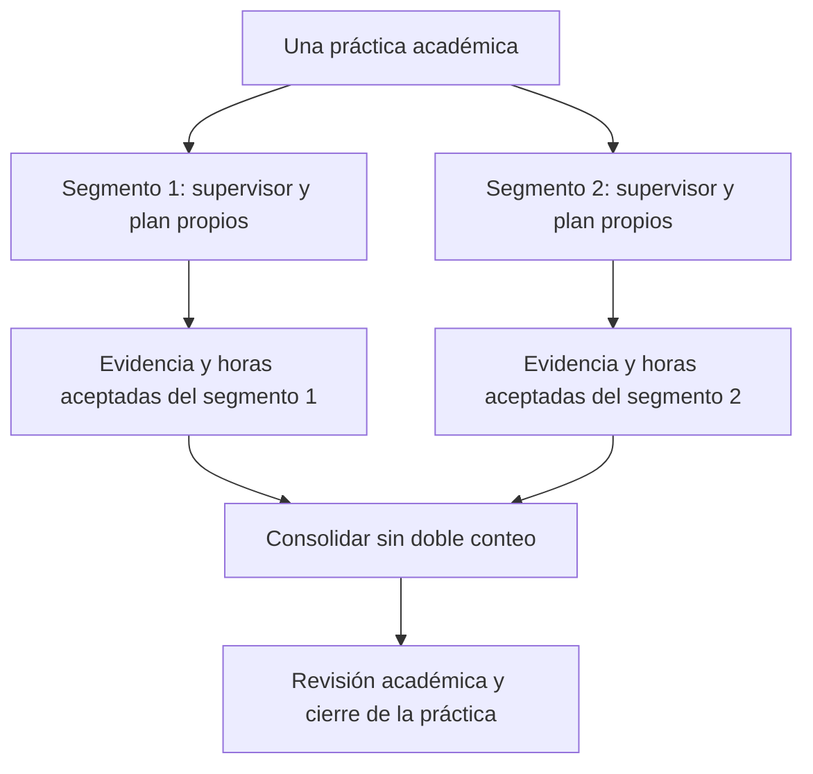

# Evaluación 4 — Solicitudes de cambio
## Software Design II · Horizon University · Digital Horizon Initiative

**Proyectos:** DH-01, DH-02, DH-03, DH-04 y DH-05.  
**Destinatarios:** equipos de desarrollo.  
**Propósito:** comprender el cambio institucional, analizar su impacto y evolucionar la solución existente.

> **La solicitud de cambio se trabaja en la Evaluación 4.** La Evaluación 3 se concentra en la arquitectura actualizada, las decisiones de diseño y un primer incremento funcional. El cambio no exige descartar ese trabajo: exige decidir qué conservar, qué modificar y cómo verificar la evolución.

---

<a id="indice"></a>
## Índice

1. [Cómo interpretar este documento](#como-usar)
2. [DH-01 · Alertas de riesgo académico y asesoría prioritaria](#dh01)
3. [DH-02 · Mantenimiento preventivo e inspecciones](#dh02)
4. [DH-03 · Investigación colaborativa entre instituciones](#dh03)
5. [DH-04 · Suspensión de destinos y replanificación de movilidad](#dh04)
6. [DH-05 · Prácticas por rotaciones y transferencias](#dh05)
7. [Guía común de análisis de impacto y evidencia](#impacto)
8. [Procedencia y límites de la guía](#procedencia)

---

<a id="como-usar"></a>
# 1. Cómo interpretar este documento

## 1.1 Una nueva necesidad, no una nueva aplicación

Cada solicitud modifica una premisa del proyecto. La solución debe responder a la nueva necesidad sin perder la coherencia de los flujos existentes, los permisos ni el historial.

| Proyecto | Premisa que el cambio pone a prueba | Nueva necesidad |
|---|---|---|
| DH-01 · Asesoría académica | La atención comienza cuando el estudiante solicita ayuda. | La institución también puede iniciar atención a partir de una alerta. |
| DH-02 · Mantenimiento | El trabajo comienza después de reportarse una falla. | Un plan puede generar inspecciones y trabajo preventivo antes de una falla. |
| DH-03 · Investigación | La coordinación está centrada en una sola institución. | Varias instituciones comparten responsabilidades, entregables y seguimiento. |
| DH-04 · Movilidad | La oportunidad sigue disponible durante el trámite normal. | Una suspensión afecta varias solicitudes, de forma distinta según su etapa. |
| DH-05 · Prácticas | Una práctica ocurre en un único lugar y período continuo. | Una práctica académica puede contener varias rotaciones o transferencias. |

Estas premisas describen el contraste didáctico del cambio, no una afirmación de que todos los equipos hayan diseñado el sistema de esa manera. Un equipo puede haber anticipado parte de la necesidad: deberá explicar y demostrar qué ya soporta y qué falta.

## 1.2 Requisitos, ejemplos y pistas no son lo mismo

| Etiqueta | Cómo interpretarla |
|---|---|
| **Alcance solicitado / regla del cambio** | Comportamiento requerido por la solicitud institucional de ese proyecto. |
| **Ejemplo sintético** | Situación concreta para comprender el cambio. Sus nombres, cantidades e identificadores no son políticas universales. |
| **Escenario de comprobación sugerido** | Forma posible de verificar una regla. No exige un framework ni una prueba con ese nombre exacto. |
| **Pista de impacto** | Zona que conviene revisar. No obliga a crear un servicio, tabla, patrón o diagrama específico. |
| **Pregunta para aclarar** | Decisión de negocio o detalle no fijado por la solicitud. Debe aclararse o registrarse como supuesto, sin presentarlo como una decisión confirmada del cliente. |

La arquitectura sigue siendo responsabilidad del equipo. No se impone microservicios, un motor de procesos, un broker, una nube, una base de datos o un framework específico. Las vistas se seleccionan por su utilidad para explicar el cambio, no por cantidad.

## 1.3 Condiciones comunes

Los datos personales e institucionales deben ser **sintéticos**. Las integraciones externas pueden simularse; cada proyecto debe poder demostrarse sin depender de los sistemas reales de otra institución o de otro equipo. Las decisiones, los registros históricos y las restricciones de acceso siguen siendo parte del problema.

Los equipos que desarrollan el mismo proyecto reciben la misma solicitud, pero pueden responder con diseños diferentes y justificados. Un cambio pequeño en código puede ser suficiente cuando la arquitectura existente lo soporta; un rediseño mayor también puede ser razonable si se explica su necesidad y sus consecuencias.

**Este documento no introduce fechas de entrega, porcentajes de calificación, duración de video ni un nuevo formato obligatorio de entrega para la Evaluación 4.** Las condiciones de ZIP y video de 5–6 minutos comunicadas para la Evaluación 3 no se trasladan automáticamente a la Evaluación 4. Aquí se especifican los cambios y se orienta la evidencia técnica de su evolución.

---

<a id="dh01"></a>
# 2. DH-01 — Alertas de riesgo académico y asesoría prioritaria

## 2.1 Ficha de la solicitud

| Campo | Descripción |
|---|---|
| Identificador | **CR-01** |
| Nombre original | *Early Academic Risk and Priority Advising* |
| Proyecto | Academic Advising Case Management |
| Oficina solicitante | Oficina de Éxito Estudiantil y Asesoría Académica — Student Success and Academic Advising Office |
| Representante solicitante | **Dra. Elena Martínez**, directora de la oficina |
| Prioridad de la solicitud | Alta |
| Evaluación | **4** |

## 2.2 Por qué se necesita

Horizon University ha aprobado una política de apoyo académico temprano. El Sistema de Información Estudiantil (**SIS**) identificará estudiantes que cumplen ciertas condiciones de riesgo académico. La oficina necesita actuar antes de que todos ellos soliciten ayuda por iniciativa propia.

La aplicación de asesoría **no calcula ni predice el riesgo**. Recibe una alerta producida por el SIS o su simulación y coordina la atención: caso, prioridad, responsable, seguimiento y respuesta del estudiante.

| Situación anterior | Situación que debe soportarse ahora |
|---|---|
| El estudiante crea una solicitud de asesoría. | El estudiante puede seguir solicitando asesoría y la institución puede iniciar un caso desde una alerta. |
| La clasificación se basa en la solicitud recibida. | Una alerta aporta origen institucional, categoría de riesgo y prioridad de atención. |
| El seguimiento se centra en casos activos. | También deben ser visibles las alertas sin atención, los plazos y las respuestas a la oferta de apoyo. |

## 2.3 Alcance solicitado

| Capacidad | Comportamiento esperado |
|---|---|
| Entrada institucional | Crear un caso a partir de una alerta simulada del SIS. |
| Origen del caso | Identificar que el caso fue iniciado por la universidad para apoyo temprano. |
| Prioridad | Clasificar la prioridad de atención y diferenciarla del estado del caso. |
| Atención más oportuna | Asignar o realizar el triaje dentro del objetivo de servicio correspondiente. |
| Notificación | Informar al asesor responsable que existe una situación que requiere atención. |
| Escalamiento | Escalar cuando el caso permanece sin asignación o sin actividad más allá del objetivo de servicio definido. |
| Separación de información | Distinguir la información interna de riesgo de lo que puede comunicarse al estudiante. |
| Respuesta del estudiante | Registrar si acepta, rechaza o no responde a la oferta de apoyo. |
| Seguimiento operativo | Informar cuántas alertas se recibieron, cuántos estudiantes fueron contactados, cuántos aceptaron y qué casos de apoyo temprano están vencidos. |

## 2.4 Reglas del cambio

| Regla | Requisito |
|---|---|
| **CR-01-BR-01** | Los casos de apoyo temprano de alta prioridad deben pasar por triaje dentro de **un día hábil**. No equivale a resolver el caso en ese tiempo. |
| **CR-01-BR-02** | La categoría interna de riesgo no debe aparecer automáticamente en pantallas ni mensajes dirigidos al estudiante. |
| **CR-01-BR-03** | La comunicación debe informar que se ofrece apoyo, evitando lenguaje estigmatizante. |
| **CR-01-BR-04** | Cuando no exista actuación del asesor dentro del objetivo de servicio, el coordinador debe recibir un escalamiento. |
| **CR-01-BR-05** | El estudiante puede rechazar el apoyo. La decisión se registra sin eliminar el caso. |
| **CR-01-BR-06** | Eventos repetidos para el mismo estudiante y período académico no deben crear automáticamente casos duplicados. |

La regla de duplicación no fija cómo fusionar alertas distintas ni qué hacer con un caso ordinario preexistente. Esa política necesita una decisión explícita; no debe confundirse con ignorar toda alerta posterior.

## 2.5 Ejemplo sintético de entrada

El siguiente mensaje ilustra la información del evento; no prescribe la tecnología de transporte.

```json
{
  "event_id": "EA-2026-00418",
  "student_id": "HU-2026-18542",
  "academic_period": "2026-2",
  "risk_category": "ACADEMIC_PROGRESS",
  "risk_level": "HIGH",
  "generated_at": "2026-10-14T09:30:00Z"
}
```

El evento no debe contener el historial académico privado completo. El sistema de asesoría puede consultar un perfil permitido mediante una integración simulada.



**Lectura del ejemplo:** el SIS envía dos veces el evento EA-2026-00418. La aplicación conserva la trazabilidad del procesamiento sin crear dos casos. El coordinador puede consultar la prioridad interna; el estudiante recibe una oferta de apoyo sin que se exponga automáticamente la categoría de riesgo. Si rechaza la oferta, el caso y la decisión siguen disponibles en el historial.

## 2.6 Pistas de impacto — no es una arquitectura obligatoria

| Zona a revisar | Pregunta de diseño |
|---|---|
| Dominio y datos | ¿El origen del caso puede ser estudiante o institución? ¿Dónde se registra la relación con la alerta y el período? |
| Flujo de atención | ¿Cómo se diferencian prioridad, estado, triaje, contacto y respuesta del estudiante? |
| Integración | ¿Cómo se validan y reconocen repeticiones? ¿Qué ocurre si no puede consultarse el perfil del estudiante? |
| Objetivos de servicio | ¿Cómo se calcula el día hábil y cómo se detecta una atención vencida? |
| Autorización y privacidad | ¿Quién ve la categoría de riesgo? ¿Qué datos pasan a mensajes, reportes y registros técnicos? |
| Notificaciones | ¿Cómo se informa al asesor y al coordinador sin confundir el envío de un mensaje con atención efectiva? |
| Reportes | ¿Cómo se distinguen alertas recibidas, casos creados y estudiantes contactados para evitar conteos engañosos? |
| ADRs y pruebas | ¿Qué decisión cambia respecto al origen de casos, la repetición de eventos o el control de acceso? |

## 2.7 Escenarios de comprobación sugeridos

| Escenario | Resultado observable que permite comprobar el cambio |
|---|---|
| Llega una alerta válida de alta prioridad. | Se crea o vincula el caso conforme a la política definida, con origen institucional, prioridad y trazabilidad. |
| Se repite un evento para el mismo estudiante y período. | No aparece un nuevo caso duplicado de forma automática; el resultado del procesamiento puede explicarse. |
| Vence el objetivo sin actuación. | El coordinador puede identificar el caso y el escalamiento correspondiente. |
| El estudiante consulta el caso. | Ve la información permitida y no recibe automáticamente la categoría interna de riesgo. |
| El estudiante rechaza el apoyo. | La respuesta queda registrada y no se borra el caso. |
| Un estudiante envía una solicitud ordinaria. | El flujo existente continúa funcionando sin exigir una alerta institucional. |

## 2.8 Límites y asuntos por aclarar

**Fuera del cambio:** construir un predictor de riesgo, un sistema de diagnóstico o un reemplazo del SIS. La aplicación gestiona atención; no toma decisiones académicas oficiales por sí misma.

Antes de implementar, aclaren qué se considera día hábil; qué actuación satisface el objetivo; cómo se trata una alerta de categoría distinta para el mismo período; qué ocurre cuando ya existe un caso; y qué política define «no respondió». La solicitud no fija todos esos detalles. Registren la respuesta o el supuesto y su impacto.

---

<a id="dh02"></a>
# 3. DH-02 — Mantenimiento preventivo e inspecciones

## 3.1 Ficha de la solicitud

| Campo | Descripción |
|---|---|
| Identificador | **CR-02** |
| Nombre original | *Preventive Maintenance and Asset Inspection Program* |
| Proyecto | Campus Maintenance and Work Order Management |
| Oficina solicitante | Oficina de Instalaciones y Operaciones del Campus — Facilities and Campus Operations |
| Representante solicitante | **María Fernanda Gómez**, directora de la oficina |
| Prioridad de la solicitud | Alta |
| Evaluación | **4** |

## 3.2 Por qué se necesita

La universidad ha aprobado una política de mantenimiento preventivo e inspecciones. Esperar a que una persona reporte una falla no es suficiente: algunas revisiones deben programarse antes de que ocurra un incidente.

La solución deberá coordinar tanto el trabajo **reactivo**, originado en reportes, como el **preventivo**, originado en planes. Ejemplos de actividades son inspecciones de aire acondicionado, iluminación de emergencia, techos, drenajes y ventilación de laboratorios. La aplicación registra y coordina estas actividades; no controla físicamente equipos.

| Situación anterior | Situación que debe soportarse ahora |
|---|---|
| Un reporte validado origina una orden de trabajo. | Un reporte o un plan preventivo puede originar trabajo, con procedencia explícita. |
| Se asigna una reparación después de detectar el problema. | Se programa una revisión recurrente y se asigna personal calificado. |
| El historial se consulta principalmente por solicitud u orden. | También puede reconstruirse por activo, ubicación, plan e inspección. |

## 3.3 Alcance solicitado

| Capacidad | Comportamiento esperado |
|---|---|
| Objetivo de mantenimiento | Registrar un activo o un objetivo de inspección. |
| Plan preventivo | Definir qué mantenimiento se requiere y a qué activo o ubicación corresponde. |
| Recurrencia | Definir la frecuencia de mantenimiento. |
| Generación de trabajo | Generar órdenes programadas desde el plan. |
| Asignación | Asignar el trabajo a un técnico calificado o a un proveedor externo. |
| Inspección | Asociar la lista de verificación aplicable. |
| Hallazgos | Registrar resultados y observaciones de la inspección. |
| Corrección | Crear trabajo correctivo cuando una inspección identifica un defecto. |
| Vencimientos | Alertar sobre trabajo preventivo vencido. |
| Historia | Conservar el historial por activo o ubicación. |
| Información operativa | Reportar trabajo programado, inspecciones completadas, vencidas o fallidas y trabajo correctivo derivado. |

## 3.4 Reglas del cambio

| Regla | Requisito |
|---|---|
| **CR-02-BR-01** | Toda orden preventiva debe identificar el plan que la generó. |
| **CR-02-BR-02** | El trabajo preventivo programado no debe representarse como si lo hubiera enviado un solicitante ordinario. |
| **CR-02-BR-03** | Completar una inspección requiere la lista de verificación o los hallazgos aplicables registrados. |
| **CR-02-BR-04** | Una inspección fallida puede generar una o varias órdenes correctivas; la relación debe seguir siendo trazable. |
| **CR-02-BR-05** | Modificar un plan no puede borrar órdenes previamente generadas ni el historial de inspecciones. |
| **CR-02-BR-06** | No deben generarse órdenes preventivas duplicadas para el mismo plan y período programado. |
| **CR-02-BR-07** | El trabajo preventivo vencido debe ser visible para el supervisor responsable. |
| **CR-02-BR-08** | Un plan puede suspenderse cuando el activo está inactivo o en reemplazo; se registran el motivo y la fecha de suspensión. |

## 3.5 Ejemplo sintético de plan

```json
{
  "plan_id": "PM-HU-0042",
  "asset_id": "HVAC-B07-03",
  "asset_type": "AIR_HANDLING_UNIT",
  "location_code": "MAIN-B07-ROOF",
  "maintenance_type": "QUARTERLY_INSPECTION",
  "frequency": {
    "unit": "MONTH",
    "value": 3
  },
  "required_skill": "HVAC",
  "next_due_date": "2026-10-20",
  "active": true
}
```

La frecuencia de tres meses es un ejemplo, no una frecuencia obligatoria para todos los planes. El contrato puede implementarse como archivo, registro o interfaz simulada.



**Lectura del ejemplo:** el plan PM-HU-0042 genera una inspección para un período. Volver a ejecutar la generación no produce una segunda orden equivalente. El técnico registra un defecto y crea una orden correctiva relacionada. La inspección original conserva su resultado; el historial no se reemplaza por el de la reparación.

## 3.6 Pistas de impacto — no es una arquitectura obligatoria

| Zona a revisar | Pregunta de diseño |
|---|---|
| Dominio | ¿Un reporte, un plan, una inspección y una orden representan conceptos diferentes? ¿Cómo se relacionan? |
| Modelo de datos | ¿Cómo se identifica el período programado y la relación entre inspección y trabajo correctivo? |
| Generación recurrente | ¿Qué ocurre si la generación se repite, se interrumpe o se ejecuta más de una vez? |
| Estados y reglas | ¿Cómo se distinguen completada, fallida, vencida y suspendida sin mezclar estados del plan y de la orden? |
| Asignación | ¿La categoría o habilidad requerida se conserva al asignar un técnico o proveedor? |
| Formularios | ¿La lista de verificación depende del tipo de mantenimiento? |
| Historia | ¿Qué valores del plan necesita conservar una orden si el plan cambia después? |
| Reportes y pruebas | ¿Los indicadores separan preventivo y reactivo? ¿El flujo reactivo sigue funcionando? |

## 3.7 Escenarios de comprobación sugeridos

| Escenario | Resultado observable que permite comprobar el cambio |
|---|---|
| Un plan activo alcanza el período de generación. | Se crea la orden preventiva y puede identificarse su plan de origen. |
| La generación se ejecuta nuevamente para el mismo plan/período. | No se duplica la orden. |
| Se intenta completar una inspección sin la evidencia aplicable. | No se acepta una finalización que omita los requisitos de inspección. |
| Una inspección registra un defecto. | El trabajo correctivo queda relacionado con la inspección y conserva la trazabilidad. |
| Se modifica o suspende el plan. | Las órdenes anteriores y sus hallazgos siguen existiendo; la suspensión tiene fecha y motivo. |
| Una orden preventiva vence sin completarse. | El supervisor puede identificarla como vencida. |
| Se recibe una solicitud de reparación ordinaria. | El flujo reactivo continúa disponible y conserva su origen correcto. |

## 3.8 Límites y asuntos por aclarar

**Fuera del cambio:** desarrollar una plataforma completa de gestión de activos, sensores reales, un sistema de control de edificios, compras o contabilidad. Un registro sintético y limitado de activos es suficiente para demostrar la necesidad.

Aclaren cómo se calcula el siguiente vencimiento; qué sucede con períodos omitidos; si una modificación afecta órdenes futuras ya creadas; quién autoriza suspensión y reactivación; y cuándo un hallazgo debe producir trabajo correctivo. La solicitud exige recurrencia y trazabilidad, pero no determina todas esas políticas ni obliga a un planificador de tareas específico.

---

<a id="dh03"></a>
# 4. DH-03 — Investigación colaborativa entre instituciones

## 4.1 Ficha de la solicitud

| Campo | Descripción |
|---|---|
| Identificador | **CR-03** |
| Nombre original | *Multi-Institutional Collaborative Research Projects* |
| Proyecto | Research Project and Grant Tracking |
| Oficina solicitante | Oficina de Investigación e Innovación — Research and Innovation Office |
| Representante solicitante | **Dra. Valeria Mendoza**, directora de la oficina |
| Prioridad de la solicitud | Alta |
| Evaluación | **4** |

## 4.2 Por qué se necesita

Horizon University ha establecido una alianza de investigación con universidades externas. Los proyectos pueden tener una institución líder, varios socios, investigadores de distintas instituciones, entregables compartidos, presupuestos distribuidos y obligaciones de aprobación o reporte por participante.

La solución debe coordinar esa colaboración **sin depender de que las instituciones externas instalen la misma aplicación**. Registrar el nombre de una universidad como texto no basta si sus participantes tienen responsabilidades, permisos y entregables distintos.

| Situación anterior | Situación que debe soportarse ahora |
|---|---|
| La coordinación se centra en Horizon University. | Un proyecto puede ser liderado por Horizon o por otra institución. |
| Las responsabilidades se asignan a personas del proyecto. | Las personas también actúan en nombre de una institución y con un rol definido. |
| Los entregables se siguen dentro de un proyecto. | Algunos son compartidos y otros pertenecen a un socio, con reglas de confirmación explícitas. |
| Se controlan documentos y presupuestos del proyecto. | Debe distinguirse lo compartible de los comentarios, riesgos y presupuestos restringidos de Horizon. |

## 4.3 Alcance solicitado

| Capacidad | Comportamiento esperado |
|---|---|
| Instituciones | Registrar participantes institucionales. |
| Liderazgo | Identificar una institución líder. |
| Investigadores y contactos | Asociarlos con sus instituciones. |
| Responsabilidades | Definir roles y obligaciones por institución. |
| Hitos compartidos | Registrar hitos comunes del proyecto. |
| Entregables por socio | Registrar hitos o entregables específicos de cada participante. |
| Aprobaciones | Registrar confirmaciones o aprobaciones de los socios. |
| Presupuesto | Mantener resúmenes presupuestales por institución, no una nueva contabilidad financiera. |
| Acceso externo | Permitir colaboración con acceso controlado. |
| Información interna | Preservar notas y datos restringidos de Horizon sin compartirlos automáticamente. |
| Acuerdos | Registrar acuerdos interinstitucionales o sus referencias. |
| Información de cartera | Reportar proyectos colaborativos, liderazgo, entregables de socios vencidos, financiación por institución y aprobaciones pendientes. |

## 4.4 Reglas del cambio

| Regla | Requisito |
|---|---|
| **CR-03-BR-01** | Cada proyecto colaborativo identifica una institución líder. |
| **CR-03-BR-02** | Todo colaborador externo debe estar asociado con una institución y un rol definido en el proyecto. |
| **CR-03-BR-03** | Los usuarios externos acceden únicamente a los proyectos, entregables e información explícitamente compartidos con ellos. |
| **CR-03-BR-04** | Los comentarios internos, evaluaciones de riesgo y presupuestos restringidos de Horizon no son automáticamente visibles para colaboradores externos. |
| **CR-03-BR-05** | Un entregable compartido puede requerir confirmación de más de una institución; debe registrarse la regla de aprobación aplicable. |
| **CR-03-BR-06** | Un entregable específico de una institución identifica institución responsable, contacto, fecha límite, estado y evidencia o referencia. |
| **CR-03-BR-07** | Retirar una institución de un proyecto activo requiere un motivo registrado y conserva contribuciones y aprobaciones históricas. |
| **CR-03-BR-08** | El proyecto debe poder demostrarse sin conexión a una universidad real; el acceso y las respuestas de socios pueden simularse. |

## 4.5 Ejemplo sintético de colaboración

```json
{
  "collaboration_id": "COLLAB-2026-018",
  "project_id": "HU-RP-2026-0047",
  "lead_institution": {
    "institution_id": "HU",
    "name": "Horizon University"
  },
  "partners": [
    {
      "institution_id": "UNI-NORTE-02",
      "name": "North Valley University",
      "role": "RESEARCH_PARTNER",
      "principal_contact": "partner.pi@example.org"
    },
    {
      "institution_id": "TEC-ANDES-07",
      "name": "Andes Institute of Technology",
      "role": "DATA_PARTNER",
      "principal_contact": "data.lead@example.org"
    }
  ],
  "agreement_reference": "AGR-2026-119",
  "start_date": "2026-09-01",
  "end_date": "2028-08-31"
}
```

Este ejemplo describe una estructura posible de datos de colaboración; no impone tablas ni obliga a tener exactamente dos socios.



**Lectura del ejemplo:** Horizon lidera un proyecto con dos socios. Un entregable común requiere, en este caso, confirmación de Horizon y del socio A. La aprobación de una sola institución no completa esa regla. El socio B puede consultar lo que se le haya compartido, no las notas internas ni automáticamente los entregables privados del socio A.

## 4.6 Pistas de impacto — no es una arquitectura obligatoria

| Zona a revisar | Pregunta de diseño |
|---|---|
| Identidad y participación | ¿Cómo se relacionan persona, institución, proyecto y rol sin convertir todo usuario externo en administrador? |
| Autorización | ¿El permiso depende solo del rol o también del proyecto, la institución y el recurso compartido? |
| Entregables | ¿Cómo se distingue responsabilidad individual, institucional y compartida? |
| Aprobaciones | ¿Dónde se representa la regla aplicable y qué confirmaciones la satisfacen? |
| Presupuesto | ¿Cómo se muestran resúmenes por institución respetando la fuente financiera y los permisos? |
| Historia y cambios | ¿Qué ocurre con responsabilidades activas y evidencia histórica cuando se retira un socio? |
| Interfaces | ¿Cómo se simulan las confirmaciones y el acceso externo sin federación real? |
| Vistas y pruebas | ¿El contexto incluye a los socios? ¿Una prueba distingue lectura permitida y lectura no autorizada? |

## 4.7 Escenarios de comprobación sugeridos

| Escenario | Resultado observable que permite comprobar el cambio |
|---|---|
| Se registra un proyecto colaborativo. | Se identifica una institución líder y las participaciones tienen roles claros. |
| Un socio consulta un entregable compartido con él. | Recibe únicamente la información autorizada. |
| El mismo socio solicita una nota interna de Horizon. | No obtiene el contenido restringido. |
| Un entregable exige dos confirmaciones y solo llega una. | Se conserva la confirmación recibida sin declarar cumplida la regla completa. |
| Vence un entregable de un socio. | Se identifica la institución y el contacto responsable junto con el estado y la evidencia disponible. |
| Se retira un socio del proyecto activo. | Quedan el motivo del retiro y sus contribuciones y aprobaciones anteriores. |
| Se demuestra un proyecto solo de Horizon. | El caso existente sigue funcionando sin crear socios ficticios obligatorios. |

## 4.8 Límites y asuntos por aclarar

**Fuera del cambio:** construir una plataforma de identidad federada, integrarse realmente con universidades externas, reemplazar sistemas financieros o implantar una plataforma global de investigación.

Aclaren quién puede invitar o retirar participantes; qué recursos se comparten por defecto —sin contradecir la necesidad de compartición explícita—; quién define la regla de confirmación de cada entregable; qué ocurre con las responsabilidades de un socio retirado; y cómo deben interpretarse los resúmenes presupuestales cuando usan monedas diferentes. No impongan una política de conversión o una aprobación unánime global sin justificación del cliente.

---

<a id="dh04"></a>
# 5. DH-04 — Suspensión de destinos y replanificación de movilidad

## 5.1 Ficha de la solicitud

| Campo | Descripción |
|---|---|
| Identificador | **CR-04** |
| Nombre original | *Destination Suspension and Emergency Mobility Replanning* |
| Proyecto | International Mobility Application Management |
| Oficina solicitante | Oficina de Relaciones Internacionales y Movilidad — International Relations and Mobility Office |
| Representante solicitante | **Carolina Andrade**, directora de la oficina |
| Prioridad de la solicitud | Crítica |
| Evaluación | **4** |

## 5.2 Por qué se necesita

La universidad recibe un aviso oficial de riesgo de viaje u operación que afecta uno o varios destinos. Un programa puede suspenderse, limitarse a modalidad virtual, aplazarse, cerrar nominaciones o cancelarse cuando ya existen estudiantes nominados o aceptados.

No basta con mostrar un aviso general. La aplicación necesita identificar a quién afecta la decisión, evitar nuevas acciones no permitidas y coordinar opciones sin borrar lo que ya ocurrió. El aviso proviene de una fuente institucional autorizada o de su simulación; el sistema no predice riesgos de viaje.

| Situación anterior | Situación que debe soportarse ahora |
|---|---|
| Cada solicitud avanza por el trámite habitual. | Una decisión sobre una oportunidad puede afectar simultáneamente varias solicitudes. |
| El avance depende de revisiones y decisiones individuales. | También depende del estado de la oportunidad y de la etapa de cada solicitud afectada. |
| Cambiar de destino parece una edición de la solicitud. | La alternativa debe conservar relación e historia con la solicitud original y revalidar sus condiciones. |

## 5.3 Alcance solicitado

| Capacidad | Comportamiento esperado |
|---|---|
| Registrar la disrupción | Identificar si afecta socio, destino, oportunidad y/o período académico. |
| Clasificarla | Representar suspensión, cancelación, pausa de nominaciones, modalidad virtual o aplazamiento de salida, según corresponda. |
| Identificar afectados | Localizar todas las solicitudes dentro del alcance del aviso. |
| Tratamiento por etapa | Diferenciar acciones según la solicitud esté en borrador, seleccionada, nominada, aceptada u otra etapa pertinente. |
| Restricción de nominaciones | Impedir nuevas nominaciones mientras opere la suspensión aplicable. |
| Pausa de solicitudes | Mantener en espera las solicitudes activas afectadas según el caso. |
| Comunicación | Notificar a estudiantes afectados y asesores responsables. |
| Opciones del estudiante | Registrar alternativa de oportunidad, aplazamiento, modalidad virtual, retiro o espera de información. |
| Revisión prioritaria | Dar seguimiento prioritario a las solicitudes alternativas. |
| Historia | Conservar selección, nominación y decisión del socio de la solicitud original. |
| Coordinación externa | Registrar comunicaciones y decisiones del socio. |
| Seguimiento operativo | Reportar solicitudes afectadas, decisiones pendientes, alternativas, aplazamientos, retiros y casos de disrupción no resueltos. |

## 5.4 Reglas del cambio

| Regla | Requisito |
|---|---|
| **CR-04-BR-01** | Una oportunidad suspendida no acepta nuevas nominaciones mientras la restricción esté activa. |
| **CR-04-BR-02** | Las solicitudes existentes no se eliminan ni se rechazan automáticamente por la disrupción. |
| **CR-04-BR-03** | Las acciones disponibles dependen de la etapa: un borrador, una selección, una nominación y una aceptación no se tratan como la misma situación. |
| **CR-04-BR-04** | Pasar a una oportunidad alternativa no sobrescribe la historia original; se conserva la relación entre solicitudes. |
| **CR-04-BR-05** | La alternativa sigue respetando elegibilidad, cupo, fechas límite y aprobación académica aplicable. |
| **CR-04-BR-06** | Las notificaciones pueden generarse de forma masiva, pero su entrega y acuse deben ser trazables por estudiante. |
| **CR-04-BR-07** | Las notas internas de la disrupción y las evaluaciones de riesgo no aparecen automáticamente en mensajes dirigidos a estudiantes. |
| **CR-04-BR-08** | Levantar la suspensión no reanuda solicitudes automáticamente: se revisan intención del estudiante, fechas, validez de documentos, confirmación del socio y cupo. |
| **CR-04-BR-09** | Los cambios de estado de la disrupción conservan fechas de vigencia y usuarios responsables. |

## 5.5 Ejemplo sintético de aviso

```json
{
  "event_id": "MOB-DISRUPTION-2026-014",
  "scope": {
    "partner_id": "PARTNER-EU-018",
    "opportunity_id": "EXCHANGE-2027-1-018",
    "academic_period": "2027-1"
  },
  "disruption_type": "NOMINATIONS_SUSPENDED",
  "effective_at": "2026-11-10T14:00:00Z",
  "expected_review_date": "2026-12-01",
  "reason_category": "TRAVEL_AND_OPERATIONAL_RISK",
  "new_applications_allowed": false,
  "new_nominations_allowed": false
}
```

Las fechas pertenecen al escenario sintético y **no son fechas de entrega del curso**. En este ejemplo también se bloquean nuevas solicitudes; no se debe convertir esa condición del ejemplo en una regla universal para toda disrupción.



**Lectura del ejemplo:** una oportunidad se suspende cuando hay una solicitud en borrador, otra nominada y otra con aceptación del socio. El sistema las identifica, pero no las rechaza en bloque. Un estudiante solicita otra oportunidad; la nueva solicitud conserva referencia a la anterior y no obtiene un cupo automáticamente. Si la suspensión termina, los trámites no se reanudan sin revisión.

## 5.6 Pistas de impacto — no es una arquitectura obligatoria

| Zona a revisar | Pregunta de diseño |
|---|---|
| Dominio y alcance | ¿Cómo se identifica una disrupción y a qué oportunidades o períodos aplica? |
| Estados | ¿La suspensión de la oportunidad y el estado de la solicitud son conceptos distintos? |
| Reglas | ¿Dónde se comprueba la prohibición de nominar, incluso si alguien intenta omitir la pantalla? |
| Historia y alternativas | ¿Cómo se relacionan solicitud original y alternativa sin sobrescribir decisiones? |
| Revalidación | ¿Cómo se vuelven a verificar cupo, elegibilidad, fechas y aprobación académica? |
| Comunicación | ¿Una campaña masiva conserva resultados individuales de entrega y acuse? |
| Privacidad | ¿Cómo se separa la explicación al estudiante del análisis interno de riesgo? |
| Interfaces y consistencia | ¿Qué ocurre si llega una nominación mientras se registra una suspensión? Esta es una pregunta de diseño, no una política temporal ya definida. |
| Reportes y pruebas | ¿Se puede explicar por qué cada solicitud está en pausa, resuelta, retirada o pendiente? |

## 5.7 Escenarios de comprobación sugeridos

| Escenario | Resultado observable que permite comprobar el cambio |
|---|---|
| Se registra la suspensión de una oportunidad. | Se identifican las solicitudes afectadas según el alcance registrado. |
| Se intenta una nueva nominación durante la restricción. | Se impide la nominación y puede explicarse la restricción aplicable. |
| Existen solicitudes en etapas diferentes. | Se ofrecen acciones pertinentes a cada etapa, sin rechazo ni eliminación automática. |
| Un estudiante solicita una alternativa sin cupo. | La reubicación no omite el control de cupo; se conserva la solicitud original. |
| Se notifica al conjunto de afectados. | Puede consultarse el resultado individual de entrega y acuse, sin asumir que un envío prueba recepción. |
| Se levanta la suspensión. | Se requiere revisar las condiciones actuales antes de continuar. |
| Una oportunidad no está afectada por el aviso. | Su trámite ordinario continúa sin restricciones introducidas por error. |

## 5.8 Límites y asuntos por aclarar

**Fuera del cambio:** predecir riesgos de viaje, emitir visas, comprar viajes, procesar pagos o conectarse a plataformas gubernamentales reales. La coordinación puede demostrarse con avisos y respuestas simuladas.

Aclaren quién puede emitir y levantar una suspensión; qué ocurre con cupos ya utilizados; cuáles son las opciones de cada etapa; quién autoriza una alternativa; cómo se gestionan avisos con alcances superpuestos; qué constituye un acuse válido; y qué comunicación requiere el socio. No asuman que pausar una solicitud equivale a cancelarla ni que reubicar significa confirmar admisión.

---

<a id="dh05"></a>
# 6. DH-05 — Prácticas por rotaciones y transferencias

## 6.1 Ficha de la solicitud

| Campo | Descripción |
|---|---|
| Identificador | **CR-05** |
| Nombre original | *Rotational Placements and Mid-Placement Transfers* |
| Proyecto | Internship and Practicum Management |
| Oficina solicitante | Oficina de Desarrollo Profesional y Aprendizaje Experiencial — Career Development and Experiential Learning Office |
| Representante solicitante | **Patricia Gómez**, directora de la oficina |
| Prioridad de la solicitud | Alta |
| Evaluación | **4** |

## 6.2 Por qué se necesita

La universidad ha aprobado una política de educación cooperativa y continuidad de prácticas. Un estudiante puede completar una práctica académica mediante varias rotaciones o continuarla en otra organización después de una interrupción.

Ejemplos son dos áreas de una empresa, un laboratorio universitario seguido de una organización externa, o una secuencia presencial/remota. El reto es conservar una sola identidad académica de práctica mientras cambian lugar, supervisor, plan, fechas y evidencia.

| Situación anterior | Situación que debe soportarse ahora |
|---|---|
| Una práctica tiene una organización y un período continuo. | Una práctica puede contener uno o varios segmentos ordenados. |
| Supervisor y plan de trabajo se tratan como datos actuales de la práctica. | Cada segmento conserva su supervisor, plan y evidencia propios. |
| Se acumulan horas en una práctica. | Se consolidan horas aceptadas, sin contar dos veces el mismo trabajo. |
| El acceso se asocia al supervisor actual. | Debe responder al segmento, la relación vigente y las autorizaciones de consulta histórica. |

## 6.3 Alcance solicitado

| Capacidad | Comportamiento esperado |
|---|---|
| Identidad académica | Una práctica contiene uno o varios segmentos sin perder su identificador académico. |
| Datos por segmento | Organización o unidad, supervisor laboral, fechas, modalidad, responsabilidades y horas previstas o completadas. |
| Secuencia | Representar el orden de rotaciones o segmentos. |
| Preparación | Registrar las condiciones de habilitación de cada segmento. |
| Evidencia | Mantener seguimiento y evaluaciones específicos del segmento. |
| Transferencia | Gestionar el paso entre segmentos u organizaciones. |
| Historia | Conservar la práctica original y los segmentos anteriores. |
| Consolidación de horas | Mostrar o calcular horas aceptadas acumuladas entre segmentos. |
| Validación académica | Revisar si la experiencia combinada satisface los requisitos del programa. |
| Acceso de supervisores | Retirar acceso actual al finalizar la relación, salvo consulta histórica autorizada. |
| Excepciones temporales | Gestionar segmentos superpuestos, cancelados, acortados o extendidos según reglas explícitas. |
| Reportes | Informar prácticas multisegmento, rotaciones activas, transferencias, interrupciones, horas aceptadas, evaluaciones faltantes y consolidaciones pendientes. |

## 6.4 Reglas del cambio

| Regla | Requisito |
|---|---|
| **CR-05-BR-01** | Todo segmento pertenece a una práctica académica. No se trata como una práctica independiente salvo decisión institucional explícita. |
| **CR-05-BR-02** | Un segmento comienza únicamente cuando cumple sus condiciones de habilitación. Completar el anterior no activa automáticamente el siguiente. |
| **CR-05-BR-03** | Cada segmento conserva supervisor, plan, fechas, modalidad, horas, evaluaciones e historial de estados propios. |
| **CR-05-BR-04** | Solo las horas aceptadas según las reglas del programa contribuyen al total; debe evitarse el doble conteo entre segmentos superpuestos o transferidos. |
| **CR-05-BR-05** | Una transferencia registra origen, destino, fecha de efecto, motivo, usuario universitario aprobador y tratamiento académico del trabajo previo. |
| **CR-05-BR-06** | Terminar el acceso actual de un supervisor no elimina las evaluaciones ni acciones que registró. |
| **CR-05-BR-07** | La práctica finaliza cuando se cumplen requisitos de segmentos, trabajo aceptado, evaluaciones y revisión académica de la experiencia combinada. |
| **CR-05-BR-08** | Un segmento terminado anticipadamente conserva horas, evaluaciones o incidentes, motivo de terminación y decisión sobre reconocimiento del trabajo. |
| **CR-05-BR-09** | Los motivos internos de transferencia y la información sensible de incidentes no son automáticamente visibles para todos los supervisores externos. |
| **CR-05-BR-10** | Deben soportarse tanto prácticas simples de un segmento como prácticas con varias rotaciones o transferencias. |

## 6.5 Ejemplo sintético de estructura

```json
{
  "placement_id": "HU-PLACEMENT-2027-0084",
  "student_id": "HU-STU-2024-1842",
  "program_code": "BSC-SWE",
  "placement_type": "COOPERATIVE_EDUCATION",
  "required_hours": 480,
  "segments": [
    {
      "segment_id": "SEG-01",
      "organization_id": "ORG-NDS-014",
      "unit": "Software Engineering",
      "supervisor_id": "EXT-SUP-109",
      "start_date": "2027-01-15",
      "end_date": "2027-03-31",
      "modality": "HYBRID",
      "expected_hours": 240,
      "status": "COMPLETED"
    },
    {
      "segment_id": "SEG-02",
      "organization_id": "ORG-NDS-014",
      "unit": "Cloud Operations",
      "supervisor_id": "EXT-SUP-227",
      "start_date": "2027-04-01",
      "end_date": "2027-06-15",
      "modality": "ONSITE",
      "expected_hours": 240,
      "status": "APPROVED"
    }
  ]
}
```

Las **480 horas son un valor de ejemplo**, no un requisito universal. Tampoco son horas aceptadas por el solo hecho de estar previstas: el ejemplo contiene `expected_hours`. El programa puede tener otros requisitos de duración o de aprendizaje.



**Lectura del ejemplo:** un estudiante completa parte de la práctica y se transfiere. En el primer segmento reportó 120 horas, de las cuales 100 fueron aceptadas; en el segundo tiene 140 horas distintas aceptadas. El total reconocido en este ejemplo es 240, no 260. La práctica no se cierra solo por alcanzar una cifra: también se revisan las evaluaciones y las demás condiciones académicas aplicables.

## 6.6 Pistas de impacto — no es una arquitectura obligatoria

| Zona a revisar | Pregunta de diseño |
|---|---|
| Dominio y datos | ¿Dónde vive la identidad académica de la práctica y dónde los datos variables de cada segmento? |
| Fechas y secuencia | ¿Cómo se representan períodos, extensiones, superposiciones y transferencias? |
| Habilitación | ¿Las condiciones se comprueban por segmento y no solo al crear la práctica? |
| Permisos | ¿Un supervisor ve únicamente los recursos del segmento y relación autorizados? |
| Historia | ¿Cómo se conserva quién supervisó o evaluó antes sin mantenerle acceso actual indebido? |
| Horas | ¿Cómo se distingue reportado, confirmado, disputado y aceptado cuando corresponde? ¿Cómo se evita contar el mismo trabajo dos veces? |
| Evaluación y cierre | ¿Qué condiciones se verifican por segmento y cuáles para la práctica completa? |
| Incidentes | ¿Qué información del traslado puede conocer el nuevo supervisor y qué permanece restringido? |
| Compatibilidad | ¿Qué se debe hacer con prácticas existentes de un solo segmento? No se presupone una migración concreta. |

## 6.7 Escenarios de comprobación sugeridos

| Escenario | Resultado observable que permite comprobar el cambio |
|---|---|
| Se registra una práctica simple. | Puede operar con un solo segmento sin exigir una rotación artificial. |
| Se crea una segunda rotación. | Conserva la identidad de la práctica y tiene datos y requisitos propios. |
| Termina el primer segmento, pero el siguiente no está habilitado. | El segundo no comienza automáticamente. |
| Se transfiere al estudiante a otra organización. | Se registran origen, destino, aprobador, fecha, motivo y reconocimiento del trabajo previo. |
| El supervisor anterior intenta operar sobre el segmento nuevo. | No obtiene acceso por su relación pasada; la evidencia que produjo permanece. |
| Se consolidan horas de varios segmentos. | Solo se cuentan horas aceptadas y no duplicadas. |
| Se alcanzan las horas, pero falta una evaluación requerida. | No se declara finalizada la práctica por la cifra de horas únicamente. |
| Se termina anticipadamente un segmento. | El historial y la decisión de reconocimiento siguen disponibles. |

## 6.8 Límites y asuntos por aclarar

**Fuera del cambio:** construir un optimizador de rotaciones, un sistema de nómina, seguimiento continuo de ubicación o una plataforma completa de recursos humanos. Los supervisores y organizaciones pueden simularse.

Aclaren quién acepta las horas; cómo se resuelven disputas y superposiciones; qué evidencia se reconoce tras una interrupción; quién autoriza una transferencia; y cuándo existe acceso histórico permitido para un supervisor anterior. La solicitud exige evitar doble conteo, pero no declara que toda superposición temporal esté prohibida: esa regla debe definirse según el caso y el programa.


## 6.9 Respuesta del equipo DH-05: estado de la versión final (2026-11-23)

> Sección añadida por el equipo DH-05 sobre la solicitud original; las secciones 6.1 a 6.8 no se modificaron. Estado según el código del repositorio con el esquema Alembic `0018`. Las categorías son las de la guía: **implementado** (existe y tiene pruebas ejecutadas), **simulado** (sustituye un servicio externo), **diseñado** (definido, no construido) y **pendiente** (requiere una decisión o trabajo que no se hizo).

### Alcance solicitado frente a lo entregado

| Capacidad (6.3) | Estado | Cómo se cumple | Evidencia |
|---|---|---|---|
| Identidad académica | Implementado | `placement` conserva la identidad; `placement_segment` guarda cada tramo con secuencia. | `test_s01`, `test_s02` |
| Datos por segmento | Implementado | Organización, unidad, supervisor, fechas, modalidad, responsabilidades y horas esperadas; horas reportadas y aceptadas por segmento. | `test_s02`, `test_s05` |
| Secuencia | Implementado | `sequence_no` único por práctica; línea de tiempo en el expediente. | `test_s02` |
| Preparación | Implementado | Condiciones de habilitación tomadas de la política de activación del programa. Las documentales las confirma revisión jurídica con una referencia verificada. | `test_s02` (escenario 3), `rotation.spec.ts` |
| Evidencia | Implementado | Horas, avances, plan, evaluaciones e incidentes llevan `segment_id`. | `test_s02`, `test_s05` |
| Transferencia | Implementado | Operación atómica: origen `TRANSFERRED`, destino `PLANNED`, registro inmutable con fecha, motivos, aprobador y trato del trabajo previo. | `test_s05`, `test_s17`, `rotation.spec.ts` |
| Historia | Implementado | Segmentos, transferencias, revisiones e historial de estados son append-only o inmutables (triggers). | `test_s05`, `test_s12` |
| Consolidación de horas | Implementado | Solo horas aceptadas; la última revisión manda; segmentos no reconocidos no suman. | `test_s10`, `test_s11`, `test_s17b` |
| Validación académica | Implementado | Revisión de la experiencia combinada obligatoria antes del cierre si hubo más de un segmento. | `test_s02` (escenario 14) |
| Acceso de supervisores | Implementado; acceso histórico pendiente | El supervisor pierde el acceso al cerrar su segmento; sus evaluaciones se conservan. La consulta histórica autorizada no se concede sin decisión (OPEN-CR05-05). | `test_s02` (7, 8), `test_s16b`, `rotation.spec.ts` |
| Excepciones temporales | Implementado; superposición pendiente | Cancelación de segmentos planificados, terminación anticipada con reconocimiento, y **acortar o extender** un segmento abierto o mover uno planificado (migración `0018`, ADR-014). Reglas explícitas: el segmento activo conserva su inicio y no termina antes de hoy, las horas registradas quedan dentro del periodo y el motivo es obligatorio. Cada cambio deja un registro append-only. **Pendiente:** la regla de superposición (OPEN-CR05-03: las fechas pueden solaparse, solo hay un segmento activo). | `test_s12`, `test_segment_schedule_changes_follow_explicit_rules_and_keep_history`, `rotation.spec.ts` |
| Reportes | Implementado | `GET /reports/rotations` y sección «Rotaciones y transferencias» con los siete indicadores pedidos, solo agregados y con el alcance del reporte de E3 (ADR-013). El filtro de organización incluye la organización de cada segmento. | `test_rotation_reports_aggregate_cr05_state_within_scope`, `rotation.spec.ts` |
| Avisos (no pedido explícitamente) | Implementado | Aviso `SEGMENT_CHANGED` al activar, completar, terminar, transferir o cambiar el periodo; el supervisor anterior no recibe avisos. | `test_segment_events_notify_related_people_but_not_the_previous_supervisor` |

### Escenarios de comprobación (6.7)

| Escenario | Resultado en la versión entregada | Prueba |
|---|---|---|
| Práctica simple | Opera con un solo segmento creado al activar; el cierre lo completa. | `test_s01` |
| Segunda rotación | Misma práctica, datos y condiciones propios. | `test_s02` |
| Primer segmento termina, el siguiente no está habilitado | El segundo no comienza: activación explícita y rechazada con `SEGMENT_CONDITIONS_UNMET`. | `test_s02`, `rotation.spec.ts` |
| Transferencia a otra organización | Origen, destino, aprobador, fecha, motivo y reconocimiento registrados. | `test_s05`, `rotation.spec.ts` |
| El supervisor anterior intenta operar | Respuesta `404` (sin relación); su evidencia permanece. | `test_s02`, `rotation.spec.ts` |
| Consolidación de horas | Solo aceptadas y no duplicadas. | `test_s10`, `test_s11` |
| Horas alcanzadas sin evaluación requerida | No se cierra: `SEGMENT_FINAL_EVALUATION_MISSING` / gate de cierre. | `test_s13` |
| Terminación anticipada | Historial y decisión de reconocimiento disponibles. | `test_s12` |

### Asuntos por aclarar (6.8): comportamiento seguro mientras no se decidan

| Pregunta | Configuración entregada |
|---|---|
| ¿Quién acepta las horas? | `PLACEMENT_HOURS_REVIEWER_ROLES` vacío por defecto: nadie acepta horas hasta que la institución decida. Las pruebas y la demo usan supervisión docente y coordinación de programa solo en bases temporales. |
| ¿Quién autoriza una transferencia? | `PLACEMENT_SEGMENT_MANAGER_ROLES` vacío por defecto. Las pruebas y la demo usan la coordinación de experiencias solo en bases temporales. |
| Disputas y superposiciones | Estado `DISPUTED`; una revisión posterior lo reemplaza. No hay mediador ni plazos. Las fechas pueden solaparse, pero solo hay un segmento activo. |
| Evidencia tras una interrupción | Se exigen motivo y decisión de reconocimiento; no se exige evidencia adicional. |
| Acceso histórico del supervisor anterior | No se concede. |

**Resultados ejecutados:** backend 126 superadas (CR-05: 15); migraciones 0001→0018 y 0010→0018 correctas, incluido el ciclo 0018→0017→0018; Vitest 52/52; `tsc -b` y `vite build` sin errores; E2E aislado 18 superadas y 5 omitidas (`@populated`, ejecutadas aparte), y `--populated` 5/5, incluido `rotation.spec.ts` con la extensión de un segmento; demo `--smoke` con cabeza 0018. Detalle, comandos y entorno en `evaluacion-4/evidence/test-results-2026-11-23.md`.

---

<a id="impacto"></a>
# 7. Guía común de análisis de impacto y evidencia

## 7.1 Empezar por la solución que existe

Antes de editar diagramas o código, identifiquen la versión que representa el incremento actual y el flujo que ya funciona. Revisen qué supuestos de ese diseño quedan afectados. Una etiqueta de versión, un commit o una copia controlada pueden servir para conservar la referencia; el mecanismo es una elección del equipo.

El análisis debe distinguir entre **nuevo**, **modificado**, **reutilizado sin cambios** y **pendiente**. Una lista de archivos editados no reemplaza la explicación del impacto.

## 7.2 Matriz sugerida de impacto

| Dimensión | Qué conviene identificar |
|---|---|
| Necesidad y requisitos | Regla nueva, modificada o afectada; beneficio institucional y responsable de aclararla. |
| Proceso y estados | Nuevos actores, transiciones, excepciones y condiciones de avance. |
| Dominio y datos | Entidades, relaciones, información histórica y adaptación de registros existentes cuando corresponda. |
| Arquitectura | Responsabilidades que se conservan, cambian o necesitan separarse; dependencias y límites. |
| Interfaces e integración | Nuevos datos, mensajes, operaciones, validaciones y comportamiento ante fallos relevantes. |
| Seguridad y privacidad | Recursos, relaciones de acceso, información sensible y cambios de permisos. |
| Pruebas | Nuevos casos, excepciones, regresiones y riesgos que todavía no se han validado. |
| Gestión | ADRs afectados, riesgos, deuda técnica, tareas, responsables y estado del trabajo. |

No todos los cambios afectan todas las dimensiones con la misma intensidad. Una conclusión de «sin impacto» necesita una explicación, no un diagrama adicional por obligación.

### Ejemplo orientativo de trazabilidad — DH-04

| Regla del cambio | Decisión que el equipo debe justificar | Artefacto que podría actualizar | Evidencia que podría mostrar |
|---|---|---|---|
| CR-04-BR-01: no nominar en una oportunidad suspendida. | Dónde se controla la restricción y cómo se interpreta su vigencia. | Reglas de nominación, secuencia relevante y ADR si la decisión es arquitectónica. | Intento de nominación rechazado durante la suspensión. |
| CR-04-BR-04: conservar original y alternativa. | Cómo se relacionan las solicitudes y se preserva la historia. | Modelo de datos y flujo de replanificación. | Consulta del vínculo y decisiones anteriores tras crear una alternativa. |
| CR-04-BR-05: revalidar condiciones. | Qué controles se reutilizan y cuáles se modifican. | Interfaces y pruebas de validación. | Alternativa sin cupo que no se confirma indebidamente. |

Este ejemplo no obliga a una base relacional, a un servicio separado ni a utilizar esos nombres de componentes.

## 7.3 Decisiones que conviene preservar

Un ADR anterior puede mantenerse, refinarse o quedar reemplazado. No es necesario producir un ADR por cada modificación de pantalla. Para decisiones significativas, expliquen el contexto nuevo, las alternativas, la decisión, sus consecuencias y la relación con el diseño anterior.

Ejemplo de razonamiento, no de solución obligatoria: «El diseño anterior vinculaba un supervisor a toda la práctica. Las rotaciones requieren distinguir responsabilidades y acceso por segmento. Comparamos las alternativas y documentamos cómo preservaremos las evaluaciones históricas sin extender los permisos a futuros segmentos».

## 7.4 Demostrar el cambio y la continuidad

Una demostración útil permite seguir cuatro momentos:

| Momento | Qué comunica |
|---|---|
| **Antes** | Qué flujo funcionaba y qué supuesto limita la nueva necesidad. |
| **Decisión** | Qué se conserva o modifica y por qué. |
| **Después** | Cómo funciona el nuevo caso y una excepción importante. |
| **Comprobación** | Qué evidencia demuestra el cambio y qué flujo anterior sigue funcionando. |

Un ejemplo exitoso por sí solo no demuestra todos los límites del cambio. Usen los escenarios sugeridos para seleccionar comprobaciones pertinentes. Distingan siempre **implementado**, **simulado**, **diseñado** y **pendiente**. Un resultado planeado no es un resultado ejecutado, y una captura de pantalla no sustituye la explicación de la regla.

## 7.5 Material que facilita la revisión

Sin imponer aquí un nuevo formato de entrega, resulta útil organizar el análisis de impacto, requisitos actualizados, vistas necesarias, decisiones, código, instrucciones de ejecución, datos sintéticos y evidencia de pruebas alrededor del cambio. Las rutas deben ser relativas al paquete o repositorio disponible para el revisor; no deben depender de una ruta personal del equipo.

Las instrucciones deben permitir reconocer la versión revisada, preparar el escenario, recorrer el comportamiento y comprobar resultados. Si alguna integración se simula, expliquen qué representa y qué no valida. Si un riesgo permanece abierto, indiquen la consecuencia y el siguiente paso.

## 7.6 Preguntas para preparar la defensa

¿Qué necesidad institucional originó el cambio? ¿Qué supuesto del diseño anterior dejó de servir? ¿Qué alternativas se consideraron? ¿Qué decisión existente permitió adaptarse? ¿Qué datos e historia se preservan? ¿Qué usuario pierde o gana acceso? ¿Qué prueba fallaría si la nueva regla no se aplicara? ¿Qué comportamiento anterior se comprobó otra vez? ¿Qué sigue sin resolverse?

**La meta no es demostrar que el primer diseño era perfecto. Es demostrar que el equipo puede analizar una necesidad nueva, modificar su solución con criterio y explicar la evidencia de que sigue siendo coherente.**
