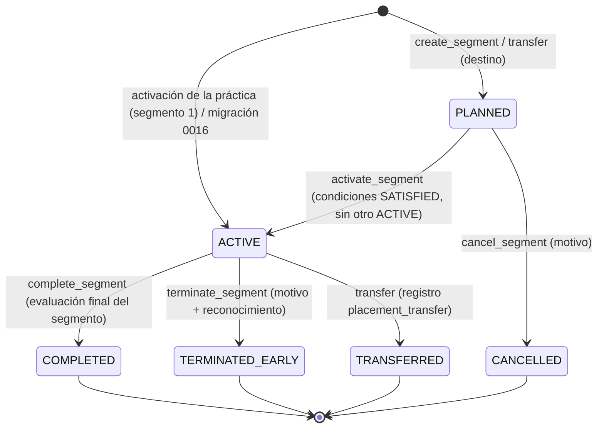
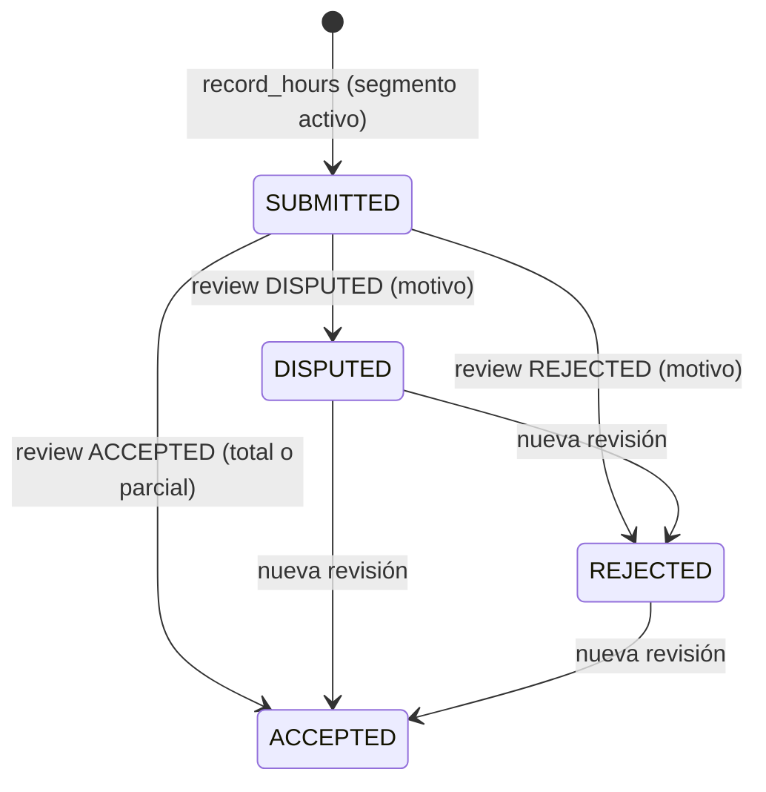
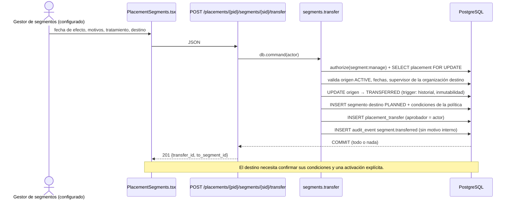
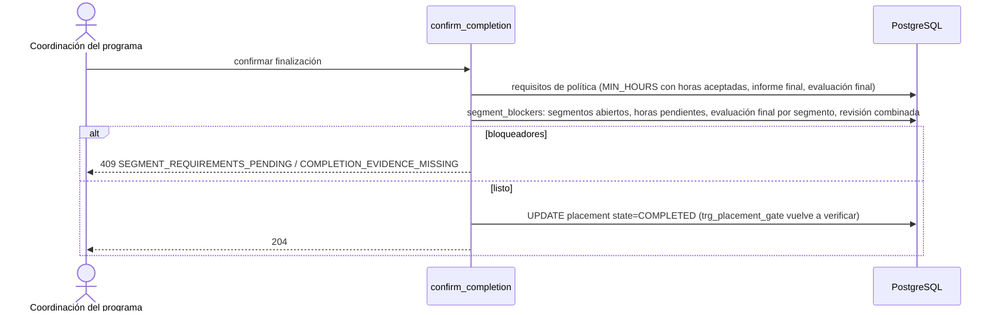

# Diagramas de estados y secuencia (CR-05)

## Estados de un segmento

Completar un segmento **no** activa el siguiente (BR-02). Los estados finales son inmutables.

## Estados de una entrada de horas

Cada flecha es una fila nueva en `progress_entry_review`; la última fila define el estado.

## Secuencia: transferencia a mitad de práctica

## Secuencia: cierre de una práctica con varios segmentos

