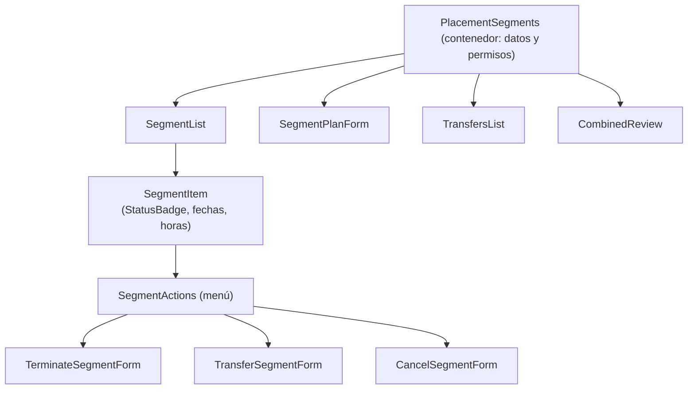

# Catálogo de componentes — DH-05

> Es una propuesta: **no hay nada implementado**. Para cada componente se indica qué código existente reemplaza o reutiliza. Todos se escriben en React 18 + TypeScript con CSS plano y tokens de `design-system.md`, sin dependencias nuevas.

## 0. Inventario: reutilizar, refactorizar o crear

| Existente (`components/ui.tsx` y otros) | Decisión | Destino |
|---|---|---|
| `PageHeader` | Refactorizar | PageHeader sin eyebrow, con slot de acciones |
| `BentoCard` (6 variantes) | Sustituir | `Panel` (una variante y slots) y `Section` |
| `MetricCard` | Reutilizar y ajustar estilo | MetricCard sin sombra y con cifra tabular |
| `Badge` + `statusTone()` + `DOMAIN_LABELS` | Unificar | `StatusBadge` con un mapa de estados único (`status.ts`) |
| `segmentTone()` y `SEGMENT_STATUS_LABELS` (`segments.ts`) | Unificar | `status.ts` |
| `HOURS_REVIEW_LABELS` y las etiquetas de oportunidad | Unificar | `status.ts` |
| `Spinner` | Reutilizar | Spinner, más `Skeleton` nuevo |
| `EmptyState` | Ampliar | Título, descripción y acción |
| `Alert` | Ampliar | `Notice` con título, tono, cierre y región viva |
| `Icon` (11 SVG) | Ampliar | ~30 iconos en el mismo componente |
| `ThemeControl` (glifo ◐) | Mover | Dentro de `UserMenu` con icono SVG |
| `Layout.tsx` | Sustituir | `AppShell`, `Sidebar`, `Header` y `Breadcrumbs` |
| `EligibilitySummary`, `ActivityTimeline`, `PlacementHistory` | Reutilizar | Solo cambio de estilos |
| `PlacementSegments` (364 l.) | Dividir | Ver §4 |
| `PlacementFollowUp` (270 l.) | Dividir | Ver §4 |
| `window.confirm` (7 usos) | Sustituir | `ConfirmDialog` |
| `formatHistoryDate`, `localDate` y formateadores dispersos | Unificar | `format/date.ts` (`formatDate`, `formatDateTime`) |

## 1. Navegación y estructura

### AppShell
- **Anatomía:** `Sidebar`, `Header` y `<main id="main">` con un enlace "Saltar al contenido".
- **Estados:** sidebar completo, en rail o como cajón (ver `design-system.md` §8.4).
- **A11y:** landmarks `nav`, `header` y `main`. El cajón móvil atrapa el foco y se cierra con Esc.

### Sidebar y NavItem
- **NavItem:** `<a href="#/{section}">` con icono de 18 px, etiqueta y contador opcional, y `aria-current="page"` en el ítem activo.
- **Grupos:** encabezado de grupo como texto atenuado sin mayúsculas forzadas, con `role="group"` y `aria-labelledby`.
- **Reemplaza** los `<button>` de navegación de `Layout.tsx`.

### Header, Breadcrumbs, UserMenu y NotificationBell
- **Breadcrumbs:** `<nav aria-label="Ruta">` con `<ol>`. El último elemento lleva `aria-current="page"`. En tableta se trunca al nivel padre.
- **UserMenu:** patrón de menú con botón (`aria-haspopup="menu"`, `aria-expanded`), flechas, Esc y retorno del foco. Contiene el nombre, los roles, el tema y Cerrar sesión.
- **NotificationBell:** botón "Avisos" con contador (`aria-label="Avisos, 3 sin leer"`) y un panel con las 5 últimas de `listNotifications`.

### PageHeader
- **Anatomía:** h1 (serif), una descripción opcional y acciones a la derecha.
- **Variante** `dossier`, que añade el StatusBadge, el LifecycleStepper y la línea de bloqueos.

### Tabs
- **ARIA completo:** `tablist`, `tab` con `aria-selected` y `aria-controls`, `tabpanel` con `aria-labelledby`, flechas izquierda/derecha y Home/End. La activación es manual.
- **Reemplaza** el `role="tab"` incompleto de `PlacementMessages.tsx:58`.

### SectionIndex (índice del expediente)
- **Lista de anclas** que resalta la sección visible.
- Es fija en ≥1440 px, horizontal en 1024–1439 px y un `<select>` "Ir a sección" en móvil.

## 2. Formularios

### Button
| Variante | Uso | Estilo |
|---|---|---|
| `primary` | Una por vista o sección | Fondo `--brand-700`, texto blanco |
| `secondary` | Acciones alternativas | Superficie, borde `--color-border-strong` |
| `danger` | Rechazar, cancelar, terminar | Fondo `--danger-700`, texto blanco |
| `ghost` | Acciones terciarias en barras | Sin borde y con fondo al hacer hover |
| `link` | Navegación en línea | Texto `--brand-700` subrayado |

- **Tamaños:** `sm` (32 px) y `md` (40 px). Táctil ≥44 px en móvil mediante un área de pulsación ampliada.
- **Estados:** hover (color, sin desplazamiento), `:focus-visible` con el anillo de 2 px, deshabilitado (con un motivo opcional vía `aria-describedby`) y **cargando**: el texto se mantiene, se añade el spinner, `aria-busy` y se bloquea el doble envío.
- **Reemplaza** las ~6 clases de botón actuales y los estilos en línea.

### IconButton
- Botón cuadrado con `aria-label` obligatorio a nivel de tipos (`label: string`).
- **Reemplaza** los glifos `☰ × ‹ ›`.

### Field (composición)
- **Anatomía:** `label` (con `htmlFor`), control, ayuda (`id-hint`) y error (`id-error`, `role="alert"` solo tras el envío).
- El control recibe `aria-describedby` y `aria-invalid`.
- **Corrige** las etiquetas sin asociar de `Opportunities.tsx:344–350` y `Policies.tsx:205/225`.
- **Controles:** `Input`, `Select`, `Textarea` (contador opcional), `Checkbox`, `RadioGroup` (`fieldset`/`legend`) y `FileInput` (botón "Seleccionar archivo", nombre y tamaño, eliminar).
- **Borde** `--color-border-strong` (3,72:1) y anillo de foco sólido. Se elimina el `outline: none` de `index.css:148`.

### FormActions
- Barra al pie del formulario con la acción primaria a la derecha en escritorio y apilada a ancho completo en móvil.
- En los Drawer queda fija al pie.

## 3. Datos y feedback

### StatusBadge
- **Props:** `entity` (`placement`, `application`, `document`, `hours`, `segment`, `opportunity` o `eligibility`) y `status`.
- **Salida:** etiqueta en español, tono (`success`, `warning`, `danger`, `info` o `neutral`) e **icono** de estado, de modo que el color nunca es el único portador.
- La fuente única es `status.ts`, con un mapa tipado.
- **Estilo:** radio de 4 px, `--text-label`, sin mayúsculas, `white-space: nowrap` y `flex-shrink: 0`. Esto corrige el badge partido del expediente.

### DataTable
- **Anatomía:** Toolbar opcional (búsqueda, filtros y conteo), `<table>` con `<caption>` (visible u oculta), `th scope="col"`, filas y estado (carga con skeleton de 5 filas, vacío o error con reintento).
- **Móvil:** modo apilado, en el que cada fila es un `<li>` con pares etiqueta–valor y la acción principal visible.
- **Paginación:** solo en cliente y opcional. La API no pagina; no se inventa.
- **Acciones por fila:** botón principal y menú "Más acciones".

### Pagination
- `<nav aria-label="Paginación">` con anterior/siguiente, la página actual (`aria-current`) y el total.
- Se usa solo cuando una lista supera las 25 filas en cliente.

### DescriptionList
- `<dl>` en una rejilla de 2 columnas en escritorio y apilada en móvil.
- Se usa en el resumen del expediente, en el detalle de documento y en el de política.

### Panel y Section
- **Panel:** superficie, borde de 1 px, radio de 8 px y sin sombra. Encabezado opcional (h3 + acciones).
- **Section:** bloque de página con h2 y ancla `id`. No lleva fondo; la separación se hace con espacio y filete.
- **Sustituyen** las 6 variantes de BentoCard.

### Notice / Alert
- **Tonos:** `info`, `success`, `warning` y `danger`, con icono, título opcional, texto, acción opcional y cierre.
- **Región viva por página:** `aria-live="polite"` para el éxito y `role="alert"` para los errores. Tras un error de envío, el foco se mueve al resumen.
- **Reemplaza** los avisos apilados por componente: hay como máximo un aviso por sección.

### ConfirmDialog y Dialog
- Usa `<dialog>` nativo con `showModal()` (foco atrapado y Esc de serie), un título, la descripción de la consecuencia, un campo de motivo opcional u obligatorio y los botones Cancelar y Confirmar (`danger` si aplica).
- El foco inicial va a Cancelar en las acciones destructivas.
- **Reemplaza** los 7 `window.confirm`.

### Drawer / SidePanel
- Panel lateral de 480 px (pantalla completa en móvil) con un título, contenido desplazable y FormActions fijas.
- Es modal en móvil y tableta; en escritorio, el SidePanel no es modal para el patrón maestro–detalle.
- Se usa en la creación de oportunidades, los formularios de segmento y las evaluaciones.

### Dropdown / Menu
- Botón "Más acciones" con un menú `role="menu"` y navegación con flechas.
- Las acciones destructivas van al final, tras un separador.

### EmptyState
- Icono de 20 px en un círculo neutro, un título ("No hay documentos pendientes"), una descripción breve y una acción opcional.
- Variante compacta para usar dentro de tablas.

### Skeleton y Spinner
- **Skeleton:** bloques `--color-surface-sunken` con forma de contenido. Bajo `prefers-reduced-motion`, sin animación de brillo.
- **Spinner:** solo dentro de botones o en cargas menores de 1 s.
- **Regla:** se conserva el contenido anterior mientras se recarga (evita el `setDossier(null)` y el parpadeo).

### Dominio DH-05
- **LifecycleStepper:** `<ol>` de etapas con estado completada, actual (`aria-current="step"`), pendiente o desvío. Cada etapa lleva texto e icono. En móvil se muestra "Etapa 3 de 7 · Aprobación académica".
- **HoursSummary:** cifra aprobadas/requeridas, barra `<progress>` nativa con etiqueta y desglose por segmento.
- **Timeline:** `<ol>` con fecha (`<time>`), actor y evento, con filtro por tipo.
- **RequirementsIndicator:** "4/5 requisitos" y una lista desplegable (`<details>`) con cada requisito y su estado.
- **WorkItem:** fila de la bandeja de inicio con StatusBadge, título, contexto, antigüedad y acción.

## 4. Refactors de composición (composition-patterns)

### 4.1 `PlacementSegments` → componentes compuestos

El estado actual usa un `panel.kind` con modos booleanos y formularios condicionales dentro de un componente de 364 líneas. Esto corresponde al antipatrón *boolean prop proliferation* y a los *explicit variants*.



- **Formularios explícitos:** cada variante es un componente propio con sus campos y su validación, que comparten `SegmentEndFormShell` (Drawer, motivo y FormActions). No hay `if (kind === ...)` dentro del JSX.
- **Datos:** el contenedor carga y expone `{segments, transfers, permissions, actions}` mediante un contexto local (`SegmentsContext`), para que los hijos no reciban una docena de props.
- **Sin cambios de API:** las mismas funciones de `api.ts` y `segments.ts`.

### 4.2 `PlacementFollowUp` → secciones independientes

`WorkPlanSection`, `ChangesSection`, `ProgressSection`, `EvaluationsSection`, `IncidentsSection` y `EvidenceSection`. Cada una gestiona su carga, su error y su aviso. Hoy comparten un único estado de aviso, por lo que un éxito en "avances" se mostraba junto a un error de "evaluaciones".

### 4.3 Hook `useAsyncAction`

```ts
// Propuesta (no implementada)
function useAsyncAction<A extends unknown[]>(fn: (...a: A) => Promise<void>) {
  // devuelve { run, busy, error, notice, reset }
}
```

Elimina el patrón `setBusy(true); try { … setNotice() } catch { setError() } finally { setBusy(false) }`, repetido en la mayoría de los componentes con formulario.

### 4.4 Utilidades únicas

- `format/date.ts`:
  - `formatDate(isoDate)` para valores de solo día, interpretados como fecha local sin zona horaria. Corrige el desfase de un día de `PlacementFollowUp.tsx:89`.
  - `formatDateTime(isoDateTime)` con `Intl.DateTimeFormat('es')`.
- `status.ts`: el mapa único de estados → etiqueta, tono e icono.

## 5. Accesibilidad transversal (checklist por componente)

- [ ] `:focus-visible` con un anillo de 2 px y contraste ≥3:1.
- [ ] Toda acción por teclado; sin trampas de foco, salvo diálogos y cajón.
- [ ] Etiquetas visibles y asociadas, y errores con `aria-describedby`.
- [ ] El color nunca es el único portador (icono o texto en los estados).
- [ ] Texto ≥12 px y contraste ≥4,5:1.
- [ ] Objetivos táctiles ≥44 px en móvil.
- [ ] Animaciones solo de `opacity`/`transform`, desactivadas con `prefers-reduced-motion`.
