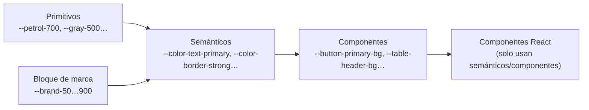
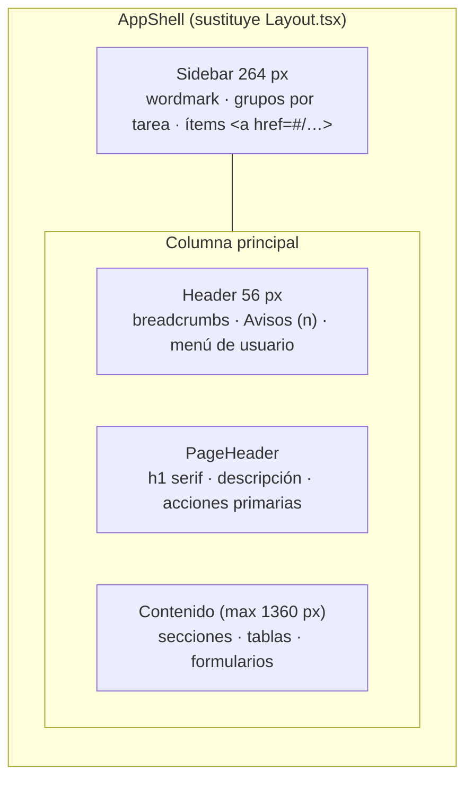

# Sistema de diseño propuesto — DH-05

> Tokens CSS para el stack real: CSS plano con propiedades personalizadas, sin Tailwind ni librerías. Los nombres son los que se proponen para sustituir progresivamente las variables de `index.css` y `theme.css`. Todos los contrastes se calcularon con la fórmula WCAG 2.x.

## 1. Arquitectura de tokens

Se proponen tres capas en un único archivo nuevo (`src/styles/tokens.css`) que reemplaza la doble capa actual:

**Reglas**
- Los componentes nunca usan hexadecimales: hoy hay 78 literales.
- El modo oscuro solo redefine la capa semántica en `:root[data-theme="dark"]`. No se repiten selectores de componente como los 54 actuales.
- La marca se aísla en `--brand-*`. Cambiar la identidad institucional consiste en sustituir esos 10 valores.

## 2. Paleta de colores

### 2.1 Marca (provisional y sustituible)

Petróleo institucional: un azul verdoso profundo. Se justifica en `design-direction.md` §4.2.

| Token | Hex | Uso |
|---|---|---|
| `--brand-50` | `#E8F0F3` | Fondo de la navegación seleccionada y de las filas seleccionadas |
| `--brand-100` | `#CFE0E6` | Borde de los elementos seleccionados |
| `--brand-300` | `#86BFD0` | Primario en modo oscuro |
| `--brand-600` | `#2A6476` | Hover de enlace (claro) |
| `--brand-700` | `#1E4D5C` | **Primario**: botón principal, enlaces y foco |
| `--brand-800` | `#173E4A` | Hover y pulsado del botón principal |
| `--brand-900` | `#10303A` | Texto sobre `--brand-50` en tamaño pequeño |
| `--brand-ink` | `#0C2730` | Texto sobre `--brand-300` (oscuro) |

### 2.2 Neutros (fríos y casi acromáticos)

| Token semántico | Claro | Oscuro | Uso |
|---|---|---|---|
| `--color-bg-page` | `#F5F7F8` | `#0E1418` | Fondo de la aplicación |
| `--color-surface` | `#FFFFFF` | `#151D22` | Paneles, tablas y formularios |
| `--color-surface-sunken` | `#EEF1F3` | `#11181C` | Encabezados de tabla, bloques de solo lectura y código de referencia |
| `--color-border-default` | `#DCE2E6` | `#26323A` | Filetes y separadores (decorativos) |
| `--color-border-strong` | `#7A8691` | `#5D6C77` | **Bordes de controles** (inputs, selects y checkboxes) |
| `--color-text-primary` | `#17212B` | `#E5EBEF` | Texto principal y títulos |
| `--color-text-secondary` | `#3E4B56` | `#C2CDD5` | Texto de apoyo y valores de las listas de datos |
| `--color-text-muted` | `#5B6873` | `#97A6B1` | Etiquetas, metadatos y fechas (**mínimo 12 px**) |
| `--color-focus` | `#1E4D5C` | `#86BFD0` | Anillo de foco de 2 px |

### 2.3 Sidebar institucional

| Token | Valor | Uso |
|---|---|---|
| `--sidebar-bg` | `#14212A` | Fondo (igual en claro y oscuro) |
| `--sidebar-text` | `#DDE5EA` | Ítems de navegación |
| `--sidebar-text-muted` | `#9DAEB9` | Títulos de grupo |
| `--sidebar-active-bg` | `#25404D` | Ítem activo, con indicador lateral de 3 px en `--brand-300` |
| `--sidebar-focus` | `#8CC3D3` | Foco dentro del sidebar |

### 2.4 Estados (semánticos y separados de la marca)

| Estado | Texto/icono claro | Fondo claro | Texto/icono oscuro | Fondo oscuro | Significado en DH-05 |
|---|---|---|---|---|---|
| `success` | `#1B6A42` | `#E7F3EC` | `#86CFA5` | `#16301F` | Activa, aprobado, cumplida, aceptadas y elegible |
| `warning` | `#8A4B00` | `#FBF0DE` | `#E9B86A` | `#33260F` | Pendiente, en revisión, requiere revisión y en disputa |
| `danger` | `#A8261D` | `#FBEAE7` | `#F2A09A` | `#3A1F1D` | Rechazado, cancelado, no elegible y terminado anticipadamente |
| `info` | `#2B5797` | `#E8EEF8` | `#9DBBEA` | `#17243A` | Planificado, transferido, enviada y propuesta |
| `neutral` | `#3E4B56` | `#ECEFF2` | `#C2CDD5` | `#1C252B` | Borrador, cerrada, completada (histórico) y sin dato |

**Mapa propuesto de estados** para sustituir `statusTone()` y `segmentTone()`. Solo cambia la presentación; los valores de dominio son los mismos:

| Tono | Estados de dominio |
|---|---|
| success | `ACTIVE`, `APPROVED`, `ELIGIBLE`, `SATISFIED`, `ACCEPTED`, `PUBLISHED`, `SELECTED` |
| warning | `PENDING_ACADEMIC_APPROVAL`, `PENDING_ELIGIBILITY_REVIEW`, `REQUIRES_REVIEW`, `DOCUMENTATION_PENDING`, `REQUIRED`, `IN_REVIEW`, `SUBMITTED` (documento o hora), `DISPUTED`, `CHANGES_REQUIRED` |
| danger | `REJECTED`, `CANCELLED`, `INELIGIBLE`, `NOT_ELIGIBLE`, `TERMINATED_EARLY` |
| info | `PLANNED`, `TRANSFERRED`, `PROPOSED`, `REPORTED`, `SUBMITTED` (postulación) |
| neutral | `DRAFT`, `COMPLETED`, `CLOSED`, desconocido |

`SUBMITTED` significa cosas distintas según la entidad. Por eso el `StatusBadge` recibe la entidad (`application`, `document` u `hours`) y no solo la cadena. Esto corrige el problema actual de casi todo en gris (hallazgo B3).

### 2.5 Verificación de contraste (WCAG 2.1 AA)

**Tema claro**

| Par | Ratio | Nivel |
|---|---|---|
| Texto principal sobre fondo de página | 15,16 | AAA |
| Texto secundario sobre superficie | 8,95 | AAA |
| Texto atenuado sobre superficie, página y hundida | 5,72 / 5,32 / 5,04 | AA |
| `--brand-700` sobre superficie (enlaces) | 9,25 | AAA |
| Blanco sobre `--brand-700` (botón principal) | 9,25 | AAA |
| Blanco sobre `--brand-800` (hover) | 11,51 | AAA |
| `--brand-700` sobre `--brand-50` (navegación seleccionada) | 8,01 | AAA |
| Borde de control `#7A8691` sobre superficie, página y hundida | 3,72 / 3,46 / 3,28 | ≥3:1 (1.4.11) |
| Foco sobre página | 8,60 | AAA |
| Éxito, advertencia, peligro e información sobre su fondo | 5,78 / 6,03 / 6,09 / 6,19 | AA |
| Neutral sobre su fondo | 7,76 | AAA |
| Blanco sobre peligro (botón destructivo) | 7,09 | AAA |
| Texto, texto atenuado y activo del sidebar | 12,86 / 7,17 / 10,94 | AAA |

**Tema oscuro**

| Par | Ratio | Nivel |
|---|---|---|
| Texto principal sobre página | 15,43 | AAA |
| Texto secundario y atenuado sobre superficie | 10,55 / 6,83 | AAA / AA |
| `--brand-300` sobre superficie | 8,43 | AAA |
| `--brand-ink` sobre `--brand-300` (botón) | 7,69 | AAA |
| Borde de control sobre superficie | 3,15 | ≥3:1 |
| Estados sobre sus fondos | 7,37–8,09 | AAA |

Los filetes decorativos (`--color-border-default`, 1,3:1) no transmiten información, así que no se les exige 3:1. Los bordes de controles sí lo cumplen.

**Mejora frente a lo actual:**
- El texto pequeño atenuado pasa de 3,49–3,80 a ≥5,04.
- El borde de input pasa de 1,64 a 3,72.
- El foco de input pasa de una sombra al 16 % a un contorno sólido de 8,6:1.

## 3. Tipografía

### 3.1 Familias

| Rol | Familia | Justificación | Alternativa sin cambios de recursos |
|---|---|---|---|
| UI y cuerpo | **Source Sans 3** (variable, OFL) | Humanista y legible en tamaños pequeños. Tiene dígitos tabulares. Está pensada para interfaces de uso prolongado. La sugiere UI/UX Pro Max ("Corporate Trust"). | Pila del sistema: `"Segoe UI", system-ui, -apple-system, sans-serif` |
| Títulos de página (h1 y título del expediente) | **Source Serif 4** (variable, OFL) | Única señal académica. Pertenece a la misma superfamilia, así que hay contraste sin choque. Solo se usa a partir de 24 px. | `Georgia, "Times New Roman", serif` |
| Referencias y códigos (IDs de condición, referencias verificadas) | `ui-monospace, "Cascadia Mono", Consolas, monospace` | Solo en valores que se copian o comparan. No se usa como decoración de etiquetas. | El mismo |

**Carga de fuentes**
- Se alojarían en el propio proyecto (`public/fonts/*.woff2`, unos 4 archivos y alrededor de 160 kB en total) con `font-display: swap` y `preload` de la variante regular.
- No se usaría Google Fonts en tiempo de ejecución, por privacidad (sin peticiones a terceros desde un sistema institucional) y rendimiento.
- Añadir estos archivos **requiere aprobación**: son recursos nuevos, aunque no dependencias npm. Mientras tanto, la pila del sistema es la alternativa.

### 3.2 Escala (base de 16 px y relación de 1,2 aproximadamente)

| Token | Tamaño / interlínea | Peso | Uso |
|---|---|---|---|
| `--text-caption` | 12 / 16 px | 400 | Metadatos, fechas y ayuda de campo. **Es el mínimo absoluto.** |
| `--text-label` | 13 / 18 px | 600 | Etiquetas de formulario, encabezados de tabla (sin mayúsculas forzadas) y badges |
| `--text-body-sm` | 14 / 20 px | 400 | Celdas de tabla y listas densas |
| `--text-body` | 15 / 24 px | 400 | Texto general y descripciones |
| `--text-h4` | 16 / 24 px | 600 | Título de subsección |
| `--text-h3` | 18 / 26 px | 600 | Título de panel o sección |
| `--text-h2` | 22 / 28 px | 600 | Título de sección mayor |
| `--text-h1` | 28 / 34 px (móvil: 24 / 30) | 600, serif | Título de página |
| `--text-metric` | 28 / 32 px | 600, tabular | Cifras de resumen |

**Reglas**
- `font-variant-numeric: tabular-nums` en tablas, horas, fechas y métricas.
- Las mayúsculas solo se permiten en siglas (ADM, ING-SIS). Las etiquetas van en tipo oración.
- Medida de texto corrido: `max-width: 72ch`.
- `text-wrap: balance` en los títulos, que ya existe.
- Interletraje 0 en cuerpo y −0,01 em en h1/h2. Se elimina el −0,045 em actual, que comprime la serif.

## 4. Espaciado y composición

### 4.1 Espaciado (base 4 px)

`--space-1: 4px`, `--space-2: 8px`, `--space-3: 12px`, `--space-4: 16px`, `--space-5: 20px`, `--space-6: 24px`, `--space-8: 32px`, `--space-10: 40px`, `--space-12: 48px`, `--space-16: 64px`.

| Contexto | Valor |
|---|---|
| Relleno interno de panel | 24 px en escritorio y 16 px en móvil |
| Separación entre secciones de página | 32 px |
| Separación entre campos de formulario | 16 px |
| Celda de tabla | 10 px vertical y 12 px horizontal |
| Separación entre botones de una barra | 8 px |

### 4.2 Radios (jerarquía y no un valor único)

| Token | Valor | Uso |
|---|---|---|
| `--radius-xs` | 4 px | Badges de estado, checkboxes y chips |
| `--radius-sm` | 6 px | Botones, inputs, selects y menús |
| `--radius-md` | 8 px | Paneles, tablas y diálogos |
| — | 0 | Filas, celdas, sidebar y header |

Se eliminan los radios de 9–18 px y las píldoras de 999 px.

### 4.3 Bordes y sombras

| Token | Valor | Uso |
|---|---|---|
| `--border-width` | 1 px | Todos los filetes y controles |
| `--focus-ring` | `2px solid var(--color-focus)` con `outline-offset: 2px` | Todo elemento interactivo, vía `:focus-visible` |
| `--shadow-overlay` | `0 8px 24px rgb(15 23 30 / 14%)` | **Solo** menús, diálogos y el cajón móvil |

Sin sombra en paneles, tarjetas ni botones. Se eliminan `--shadow-soft`, `--shadow-raised` y el `translateY` del hover.

### 4.4 Anchos máximos

| Token | Valor | Uso |
|---|---|---|
| `--content-max` | 1360 px | Contenedor de página (hoy 1680 px; en monitores anchos la línea de lectura era excesiva) |
| `--form-max` | 720 px | Formularios de una columna |
| `--prose-max` | 72ch | Textos narrativos (avances, evaluaciones y motivos) |
| `--sidebar-width` | 264 px (rail: 72 px) | Navegación |

### 4.5 Rejilla

- **12 columnas** con un gutter de 24 px en escritorio, 16 px en tableta y 16 px en móvil (4 columnas).
- **Expediente en escritorio ancho:** índice de 3 columnas, fijo al hacer scroll, y detalle de 9 columnas.
- **Bandeja de inicio:** lista principal de 8 columnas y columna de apoyo de 4.

### 4.6 Puntos de corte (sustituyen 1100/820/680/420)

| Nombre | Ancho | Comportamiento |
|---|---|---|
| `sm` | < 768 px | Móvil: sidebar en cajón, tablas como lista de tarjetas y acciones apiladas |
| `md` | 768–1023 px | Tableta: sidebar en rail de iconos con etiqueta en tooltip, una columna de contenido |
| `lg` | 1024–1439 px | Escritorio: sidebar completo, rejilla de 12 columnas y expediente con índice superior |
| `xl` | ≥ 1440 px | Escritorio ancho: expediente con índice lateral fijo |

Las media queries se escriben de menor a mayor (`min-width`), en un solo lugar por componente.

## 5. Movimiento

| Token | Valor | Uso |
|---|---|---|
| `--duration-fast` | 120 ms | Hover y cambios de color |
| `--duration-base` | 180 ms | Abrir o cerrar disclosure, menú y cajón |
| `--ease-out` | `cubic-bezier(.2,0,0,1)` | Entradas |

- Solo se animan `opacity` y `transform`.
- No hay animaciones de entrada de página ni de scroll.
- Se mantiene el bloque `prefers-reduced-motion` actual.

## 6. Iconografía

- **Un único set SVG de trazo:** 24×24, trazo de 1,75 y extremos redondeados, coherente con los 11 iconos existentes en `ui.tsx:83`.
- **Se amplía a unos 30 iconos**, dibujados en el mismo componente `Icon`, sin dependencias:
  - menu, close, chevron-left/right/down, search, filter, download, upload, calendar, clock;
  - user, users, building, external, more-horizontal;
  - status-success, status-warning, status-danger, status-info;
  - segment, transfer, hours, message.
- **Tamaños:** 16 px en línea con texto, 18 px en la navegación y 20 px en los estados vacíos.
- **Los iconos decorativos** llevan `aria-hidden`. Los botones que solo tienen icono llevan `aria-label`.
- **Prohibido:** emojis y glifos de texto como icono (`☰ × ‹ › ◐ →`).

## 7. Modo oscuro

- Se conserva la funcionalidad actual: `ThemeProvider`, la preferencia "Sistema/Claro/Oscuro", el script anti-parpadeo de `index.html` y `theme-color`.
- Solo cambian los valores (§2). El sidebar es igual en ambos modos.
- `theme-color` pasará a `#F5F7F8` en claro y `#0E1418` en oscuro.

## 8. Layout institucional

### 8.1 Sidebar

- **Agrupación por tarea**, no por módulo técnico. Los ítems y su visibilidad por rol se derivan sin cambios de `canAccessSection` (`App.tsx:38`). Solo cambia la agrupación visual:
  - **Trabajo:** Inicio, Oportunidades, Mis postulaciones y Mis documentos y horas.
  - **Revisión:** Revisión académica, Revisión documental y Activación.
  - **Gestión:** Expediente, Políticas, Reportes y Notificaciones.
- **Cada ítem es un enlace real** (`<a href="#/opportunities">`) con `aria-current="page"`. Así funcionan abrir en pestaña nueva y la navegación por teclado nativa. Hoy son `<button>` (hallazgo B1).
- **Contadores** de pendientes solo donde ya existe el dato cargado (por ejemplo, el número de notificaciones no leídas). No se crean endpoints.
- **Pie:** versión del entorno ("Demo sintética") y nada más. El usuario, el rol y el tema pasan al header.

### 8.2 Header

- **Breadcrumbs** derivados de la sección del hash, por ejemplo `Inicio / Expediente / P-0007 · Ingeniería de datos`. El último nivel es texto con `aria-current`.
- **Avisos:** botón con icono y contador que abre un panel con las últimas 5 notificaciones de `listNotifications` y un enlace a "Ver todas".
- **Menú de usuario:** nombre, rol o roles (chips), selector de tema (Sistema/Claro/Oscuro, el control actual) y Cerrar sesión. Es un menú accesible: botón con `aria-expanded`, cierre con Esc y retorno del foco.
- **Sin `backdrop-filter`.** El fondo es sólido de superficie con un filete inferior.

### 8.3 Área de contenido y navegación secundaria

- `PageHeader`: h1, descripción de una línea y acciones a la derecha (apiladas en móvil). Se elimina la "eyebrow" decorativa.
- **Navegación secundaria** dentro de una página: pestañas (Tabs con ARIA completo) cuando se alterna entre vistas hermanas (por ejemplo, Conversación: Mensajes / Notas internas). En el expediente se usa un índice de secciones con anclas.
- **Menús contextuales:** "Más acciones" (icono `more-horizontal`) en filas de tabla y segmentos para las acciones secundarias. Las destructivas van al final, separadas y en color de peligro.

### 8.4 Comportamiento por dispositivo

| Elemento | Escritorio ≥1024 | Tableta 768–1023 | Móvil <768 |
|---|---|---|---|
| Sidebar | Fijo, 264 px | Rail de 72 px con iconos, `aria-label` y tooltip | Cajón modal desde la izquierda (foco atrapado, Esc, overlay) abierto con botón `menu` |
| Header | Breadcrumbs completos, Avisos y usuario | Breadcrumbs truncados al nivel padre | 56 px: botón de menú, título de sección y Avisos; el usuario dentro del cajón |
| PageHeader | Acciones en línea | Acciones en línea y ajuste de línea | Acción primaria a ancho completo y secundarias en "Más" |
| Tablas | Tabla completa | Columnas secundarias ocultas | Lista apilada: cada fila es un bloque con etiqueta y valor |
| Expediente | Índice lateral fijo en ≥1440, superior en 1024–1439 | Índice superior desplegable | Selector "Ir a sección" y detalle primero |
| Formularios | Hasta 2 columnas dentro de 720 px | 1–2 columnas | 1 columna con objetivos táctiles ≥44 px |

En móvil, la cabecera ocupa ≤56 px, frente a los ~110 px actuales.
