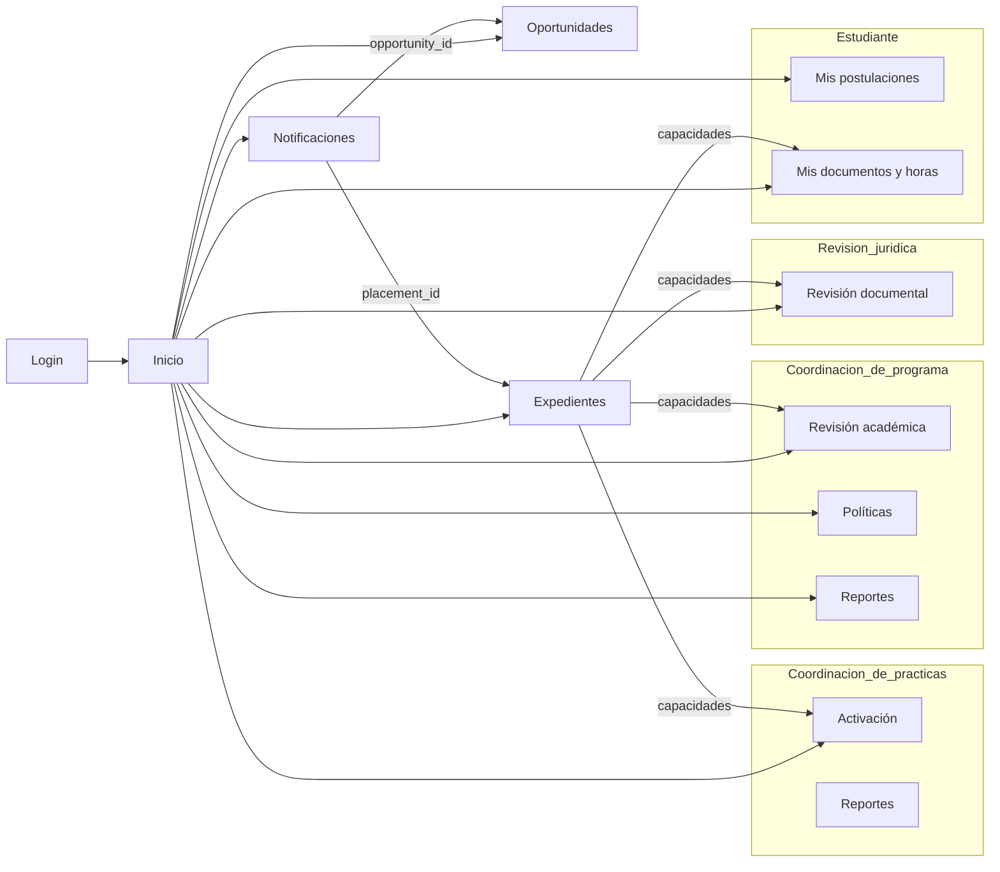

# Auditoría del frontend actual — DH-05

> Fase 2, auditoría y diseño. Este documento describe el estado real del código en `frontend/src` (árbol de trabajo sobre `00940e3` con CR-05 sin commitear). No propone todavía la implementación.

## 1. Alcance y método

- **Lectura completa del código de interfaz:**
  - 11 páginas y 13 componentes;
  - `ui.tsx`, `Layout.tsx`, `App.tsx`, `theme.tsx`;
  - `index.css` (523 líneas) y `theme.css` (415 líneas);
  - los helpers puros (`segments.ts`, `studentJourney.ts`, `eligibility.ts`, `progress.ts` y otros).
- **Skills aplicadas:**
  - `web-design-guidelines`: reglas fijadas en `references/command.md`, SHA-256 `d246b0…`.
  - `composition-patterns` y `vercel-react-best-practices`: solo las reglas cliente, porque no hay Next.js ni RSC.
  - `ui-ux-pro-max`: búsquedas locales y contraste.
  - `frontend-design` y `bencium-controlled-ux-designer`: criterios de dirección visual.
- **Inspección visual:** demo aislada (pgserver temporal, datos sintéticos) con la cuenta `ec1`, a 1440×900 y a 390×844, en modo claro.
- **Contraste:** calculado con la fórmula WCAG 2.x sobre los tokens reales de `theme.css` (ver §12).
- **Restricciones respetadas:** no se modificó código, CSS, rutas, API, backend ni el ZIP de entrega.

## 2. Inventario técnico

| Aspecto | Estado actual |
|---|---|
| Stack | React 18.3, TypeScript 5.5, Vite 5. Sus únicas dependencias de ejecución son `react` y `react-dom`. |
| Estilos | CSS plano en dos capas: `index.css` (base) y `theme.css` (sobrescritura y modo oscuro), importadas en ese orden en `main.tsx`. |
| Tamaño | ≈4.300 líneas de UI, más `api.ts` (1.070 líneas y 70 funciones exportadas). |
| Enrutamiento | Router propio por hash (`App.tsx:33`): 11 secciones más `#/login` y `#/demo-login`. Sin parámetros: el expediente seleccionado viaja por `sessionStorage` (`dh05:open-placement`). |
| Estado | `useState` y `useEffect` por página, sin caché compartida. Cada página vuelve a pedir sus datos al montarse. |
| Iconos | 11 iconos SVG propios en `ui.tsx:83`, más glifos de texto (`☰ × ‹ › ◐ →`). |
| Pruebas | 16 archivos vitest (lógica pura y API) y Playwright E2E (`e2e/lifecycle.spec.ts`). |

### 2.1 Rutas, componentes y roles

| Hash | Componente | Roles con acceso (`App.tsx:38`) | Llamadas principales |
|---|---|---|---|
| `#/home` | `pages/Dashboard.tsx` | todos | `listOpportunities`, más colas según rol |
| `#/opportunities` | `pages/Opportunities.tsx` | todos | catálogo, creación, transiciones, selección |
| `#/notifications` | `components/NotificationInbox.tsx` | todos | `listNotifications`, `markNotificationRead` |
| `#/applications` | `pages/Applications.tsx` | STUDENT | `listApplications` |
| `#/documents` | `pages/Documents.tsx` | STUDENT | requisitos, entregas y horas |
| `#/academic` | `pages/AcademicReview.tsx` | PROGRAM_COORDINATOR | elegibilidad manual y selecciones |
| `#/policies` | `pages/Policies.tsx` | PROGRAM_COORDINATOR | versiones de política |
| `#/reports` | `pages/OperationalReports.tsx` | PROGRAM_COORDINATOR, EXPERIENTIAL_COORDINATOR | `getOperationalReports` |
| `#/docreview` | `pages/DocumentReview.tsx` | LEGAL_REVIEWER | revisión documental |
| `#/activation` | `pages/Activation.tsx` | EXPERIENTIAL_COORDINATOR | activación |
| `#/dossier` | `pages/PracticeDossier.tsx` | los 7 roles con relación | expediente y CR-05 |
| `#/login` | `pages/Login.tsx` | sin sesión | login y recuperación |
| `#/demo-login` | `pages/DemoLogin.tsx` | sin sesión y solo en loopback | cuentas sintéticas |

## 3. Layout, sidebar, header y breadcrumbs

**Layout** (`components/Layout.tsx`)
- Es un `app-shell` flex con `aside.sidebar` de 252 px, sticky, y `main` con `header.topbar` sticky de 70 px.
- **Bien resuelto:** tiene enlace de salto (`Layout.tsx:114`), `aria-current="page"` en la navegación, cierre del menú móvil con Escape y devolución del foco al botón.

**Sidebar**
- Agrupa la navegación en "Principal", "Ciclo de vida", "Mi práctica", "Coordinación", "Revisión" y "Operación".
- Los grupos se calculan por rol y se eliminan los duplicados (`Layout.tsx:87`).
- **Problemas:**
  - Los ítems son `<button>` con cambio de hash, no `<a href>`, así que no admiten Ctrl+clic ni el botón central del ratón (regla *Links use `<a>`* de Web Interface Guidelines).
  - Repite `aria-label` con el mismo texto visible.
  - El botón "Contraer menú" se monta con margen negativo (`theme.css:83`).
- **En móvil (<820 px):** el sidebar pasa a ser un bloque superior sticky con marca, botón "Menú" y la fila de cuenta siempre visible. Ocupa unos 110 px de alto y deja menos espacio al contenido.

**Header**
- Muestra el texto fijo "DH-05 · ESPACIO DE TRABAJO" en mayúsculas y la misma etiqueta de sección, con `aria-hidden`.
- Muestra "Prácticas y pasantías" y el selector de tema.
- No hay breadcrumbs, campana de notificaciones, menú de usuario ni contexto del registro abierto.

**Breadcrumbs:** no existen.
- En el expediente, el usuario no ve en qué práctica está salvo leyendo la tarjeta principal.
- La URL no identifica la práctica abierta (`#/dossier` es igual para todas).

## 4. Experiencias por rol

El código define 7 roles de negocio (`ui.tsx:48`). **No existe un rol de administrador** ni pantalla de administración: no hay gestión de usuarios, catálogos ni configuración global, y el backend tampoco define un rol `ADMIN`. Las tareas "administrativas" se reparten entre las dos coordinaciones. El rediseño no debe inventar ese rol.

| Grupo pedido | Roles reales | Panel de inicio (`Dashboard.tsx`) | Acciones principales |
|---|---|---|---|
| Estudiantes | `STUDENT` | Tarjeta "Siguiente paso" calculada por `studentJourney.ts` (bien resuelta), 2 métricas, catálogo y actividad | Postular, entregar documentos, registrar horas, avances e informe final |
| Supervisores | `WORKPLACE_SUPERVISOR`, `FACULTY_SUPERVISOR` | Tarjeta principal genérica, 1 métrica y lista de prácticas vinculadas | Plan de trabajo, evaluaciones, revisión de horas (según configuración CR-05) y mensajes |
| Coordinadores | `PROGRAM_COORDINATOR`, `EXPERIENTIAL_COORDINATOR` | Académico: cola de selecciones y políticas. Experiencial: tarjeta principal y una única métrica ("En documentación") | Elegibilidad, aprobación académica, políticas, activación, segmentos, transferencias y cierre |
| Otros | `HOST_ORG_MEMBER`, `LEGAL_REVIEWER` | Organización: 3 métricas. Jurídico: tarjeta principal y 1 métrica | Oportunidades y selección; revisión de documentos |

**Hallazgos:**
1. **Los paneles de inicio no priorizan el trabajo pendiente.**
   - Para coordinación experiencial y revisión jurídica, el panel muestra un texto genérico y un número.
   - No muestra la lista de casos que esperan acción, aunque los datos ya se cargan (`listPendingActivation`, `listDocumentsPending`).
2. **Las cuentas con dos roles duplican la tarjeta principal.**
   - Los bloques `isAcademic` (`Dashboard.tsx:201`) y `isWorkplaceSupervisor || isFacultySupervisor` (`Dashboard.tsx:231`) se evalúan por separado.
   - La cuenta `dual1` (coordinador y supervisor académico) recibe dos tarjetas principales en la misma rejilla, y la variante CSS solo contempla una.
3. **La supervisión recibe la vista más pobre** pese a ser el rol con más tareas recurrentes en CR-05: revisar horas por segmento, plan de trabajo y evaluaciones.
4. **El rol de cada usuario solo se ve como texto pequeño** en el pie del sidebar (10–11 px, `index.css:70`).

## 5. Componentes compartidos

`components/ui.tsx` define:

| Componente | Uso | Observaciones |
|---|---|---|
| `Icon` | sidebar | Solo 11 iconos. No hay iconos de estado (éxito, alerta, error, información), ni de buscar, cerrar, menú, descargar, flechas o calendario, y por eso aparecen glifos de texto. |
| `PageHeader` | todas las páginas | Siempre lleva una etiqueta superior en mayúsculas (`eyebrow`). La prop `showTitle` puede ocultar el `h1`. |
| `BentoCard` | ≈45 usos | Seis variantes (`hero`, `metric`, `activity`, `task`, `content`, `action`) que en la práctica son el mismo contenedor con borde, radio de 14 px y sombra. |
| `MetricCard` | panel de inicio | Bien acotado. Usa "—" para la carga. |
| `Badge` | ≈60 usos | El tono se decide con `statusTone()`: solo verde, rojo o gris. Estados como "Documentación pendiente", "En revisión", "Pendiente de aprobación" o "Transferido" salen en gris, igual que los neutros. El estado depende solo del color y del texto, sin icono. |
| `Spinner`, `EmptyState`, `Alert` | estados | Correctos y mínimos. `EmptyState` no admite título ni icono. `Alert` no tiene título ni botón de cierre. |

**Componentes que faltan** y se reimplementan a mano en cada página:
- `Button` (usa la clase `btn`);
- `Field`, con `label`, ayuda y error asociados;
- `DataTable` y `Toolbar`;
- `DescriptionList` (`dossier-facts` repetido);
- `Dialog` y confirmación;
- `Tabs`, `Breadcrumbs`, `StatusBadge` con icono, `Section` y `Disclosure`.

**Componentes de dominio:**
- `PlacementSegments` (364 líneas) y `PlacementFollowUp` (270 líneas) concentran CR-05 y el seguimiento.
- `HoursReviewList`, `PlacementWorkPlan`, `PlacementMessages`, `FacultyAssignmentManager`, `ActivityTimeline`, `PlacementHistory` y `EligibilitySummary` están bien separados por responsabilidad.

## 6. Tablas y listados

- **Hay 11 tablas en total.** Usan `<table>` semántico dentro de `.table-scroll` con `tabIndex=0` y `aria-label`, que es correcto.
- **Solo 2 tablas pasan a tarjetas en móvil:** `applications-table` y `eligibility-review-table` (`index.css:411`). Las demás usan desplazamiento horizontal con un `min-width` de 600–680 px.
- **No hay ordenación, paginación, filtros guardados ni recuento**, salvo en el catálogo de oportunidades, que tiene búsqueda, estado y "N de M".
- **La columna de acciones se satura:**
  - En `Opportunities.tsx:278-295` una fila puede mostrar Postular, Postulaciones, Enviar a revisión, Aprobar, Publicar y Cerrar a la vez, junto con notas.
  - La última columna no tiene encabezado (`<th />`, línea 267).
- **Hay formularios completos dentro de celdas:**
  - selección de candidato en `Opportunities.tsx:333`;
  - motivo y decisión en `DocumentReview.tsx:116`;
  - fundamento de elegibilidad en `AcademicReview.tsx:125`;
  - revisión de horas en `HoursReviewList.tsx:66`.
  - Esto rompe el ritmo de la tabla y obliga a fijar `min-width` con estilos en línea (19 estilos `style={{…}}` en total).
- **Los listados que no son tablas** (cola de activación y revisión documental) son tarjetas por caso con un botón "Ver/Ocultar". Esto contradice el uso de tabla para datos comparables.

## 7. Formularios

Hay cuatro patrones distintos de formulario:
1. Un `div.field` con `label htmlFor` y `id`, que es el patrón correcto (Login, Policies parcial, PlacementSegments).
2. Un `label.field` que envuelve el texto y el control (PlacementFollowUp, PlacementWorkPlan y PlacementMessages). Además añade un `aria-label` que sustituye al texto visible.
3. **Etiquetas no asociadas.** No cumplen WCAG 1.3.1 ni 4.1.2:
   - `Opportunities.tsx:344`, `:346`, `:348` y `:350`: fechas, ubicación y responsabilidades sin `id`/`htmlFor`;
   - `Policies.tsx:205` (documentos obligatorios) y `:225` (horas mínimas).
4. Formularios en línea dentro de tablas y listas (§6).

**Validación**
- Los errores se muestran en un `Alert` al principio de la página (`setError`), lejos del campo, y no se mueve el foco al primer error.
- Muchos botones de envío quedan deshabilitados hasta que el formulario es válido. Así el usuario no recibe explicación, en contra de la regla *Submit button stays enabled until request starts*.
- Los campos obligatorios se marcan de forma desigual: solo `Policies.tsx:236` usa `*`.

**Confirmaciones:** se usa `window.confirm` en 7 puntos (por ejemplo, `AcademicReview.tsx:36`, `DocumentReview.tsx:51` y `Activation.tsx:33`). Es nativo, no sigue el tema visual y no permite explicar consecuencias.

## 8. Modales y diálogos

- **No hay modales ni cajones.** Las acciones complejas de CR-05 (terminar, transferir, cancelar segmento y planificar segmento) se abren como paneles en línea con borde discontinuo (`.segment-panel`) dentro del ítem del segmento.
- Funciona, pero sin foco gestionado.
- Con varios segmentos, el formulario de transferencia (13 campos) aparece en mitad de la lista.

## 9. Estados de carga, error, vacío y éxito

| Estado | Implementación | Problemas |
|---|---|---|
| Carga | `Spinner` con texto. Se usan tres formas visuales distintas: `.empty` en fila, `.loading-line` y "—" en métricas. | No hay skeletons. El texto varía ("Cargando…", "Actualizando tu espacio de trabajo…", "Preparando el expediente…"). Al cambiar de expediente, el detalle desaparece por completo (`setDossier(null)`, `PracticeDossier.tsx:89`) y la página salta. |
| Error | `Alert kind="error"` con "Reintentar" en algunas páginas (Dashboard, Dossier, Reportes, Notificaciones). | `Applications`, `Activation`, `DocumentReview`, `AcademicReview` y `Policies` no ofrecen reintento. Los errores de la API llegan como texto técnico sin traducir en varias rutas (`err.message`). |
| Vacío | `EmptyState` con un mensaje y una acción opcional. | No tiene título ni icono, ni explica qué hacer salvo en Applications. El estilo depende de si está dentro de `.page-stack` (borde discontinuo) o no. |
| Éxito | `Alert kind="success"` persistente. | No desaparece ni lleva el foco. Se acumula con avisos de varios componentes del expediente (cada componente tiene su propio `notice`). |

## 10. Visualización de información

- **Se usan:** `MetricCard` (números grandes), `activity-list`, `ActivityTimeline` (línea vertical con marcadores), `dossier-facts` (`<dl>`), resúmenes de horas (`segment-hours-overview`) y tablas de reportes.
- **No hay gráficos.** Los reportes son conteos en tablas, lo cual es adecuado para el volumen actual; no se recomienda añadir librerías de gráficos.
- **Falta una representación del ciclo de vida de la práctica.** El estado se comunica solo con un badge, aunque el dominio es una secuencia definida (postulación → selección → aprobación académica → documentación → activa → completada → cerrada).

## 11. Diseño responsive

- **Puntos de corte:** 1100, 820 (con su contraparte `min-width: 821`), 680 y 420 px. Hay reglas repetidas para el mismo corte en los dos archivos (`index.css:349`, `theme.css:238` y otros).
- **Positivo:** el E2E comprueba que no hay desplazamiento horizontal a 390 px.

**Problemas observados en la demo**

- **A 1440 px:**
  - El índice de expedientes ocupa una columna fija que queda vacía al desplazarse, porque no es sticky.
  - El detalle apila unas 15 tarjetas de ancho completo que obligan a desplazarse mucho.
  - El badge de estado de la tarjeta principal se parte en dos líneas: "Rechazad / o" (`dossier-hero-heading`, sin `flex-shrink: 0`).
- **A 390 px:**
  - El expediente muestra primero los 12 ítems del índice y después el registro seleccionado, a varias pantallas de distancia.
  - Los ítems del índice tienen anchos desiguales: la cuadrícula no estira algunos botones.
  - La navegación móvil es una cuadrícula de dos columnas con texto de 10–11 px.

## 12. Sistema de color y tipografía

### 12.1 Arquitectura

- `index.css` define una paleta "Apple-like" (azul `#0a66ff`, grises `#f5f5f7`) que `theme.css` sobrescribe con una paleta verde-salvia (`#176b59`, `#f2f6f3`) y un acento cobre (`#bd7542`). El resultado es correcto en pantalla pero frágil.
  - Hay 78 colores hexadecimales literales distintos en CSS.
  - Hay 13 `!important` (`index.css` 6, `theme.css` 7).
  - Hay 54 selectores específicos de `[data-theme="dark"]` que repiten lo que los tokens ya resuelven.
  - Algunos colores están fijados fuera de los tokens: `#a43e45` en `button.btn.danger` (`theme.css:145`) y `#587c70` en `.login-submit:disabled` (`theme.css:378`).
- Se usan 8 colores de acento por rol (`theme.css:225-232`): verde, cobre, azul, violeta, turquesa y otros. Fragmentan la identidad sin aportar información.

### 12.2 Tipografía

- **Familia:** se declara `Inter` (`theme.css:2`), pero no se carga en ningún sitio. En Windows se ve Segoe UI y en macOS SF; la experiencia varía por plataforma.
- **Tamaño base:** `index.css:3` fija 14 px y `theme.css:3` lo cambia a 15 px.
- **Tamaños demasiado pequeños:** hay 78 declaraciones de `font-size` ≤ 11 px (3 de 8 px, 7 de 9 px, 30 de 10 px y 38 de 11 px). Entre ellas, las etiquetas del pie del sidebar, los encabezados de tabla (9–10 px en mayúsculas), las etiquetas de `dossier-hero-grid` (9 px) y las tarjetas de datos en móvil (8 px). En una plataforma administrativa con uso prolongado esto daña la legibilidad.
- **Rótulos superiores en mayúsculas con tracking amplio** en cada página y sección ("CATÁLOGO", "GESTIÓN", "EXPLORAR", "COLA DE REVISIÓN"…). La skill `frontend-design` lo identifica como el rasgo más reconocible de las interfaces genéricas generadas.

### 12.3 Contraste medido (tema claro actual)

| Par | Ratio | Resultado |
|---|---|---|
| `--ink` sobre `--page` | 13,97 | AAA |
| `--muted` sobre superficie | 5,23 | AA |
| `--muted-light` sobre superficie (texto de 9–11 px) | **3,80** | **No cumple AA para texto pequeño** |
| `--muted-light` sobre `--page` | **3,49** | **No cumple** |
| Acento cobre `#bd7542` sobre superficie | 3,63 | Solo vale para elementos gráficos |
| Borde de input `--line-strong` sobre superficie | **1,64** | **No cumple 1.4.11 (contraste de componentes ≥ 3:1)** |
| Borde de input oscuro `#40564c` sobre superficie oscura | **2,04** | **No cumple** |
| Primario, éxito, peligro e información sobre sus fondos | 5,0–6,4 | AA |

El anillo de foco de inputs es una sombra del 16 % de opacidad (`theme.css:134`) y `outline: none` (`index.css:148`), así que su contraste es bajo. El `:focus-visible` global (`index.css:42`) sí es correcto para botones.

## 13. Inconsistencias visuales

1. **Botones:** la hover eleva con `translateY(-1px)` y sombra (`theme.css:139`), un rasgo de "SaaS kit" no institucional. Hay estilos de deshabilitado distintos para el login y para el resto.
2. **Radios:** 8, 9, 10, 11, 12, 13, 14, 16 y 18 px y píldoras de 999 px, todos a la vez.
3. **Contenedores:** el mismo panel lleva clases `card`, `bento-card`, `catalog-card` y `queue-card`, con rellenos de 14 a 22 px.
4. **Encabezados de sección:** `section-heading` (h2 de 17–19 px), `bento-heading` (h2 de 15–16 px), `dossier-section-title` (h3 de 13 px) y h3 sueltos en `PlacementSegments`.
5. **Nombres de estado:** el mismo concepto aparece con rótulos distintos según la página. "Documentación pendiente" y "REQUIRED" se muestra como "Pendiente". Los estados de oportunidad tienen dos tablas de traducción (`Opportunities.tsx:8` y `:256`, además de `ui.tsx`).
6. **Fechas:** `toLocaleDateString` en unos sitios, `toLocaleString` con hora en otros y "jornada 2026-11-20" sin formato en `HoursReviewList.tsx:53`.
7. **Iconografía mezclada:** SVG en el sidebar y glifos de texto en el botón de menú (`☰`/`×`), el plegado (`‹`/`›`), el tema (`◐`) y las flechas de CTA (`→`).

## 14. Usabilidad y accesibilidad

### Críticos (bloquean WCAG 2.1 AA o la tarea)

| # | Hallazgo | Ubicación |
|---|---|---|
| A1 | Etiquetas no asociadas a controles | `Opportunities.tsx:344`, `:346`, `:348`, `:350`; `Policies.tsx:205`, `:225` |
| A2 | Texto secundario de 9–11 px en `--muted-light` (3,49–3,80:1) | `index.css:58`, `:77`, `:86`, `:186`, `:268` y otros |
| A3 | Bordes de inputs con contraste 1,64:1 (claro) y 2,04:1 (oscuro) | `theme.css:10`, `:51`, `:131` |
| A4 | Anillo de foco de inputs al 16 % de opacidad | `index.css:148`, `theme.css:134` |
| A5 | Los errores de validación no están junto al campo ni reciben el foco | patrón `setError` en todas las páginas |
| A6 | En móvil, el expediente seleccionado queda detrás de todo el índice | `PracticeDossier.tsx:146`, `index.css:366` |

### Importantes

| # | Hallazgo | Ubicación |
|---|---|---|
| B1 | Navegación con `<button>` en vez de `<a href>` (sin Ctrl+clic, sin abrir en pestaña nueva) | `Layout.tsx:151` |
| B2 | Patrón de pestañas incompleto: `role="tab"` sin `tabpanel`, `aria-controls` ni flechas | `PlacementMessages.tsx:58` |
| B3 | Estados que dependen solo del color: amarillo y azul inexistentes, la mayoría en gris | `ui.tsx:64` |
| B4 | Confirmaciones nativas (`window.confirm`) sin explicar la consecuencia | 7 puntos |
| B5 | El expediente seleccionado no se refleja en la URL (no se puede enlazar ni volver atrás) | `PracticeDossier.tsx:72` |
| B6 | Botones deshabilitados sin motivo visible (por ejemplo, "Activar" sin explicación) | `Activation.tsx:65` |
| B7 | Los avisos de éxito y error se acumulan por componente dentro del expediente | `PlacementFollowUp.tsx:76`, `PlacementSegments.tsx:172` |

### Mejoras

- Usar `font-variant-numeric: tabular-nums` también en las tablas, no solo en métricas.
- Mostrar el texto de carga con "…" de forma uniforme.
- Usar "Título de página · DH-05" en `<title>`. Ahora siempre es "Prácticas · DH-05", así que las pestañas del navegador y los lectores de pantalla no distinguen secciones.

## 15. Defectos funcionales observados (fuera del alcance visual, se reportan)

1. **Fechas desplazadas un día.**
   - `PlacementFollowUp.tsx:89` formatea `start_date` y `end_date` (fechas sin hora) con `formatHistoryDate`, que hace `new Date("2026-09-01")`. Eso se interpreta como medianoche UTC.
   - En UTC−5 la demo muestra "31/8/2026, 7:00:00 p. m." en lugar de "1/9/2026".
   - El expediente ya tiene un `localDate` correcto que debería reutilizarse.
2. **Badge partido** en la tarjeta principal del expediente (§11).
3. **Tarjeta principal duplicada** en el panel de inicio para cuentas con dos roles (§4).
4. **Cascada de peticiones en `Activation.tsx:21`.** El bucle `for … await activationStatus` es secuencial: con N prácticas son N peticiones en serie. Debería usar `Promise.all`, como ya hace `Documents.tsx`.

## 16. Fortalezas que el rediseño debe conservar

- La UI se basa en capacidades del backend (`dossier.capabilities.*`). No se infieren permisos en el cliente más allá de la navegación.
- Los textos son precisos y honestos ("no representa aprobación académica", "sin umbral inventado"). Es un activo del producto y no hay que "venderlo" con texto de marketing.
- El enlace de salto, `aria-current`, las tablas con foco y etiqueta, `prefers-reduced-motion`, `color-scheme`, `theme-color` y la ausencia de zoom bloqueado.
- El modo oscuro completo, con persistencia y respeto por la preferencia del sistema.
- Los helpers puros y probados: `segments.ts`, `studentJourney.ts`, `eligibility.ts`, `relatedPlacements.ts` y `progress.ts`.
- No tiene dependencias de UI: el rediseño puede mantener ese nivel.
