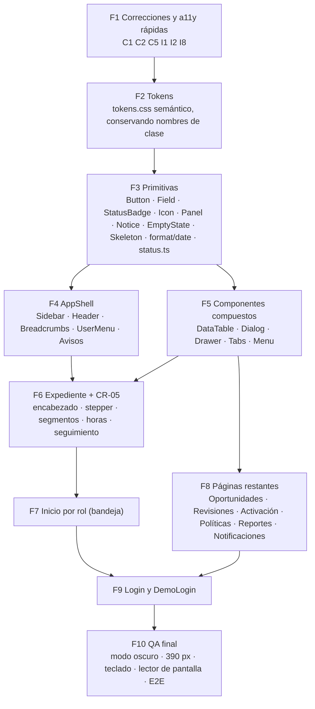

# Hoja de ruta de implementación — DH-05

> No se implementará nada hasta que haya aprobación explícita. Cada fase debe terminar con las cuatro verificaciones de `CLAUDE.md` en verde:
> 1. `npx vitest run --exclude "e2e/**"`
> 2. `npx tsc -b`
> 3. `npx vite build`
> 4. Si cambian flujos o selectores, también `python scripts/run_isolated_e2e.py`.

## 0000. Séptima sesión (2026-11-24): producto final, sin generar el ZIP

**Hecho y probado** (evidencia: `evaluacion-4/evidence/test-results-2026-11-24.md`)
- **Ajustes de datos de segmento** (migración `0019`, ADR-015).
  - Revisiones append-only con reglas por estado: la organización nunca se edita, y la unidad o el supervisor de un segmento activo solo cambian por transferencia.
  - El trigger exige la revisión en la misma transacción.
  - En el expediente: acción «Ajustar datos» e historial «Ajustes de datos».
- **Evidencia documental de condiciones** reutilizando el módulo documental (ítem opcional enlazado a la condición).
  - Aprobarla cumple la condición; revocarla la reabre.
  - Etiquetas «Seguro · segmento N» en «Mis documentos» y «Revisión documental».
- **Reporte de rotaciones:** filtro por estado de práctica y prueba de regresión de filtros y alcance por rol.
- **Fixture poblada** con fechas relativas al día de generación.
- **Secretos JWT publicados** rechazados fuera de `development` y `demo`.
- **Verificaciones externas:** guiones y listas de control en `docs/operacion/verificaciones-externas-pendientes.md`.

**Resueltas** (de la lista de la sexta sesión): editar datos de segmentos y adjuntar archivos a las condiciones de segmento.

**Siguen como limitación**
- El reporte se calcula en cada petición.
- No hubo revisión con lector de pantalla real ni pruebas con usuarios.
- No se auditaron dependencias contra bases externas.

**Pendiente de decisión institucional:** OPEN-CR05-01 a 06, sin cambios.

**Cómo retomar**
1. Ejecutar las verificaciones del encabezado y `--populated`.
2. Solo con autorización expresa, generar el paquete. **`evaluacion-4.zip` no se tocó en esta sesión y sigue en el estado del 2026-11-22 (0017).**
3. Sin `git add`, commits ni push.

## 000. Sexta sesión (2026-11-23/24): auditoría final, sin regenerar el ZIP

**Hecho y probado** (evidencia: `evaluacion-4/evidence/test-results-2026-11-23.md`)
- Excepciones temporales de CR-05: acortar o extender un segmento abierto, o mover uno planificado.
  - Migración `0018`, ADR-014, `POST /placements/{pid}/segments/{sid}/schedule`.
  - Historial append-only protegido por trigger, aviso `SEGMENT_CHANGED` y acción en el expediente.
- El filtro de organización del reporte de rotaciones incluye la organización del segmento.
- PPTX:
  - Desbordamiento corregido en la diapositiva 16.
  - Tipografía de las diapositivas 13–14 igualada al resto.
  - La diapositiva 13 ya no presenta como diseñado un acceso histórico que no lo está.
- Revisión visual de las 16 diapositivas. MD §6.9 actualizado; §1–6.8 idénticos al original.
- Resultados:
  - backend 126 superadas (CR-05: 15);
  - migraciones 0001→0018, 0010→0018 y ciclo 0018→0017→0018;
  - Vitest 52/52, `tsc -b` y build correctos;
  - E2E 18 superadas / 5 omitidas (`@populated`), y `--populated` 5/5;
  - demo `--smoke` con cabeza 0018.

**Resueltas** (de la lista de la quinta sesión): extender o acortar segmentos, y el filtro de organización del reporte.

**Siguen como limitación**
- Organización, unidad, supervisor, modalidad y responsabilidades de un segmento no se editan: se cambian por transferencia, o cancelando y planificando.
- El reporte se calcula en cada petición.
- Las condiciones documentales se confirman con una referencia escrita, sin archivo adjunto por segmento.

**Pendiente de decisión institucional:** OPEN-CR05-01 a 06, sin cambios.

**Cómo retomar**
1. Ejecutar las verificaciones del encabezado y `--populated`.
2. Cuando se autorice, regenerar el paquete con `python scripts/build_eval4_package.py`. **`evaluacion-4.zip` sigue en el estado del 2026-11-22 (0017).**
3. Sin `git add`, commits ni push.

## 00. Quinta sesión (2026-11-22/23): versión final de DH-05

**Hecho y probado**
- CR-05 completo en el backend: `GET /reports/rotations` (`reports/service.py::rotations`, mismo alcance que el reporte operativo, solo agregados) y avisos `SEGMENT_CHANGED` al activar, completar, terminar o transferir un segmento. El supervisor anterior no recibe avisos. Migración `0017`, que solo amplía las categorías de aviso. Decisión en ADR-013.
- Frontend: sección «Rotaciones y transferencias» en Reportes operativos (`RotationReportSection.tsx`, clases propias `.rotation-*`) y etiqueta del aviso en la bandeja.
- Defecto corregido: `PracticeDossier.tsx` refresca el expediente en el sitio tras una acción. Antes se desmontaba y se perdían el aviso de éxito, la pestaña y la posición.
- E2E nuevo `e2e/rotation.spec.ts` (`@populated`): transferencia con horas aceptadas conservadas, condición jurídica del destino, `404` para el supervisor anterior, avisos y reporte.
- Documentación (README, ADR-013, adr-review, arquitectura, contratos, migraciones, matriz de impacto y de trazabilidad, limitaciones, guion, instalación) y copias del MD (§6.9) y del PPTX (diapositivas 13–14) en `docs/cambio-e-impacto/`.
- Resultados en `evaluacion-4/evidence/test-results-2026-11-22.md`:
  - backend 125 superadas (CR-05: 14);
  - migraciones 0001→0017 y 0010→0017;
  - Vitest 51/51, `tsc -b` y build correctos;
  - E2E 18 superadas / 5 omitidas, y `--populated` 5/5;
  - demo `--smoke` con cabeza 0017.

**Implementado con limitaciones**
- Excepciones temporales: no se puede extender ni editar un segmento (se cancela y se planifica otro).
- El filtro de organización del reporte usa la organización de la oportunidad.
- El reporte se calcula en cada petición.

**Pendiente de decisión institucional**
- OPEN-CR05-01 a 06: quién gestiona segmentos, quién acepta horas, superposición, disputas, acceso histórico y evidencia tras una interrupción. Las dos autoridades siguen vacías por defecto.

**Bloqueos externos**
- Video de 5–6 minutos no grabado (hay guion).
- Sin revisión con lector de pantalla real ni con usuarios.
- Activos institucionales oficiales no recibidos.

**Cómo retomar**
1. Ejecutar las verificaciones del encabezado, más `run_isolated_e2e.py --populated`.
2. Si algo cambia, regenerar el paquete con `python scripts/build_eval4_package.py` (refresca `evaluacion-4/src`, `evaluacion-4/tests` y `evaluacion-4.zip`).
3. Sin `git add`, commits ni push.

## 0. Estado de implementación (actualizado el 2026-11-22, cuarta sesión: cierre de F10)

| Fase | Estado | Qué quedó hecho | Qué falta |
|---|---|---|---|
| F1 | **Completa** | C1 (fechas con `formatCalendarDate`), C2 (etiquetas), C5 (foco sólido), I1 (doble rol), I2 (badge), I8 (`Promise.all`) | — |
| F2 | **Completa** | Tokens en `theme.css`, paleta petróleo y grises fríos, modo oscuro por tokens, Source Sans 3 / Source Serif 4 locales (OFL), escala ≥12 px, radios 4/6/8. Media queries de `index.css` consolidadas en los cortes del tema (1023 / 767 / 420) | — |
| F3 | **Completa** | `Badge`, `Alert`, `EmptyState`, `Skeleton`, 34 iconos SVG, botones, tablas. **Nuevo:** `components/Field.tsx` (`Field` asocia etiqueta, pista y error con `aria-describedby`/`aria-invalid`; `useFieldErrors` enfoca el primer campo inválido) y `useAsyncAction.ts` (`busy`/`error`/`notice` y `run()` uniformes) | — (`Field` ya se usa en expediente, seguimiento, plan de trabajo, conversación y supervisión docente) |
| F4 | **Completa** | Sidebar institucional, header de 56 px, breadcrumbs, Avisos con contador, menú de perfil, rail y cajón móvil | — (focus trap implementado y probado con teclado) |
| F5 | **Completa** | `overlays.tsx`: `ConfirmProvider`/`useConfirm`, `Drawer`, `Tabs`/`TabPanel`, `DisabledReason`. Las pestañas ya no muestran barra de desplazamiento vertical | — |
| F6 | **Completa** | Expediente con stepper, panel de situación, horas, navegación de secciones; CR-05 como línea de tiempo con paneles laterales. **`PlacementSegments.tsx` dividido** (474 → 252 líneas) en `segments/SegmentFields`, `SegmentHours`, `SegmentItem`, `SegmentTransfers` sin cambiar marcado ni selectores | Rediseño interno de `PlacementFollowUp` y `PlacementWorkPlan` |
| F7 | **Completa** | Inicio como bandeja de trabajo por rol | — |
| F8 | **Completa** | **Oportunidades:** panel de datos con búsqueda, filtro por estado con conteos, tabla con celdas primaria/secundaria y acciones por fila; "Nueva oportunidad" y "Seleccionar" en panel lateral con `Field` y errores por campo. **Políticas:** cabecera de programa con versiones vigentes, una pestaña por tipo de política, procedencia de la versión vigente, condiciones en `fieldset`, motivo con error asociado y foco. **Documentos:** cada práctica como panel con resumen de requisitos (aprobados, en revisión, por entregar, con corrección), nota de activación con icono, registro de horas con `Field` y error en línea, tabla de requisitos con selector de archivo accesible y fila marcada si hay corrección. **Revisión documental:** cola única con contador y búsqueda, filas expandibles (`aria-expanded`/`aria-controls`), tabla de decisión con motivo validado en línea. **Solicitudes (Mis postulaciones):** panel con filtro por los estados presentes, resumen, acceso a documentos y expediente. Tablas de datos con modo apilado en móvil (`.data-table--stack`) | — |
| F9 | **Completa** | Login institucional sobrio; el pie del panel de marca comparte la columna centrada (bordes izquierdos a 104 px los tres bloques) | — |
| F10 | **Completa** | Media queries consolidadas (1023/767/420); selectores muertos eliminados. **Cuarta sesión:** focus trap del cajón de navegación móvil (foco al enlace actual al abrir, Tab/Shift+Tab confinados, `inert` en el contenido de fondo, Escape cierra y devuelve el foco al botón, cierre automático al pasar a escritorio); `Field` y `useFieldErrors` en `PlacementWorkPlan`, `PlacementFollowUp` (cambio, avance, evaluación, situación, informe final), `PlacementMessages` y `FacultyAssignmentManager`: etiqueta visible = nombre accesible, mismas reglas de validación evaluadas al enviar, error en línea con `aria-describedby`/`aria-invalid` y foco en el primer campo inválido, botón habilitado salvo durante el envío; auditoría `web-design-guidelines` (sin `transition: all`, sin `outline: none` sin reemplazo, sin `div` clicables, avisos con `role=alert/status`, `select` con color explícito en oscuro, marcadores de posición con «…», regla duplicada de `.drawer-content form` eliminada); auditoría visual automatizada (desbordamiento, recortes, contraste WCAG por texto, controles sin nombre) de los 7 roles, todas sus páginas, tema claro y oscuro, a 1440 px y 390 px, y tablet (768 px estudiante; ~730 px resto de roles). Defectos reales corregidos: expediente de vista única colapsado a 300 px (regla de F6 que anulaba `.dossier-layout--single`), desbordamiento horizontal de la página a 390 px en Oportunidades (texto `.sr-only` absoluto fuera de `.table-scroll`), badge recortado en Mis postulaciones a 768 px, navegación de secciones del expediente con enlaces ocultos y sin barra visible (ahora se ajusta en escritorio y muestra barra fina en móvil) | Revisión con lector de pantalla real (NVDA/VoiceOver) y con usuarios; el contraste se midió por cálculo sobre colores computados, no con una herramienta externa |

**Capturas reales:** `evaluacion-4/frontend-redesign/screenshots/` (`f3-*` y `f4-*`).

**Pruebas de la cuarta sesión (2026-11-22):** Vitest 16 archivos / 50 pruebas superadas; `tsc -b` sin errores; `vite build` correcto; E2E aislado 18 superadas / 4 omitidas (las `@populated`) / 0 fallidas; `--populated` 4/4. Auditoría visual y de accesibilidad: sin desbordamiento de página, recortes, contraste insuficiente ni controles sin nombre tras las correcciones.

**Diagnóstico de la demo (`Start isolated interactive demo`, exit code 4):** el registro de la API no contiene errores y atendió peticiones hasta las 23:10:21; el script no imprimió `TEMPORARY_DATABASE_CLEANED` ni la traza de su `RuntimeError`, y su carpeta temporal `dh05-eval3-demo-*` quedó sin borrar. El script solo sale con 0 (Ctrl+C o `--smoke`) o 1 (excepción con traza), así que el código 4 corresponde a una terminación externa del proceso por el entorno de ejecución de herramientas al cerrar la sesión, no a un fallo de la demo. No se modificó nada; la demo se volvió a arrancar sin problemas para la auditoría. Limitación: al matar el proceso de forma abrupta quedan carpetas temporales `dh05-eval3-demo-*` en `%TEMP%`, que pueden borrarse a mano.

**Pruebas de la tercera sesión:** Vitest 50/50, `tsc -b` y `vite build` correctos; E2E aislado 18 superadas / 4 omitidas (las `@populated`, que se ejecutan aparte); `--populated` 4/4. Un primer intento falló porque el encabezado "Postulaciones recibidas — {título}" y el estado vacío "No hay postulaciones." habían cambiado de texto; se restauraron los textos originales en lugar de tocar la prueba.

### Continuidad para la siguiente sesión

1. Arrancar la demo aislada: `PYTHONPATH=backend/.deps;backend`, `DATABASE_URL=''`, `python scripts/run_eval3_demo.py`; el puerto se imprime en la línea `FRONTEND=` y cambia en cada arranque.
2. Verificar: `npx vitest run --exclude "e2e/**"`, `npx tsc -b`, `npx vite build`, y el E2E aislado con el mismo `PYTHONPATH` (`python scripts/run_isolated_e2e.py` y `--populated`). **No editar `frontend/` mientras corre el E2E.**
3. Selectores E2E migrados: `acceptConfirm(page)` para confirmaciones; "Nueva oportunidad" abre el panel antes de `#opp-title`; la selección se hace en el `dialog` "Seleccionar a …" con "Confirmar selección"; en Políticas hay que pulsar la pestaña "Activación" antes de sus campos. Los formularios del expediente se localizan por su etiqueta visible ("Nombre de la actividad", "Detalle del avance", "Observaciones de la evaluación", "Resumen/Detalle de situación o cambio", "Archivo del informe final", "Mensaje de la práctica"). Textos y clases que deben conservarse: " · obligatorio" en el expediente, `.activity-list`, `.segment-hours-overview`, `.segment-heading`, `.dossier-hours-summary`, `.policy-program` con "cierre v1", `.policy-card`, `.document-placement`, `.document-review-card`, `.applications-table`, `.metric-value` y `.work-log-list` en Documentos.
4. Siguiente trabajo: revisión con lector de pantalla real, rediseño interno de `PlacementFollowUp`/`PlacementWorkPlan` (estructura, no solo campos), capturas nuevas para la entrega y regenerar `evaluacion-4.zip` cuando se apruebe.
5. No regenerar `evaluacion-4.zip` hasta terminar y validar todo el rediseño. Sin `git add`, commits ni push.

## 1. Auditoría de calidad (Fase E)

Se basa en web-design-guidelines (reglas de `references/command.md`), composition-patterns y react-best-practices (solo las reglas de cliente; las de Next.js/RSC no aplican).

### 1.1 Críticos (bloquean WCAG 2.1 AA o producen datos incorrectos)

| # | Hallazgo | Evidencia | Corrección |
|---|---|---|---|
| C1 | Fechas de solo día desplazadas un día y con hora | `PlacementFollowUp.tsx:89` (`formatHistoryDate` sobre `start_date`/`end_date`) | `formatDate` local (reutilizar `localDate`) |
| C2 | Etiquetas no asociadas a sus controles | `Opportunities.tsx:344/346/348/350`, `Policies.tsx:205/225` | `htmlFor`/`id` o el componente `Field` |
| C3 | Texto atenuado con contraste insuficiente en 9–11 px | `--muted-light`: 3,80 en superficie y 3,49 en página | Token `--color-text-muted` (≥5,04) y mínimo de 12 px |
| C4 | Borde de inputs por debajo de 3:1 | 1,64 en claro y 2,04 en oscuro | `--color-border-strong` (3,72 / 3,15) |
| C5 | Foco casi invisible | `outline: none` (`index.css:148`) y sombra al 16 % | `:focus-visible` con 2 px sólido |
| C6 | Estado transmitido solo por color (y casi todo en gris) | `statusTone()` con 3 tonos | `StatusBadge` con icono y 5 tonos |
| C7 | Errores sin anuncio ni movimiento de foco | Avisos en la cabecera de la página | Región viva y foco al resumen de errores |
| C8 | Navegación con `<button>` y no con enlaces | `Layout.tsx` | `<a href="#/…">` y `aria-current` |
| C9 | Tabs incompletos | `PlacementMessages.tsx:58` | Tabs con ARIA completo |

### 1.2 Importantes (calidad y consistencia)

| # | Hallazgo | Evidencia | Corrección |
|---|---|---|---|
| I1 | Doble hero en cuentas con dos roles | `Dashboard.tsx:201` y `:231` | Composición por secciones |
| I2 | Badge del expediente partido | Falta `flex-shrink: 0` | Estilo de StatusBadge |
| I3 | 7 `window.confirm` | Varios componentes | `ConfirmDialog` |
| I4 | Componentes sobredimensionados con modos booleanos | `PlacementSegments` (364 l.), `PlacementFollowUp` (270 l.) | §4 del catálogo |
| I5 | Patrón busy/error/notice repetido | La mayoría de los formularios | `useAsyncAction` |
| I6 | Doble capa CSS con sobrescrituras: 78 literales hex, 13 `!important` y 54 overrides oscuros | `index.css` + `theme.css` | `tokens.css` semántico |
| I7 | 78 declaraciones de tamaño ≤11 px y una tipografía "Inter" declarada pero no cargada | CSS | Escala tipográfica y fuente cargada o pila del sistema |
| I8 | `await` secuencial en un bucle | `Activation.tsx:21` | `Promise.all` |
| I9 | Parpadeo al recargar el expediente | `setDossier(null)` | Mantener los datos previos y un indicador sutil |
| I10 | Índice del expediente no fijo; en móvil va antes del detalle | `PracticeDossier.tsx` | SectionIndex responsive |
| I11 | Cabecera móvil de ~110 px | `Layout.tsx` | Header de 56 px y cajón |
| I12 | Iconos con glifos de texto (`☰ × ‹ › ◐ →`) | Varios | Set SVG ampliado |
| I13 | Botones deshabilitados sin motivo | Activación y segmentos | Motivo visible y `aria-describedby` |

### 1.3 Opcionales (mejora)

- **O1** — Eliminar `backdrop-filter: blur` del topbar y el `translateY` del hover.
- **O2** — Sustituir los 19 estilos en línea por clases.
- **O3** — N+1 de `listApplicationsForOpportunity` en el inicio del empleador. Se puede mitigar con `Promise.all`; la solución completa requiere un endpoint agregado, que **queda fuera de alcance**.
- **O4** — Paginación en cliente para listas de más de 25 filas.
- **O5** — Enlace profundo `#/dossier/:id`, que requiere aprobación.
- **O6** — `content-visibility: auto` en las secciones largas del expediente.

## 2. Fases

| Fase | Contenido | Archivos principales | Riesgo | Verificación adicional |
|---|---|---|---|---|
| F1 | Correcciones C1, C2, C5, I1, I2 e I8 | `PlacementFollowUp.tsx`, `Opportunities.tsx`, `Policies.tsx`, `index.css`, `Dashboard.tsx`, `Activation.tsx` | Bajo | Prueba unitaria de `formatDate` con fechas límite; revisión a 390 px |
| F2 | Tokens semánticos; `index.css` y `theme.css` pasan a consumirlos sin cambiar clases | `styles/tokens.css`, `index.css`, `theme.css` | Medio (regresión visual) | Capturas antes/después de las 13 páginas, en claro y oscuro |
| F3 | Primitivas y utilidades | `components/ui/*`, `status.ts`, `format/date.ts` | Bajo | Pruebas unitarias de `status.ts` (todos los estados conocidos) |
| F4 | Shell | `Layout.tsx` → `AppShell` | Medio (E2E de navegación) | E2E aislado y teclado completo |
| F5 | Componentes compuestos | `components/ui/*` | Bajo | Pruebas de interacción (Esc, foco y flechas) |
| F6 | Expediente y CR-05 | `PracticeDossier.tsx`, `PlacementSegments.tsx`, `HoursReviewList.tsx`, `PlacementFollowUp.tsx`, `PlacementWorkPlan.tsx`, `PlacementMessages.tsx` | **Alto** (flujos CR-05 y selectores E2E) | `api.segments.test.ts`, `api.followup.test.ts` y E2E `lifecycle.spec.ts` |
| F7 | Inicio | `Dashboard.tsx` | Medio | Cuentas dual1, estudiante y coordinación |
| F8 | Resto de páginas | Páginas restantes | Medio | E2E aislado |
| F9 | Acceso | `Login.tsx`, `DemoLogin.tsx` | Bajo | Contraste del botón y el flujo de demo |
| F10 | QA | — | — | Lista de §4 |

Cada fase es un incremento entregable que se puede revisar por separado. No se mezclan fases en un mismo cambio.

## 3. Riesgos y dependencias

| Riesgo o dependencia | Impacto | Mitigación |
|---|---|---|
| Los selectores E2E dependen de textos y clases (`.segment-heading`, "Segmento 1 · ") | Fallos en `lifecycle.spec.ts` | Conservar los textos visibles; si cambian clases, actualizar el spec en la misma fase |
| Fuentes Source Sans 3 / Source Serif 4 (OFL) alojadas en `public/fonts` | Recursos nuevos de unos 160 kB | **Requiere aprobación.** Sin ella se usa la pila del sistema |
| Ruta `#/dossier/:id` | Cambio de rutas | **Requiere aprobación.** Hasta entonces se mantiene sessionStorage |
| Identidad institucional (escudo, colores y tipografía oficiales) | No existe | La marca queda aislada en `--brand-*`; hay que pedir los recursos oficiales a Horizon University |
| Paquete de entrega `evaluacion-4.zip` | `scripts/build_eval4_package.py` incluiría `frontend-redesign/` | **No se ha regenerado.** Solo se hará con aprobación |
| Cambios CR-05 sin commit en el árbol de trabajo | Conflictos al refactorizar | Implementar sobre el estado actual sin revertir nada; revisión de diff por fase |
| Modo oscuro | Regresiones por eliminar los 54 overrides | Solo redefinir los tokens semánticos; QA en F2 y F10 |
| Sin endpoints nuevos | Algunas mejoras (N+1 y contadores globales) son limitadas | Usar solo los datos ya cargados; se documenta lo que queda fuera |

## 4. Estrategia de pruebas

- **Unitarias (Vitest):** `formatDate`/`formatDateTime` (zonas horarias y fechas límite), `status.ts` (cobertura total de estados por entidad), los derivados del LifecycleStepper desde `placement.state`/`application.state` y `useAsyncAction`.
- **Tipos:** `npx tsc -b` en cada fase. IconButton exige `label` por tipo.
- **Build:** `npx vite build`, revisando que el tamaño del bundle no crezca de forma significativa (no hay dependencias nuevas).
- **E2E aislado:** `python scripts/run_isolated_e2e.py` en F4, F6, F7, F8 y F10.
- **Manual por fase:**
  - 390 px sin scroll horizontal;
  - 768 y 1440 px;
  - navegación solo con teclado;
  - foco visible;
  - lector de pantalla (NVDA) en el expediente y los formularios;
  - `prefers-reduced-motion`;
  - modo oscuro.
- **Revisión final** con la skill web-design-guidelines sobre los archivos modificados.

## 5. Elementos que requieren aprobación antes de empezar

1. Aprobación general de esta propuesta y del orden de fases.
2. Fuentes alojadas en el proyecto (o confirmar la pila del sistema).
3. Ruta de enlace profundo `#/dossier/:id` (opcional).
4. Regenerar `evaluacion-4.zip` con la carpeta `frontend-redesign/` (opcional).
