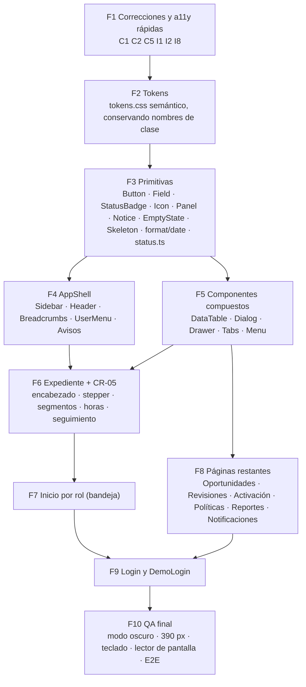

# Hoja de ruta de implementación — DH-05

> No se implementará nada hasta que haya aprobación explícita. Cada fase debe terminar con las cuatro verificaciones de `CLAUDE.md` en verde:
> 1. `npx vitest run --exclude "e2e/**"`
> 2. `npx tsc -b`
> 3. `npx vite build`
> 4. Si cambian flujos o selectores, también `python scripts/run_isolated_e2e.py`.

## 0. Estado de implementación (actualizado el 2026-11-21)

| Fase | Estado | Qué quedó hecho | Qué falta |
|---|---|---|---|
| F1 | **Completa** | C1 (fechas con `formatCalendarDate`), C2 (etiquetas), C5 (foco sólido), I1 (doble rol), I2 (badge), I8 (`Promise.all`) | — |
| F2 | **Completa** | Tokens definitivos en `theme.css` (marca `--brand-*`, semánticos, alias legados), paleta petróleo y grises fríos, modo oscuro solo por tokens, Source Sans 3 / Source Serif 4 alojadas en `public/fonts` (OFL, vía Fontsource 5.2.8/5.2.9), escala tipográfica ≥12 px, radios 4/6/8, sin sombras en paneles. `index.css` sin tokens duplicados ni hex (salvo `#fff` heredado) y con `!important` solo en reduced-motion | Eliminar las media queries antiguas de `index.css` (1100/820/680/420) a favor de 767/1023 |
| F3 | **Completa (sin componentes nuevos de formulario)** | `Badge` con tono, icono y texto (5 tonos), `Alert` con icono, `EmptyState` con icono, `Skeleton`, set de 34 iconos SVG, botones (primario, secundario, peligro, enlace, ghost, small), inputs/selects con borde 3,72:1, tablas con encabezado sobrio, etiquetas en MAYÚSCULAS eliminadas, flechas "→" eliminadas | `Field` con `aria-describedby`/errores y `useAsyncAction` (F5/F6) |
| F4 | **Completa** | `Layout.tsx`: sidebar oscura institucional con enlaces `<a href>`, grupos por rol (mismas reglas que `canAccessSection`), header de 56 px, breadcrumbs, botón Avisos con contador de no leídas (`listNotifications`, sin endpoint nuevo), menú de perfil con roles, Cerrar sesión, rail en tableta y desktop contraído, cajón móvil | Focus trap completo en el cajón móvil |
| F5 | Pendiente | — | DataTable, ConfirmDialog (7 `window.confirm`), Drawer, Tabs ARIA |
| F6–F10 | Pendientes | — | Ver §2 |

**Capturas reales:** `evaluacion-4/frontend-redesign/screenshots/` (`f3-*` tras F3, `f4-*` tras F4).

### Continuidad para la siguiente sesión

1. Arrancar la demo aislada: `PYTHONPATH=backend/.deps;backend`, `DATABASE_URL=''`, `python scripts/run_eval3_demo.py` y entrar por `#/demo-login`.
2. Verificar: `npx vitest run --exclude "e2e/**"`, `npx tsc -b`, `npx vite build`, y el E2E aislado con el mismo `PYTHONPATH` (`python scripts/run_isolated_e2e.py` y `--populated`). **No editar archivos de `frontend/` mientras corre el E2E** (Vite recarga y provoca timeouts falsos).
3. Regenerar capturas: script Playwright usado en esta sesión (iniciar sesión con el botón de la cuenta demo, `page.screenshot`), guardando en `screenshots/` con prefijo de fase.
4. Siguiente trabajo: F5 (ConfirmDialog con `<dialog>` para los 7 `window.confirm`, Tabs ARIA en `PlacementMessages.tsx`, Drawer para formularios de segmento) y luego F6 (expediente: índice fijo, stepper, división de `PlacementSegments`).
5. Selectores E2E ya migrados: navegación lateral usa `getByRole("link")`; eyebrows del inicio en tipo oración; fondo oscuro `rgb(14, 20, 24)`; `theme-color` oscuro `#0e1418`.
6. No regenerar `evaluacion-4.zip` hasta terminar y validar todo el rediseño.

## 1. Auditoría de calidad (Fase E)

Se basa en web-design-guidelines (reglas de `references/command.md`), composition-patterns y react-best-practices (solo las reglas de cliente; las de Next.js/RSC no aplican).

### 1.1 Críticos (bloquean WCAG 2.1 AA o producen datos incorrectos)

| # | Hallazgo | Evidencia | Corrección |
|---|---|---|---|
| C1 | Fechas de solo día desplazadas un día y con hora | `PlacementFollowUp.tsx:89` (`formatHistoryDate` sobre `start_date`/`end_date`) | `formatDate` local (reutilizar `localDate`) |
| C2 | Etiquetas no asociadas a sus controles | `Opportunities.tsx:344/346/348/350`, `Policies.tsx:205/225` | `htmlFor`/`id` o el componente `Field` |
| C3 | Texto atenuado con contraste insuficiente en 9–11 px | `--muted-light`: 3,80 en superficie y 3,49 en página | Token `--color-text-muted` (≥5,04) y mínimo de 12 px |
| C4 | Borde de inputs por debajo de 3:1 | 1,64 en claro y 2,04 en oscuro | `--color-border-strong` (3,72 / 3,15) |
| C5 | Foco casi invisible | `outline: none` (`index.css:148`) y sombra al 16 % | `:focus-visible` con 2 px sólido |
| C6 | Estado transmitido solo por color (y casi todo en gris) | `statusTone()` con 3 tonos | `StatusBadge` con icono y 5 tonos |
| C7 | Errores sin anuncio ni movimiento de foco | Avisos en la cabecera de la página | Región viva y foco al resumen de errores |
| C8 | Navegación con `<button>` y no con enlaces | `Layout.tsx` | `<a href="#/…">` y `aria-current` |
| C9 | Tabs incompletos | `PlacementMessages.tsx:58` | Tabs con ARIA completo |

### 1.2 Importantes (calidad y consistencia)

| # | Hallazgo | Evidencia | Corrección |
|---|---|---|---|
| I1 | Doble hero en cuentas con dos roles | `Dashboard.tsx:201` y `:231` | Composición por secciones |
| I2 | Badge del expediente partido | Falta `flex-shrink: 0` | Estilo de StatusBadge |
| I3 | 7 `window.confirm` | Varios componentes | `ConfirmDialog` |
| I4 | Componentes sobredimensionados con modos booleanos | `PlacementSegments` (364 l.), `PlacementFollowUp` (270 l.) | §4 del catálogo |
| I5 | Patrón busy/error/notice repetido | La mayoría de los formularios | `useAsyncAction` |
| I6 | Doble capa CSS con sobrescrituras: 78 literales hex, 13 `!important` y 54 overrides oscuros | `index.css` + `theme.css` | `tokens.css` semántico |
| I7 | 78 declaraciones de tamaño ≤11 px y una tipografía "Inter" declarada pero no cargada | CSS | Escala tipográfica y fuente cargada o pila del sistema |
| I8 | `await` secuencial en un bucle | `Activation.tsx:21` | `Promise.all` |
| I9 | Parpadeo al recargar el expediente | `setDossier(null)` | Mantener los datos previos y un indicador sutil |
| I10 | Índice del expediente no fijo; en móvil va antes del detalle | `PracticeDossier.tsx` | SectionIndex responsive |
| I11 | Cabecera móvil de ~110 px | `Layout.tsx` | Header de 56 px y cajón |
| I12 | Iconos con glifos de texto (`☰ × ‹ › ◐ →`) | Varios | Set SVG ampliado |
| I13 | Botones deshabilitados sin motivo | Activación y segmentos | Motivo visible y `aria-describedby` |

### 1.3 Opcionales (mejora)

- **O1** — Eliminar `backdrop-filter: blur` del topbar y el `translateY` del hover.
- **O2** — Sustituir los 19 estilos en línea por clases.
- **O3** — N+1 de `listApplicationsForOpportunity` en el inicio del empleador. Se puede mitigar con `Promise.all`; la solución completa requiere un endpoint agregado, que **queda fuera de alcance**.
- **O4** — Paginación en cliente para listas de más de 25 filas.
- **O5** — Enlace profundo `#/dossier/:id`, que requiere aprobación.
- **O6** — `content-visibility: auto` en las secciones largas del expediente.

## 2. Fases

| Fase | Contenido | Archivos principales | Riesgo | Verificación adicional |
|---|---|---|---|---|
| F1 | Correcciones C1, C2, C5, I1, I2 e I8 | `PlacementFollowUp.tsx`, `Opportunities.tsx`, `Policies.tsx`, `index.css`, `Dashboard.tsx`, `Activation.tsx` | Bajo | Prueba unitaria de `formatDate` con fechas límite; revisión a 390 px |
| F2 | Tokens semánticos; `index.css` y `theme.css` pasan a consumirlos sin cambiar clases | `styles/tokens.css`, `index.css`, `theme.css` | Medio (regresión visual) | Capturas antes/después de las 13 páginas, en claro y oscuro |
| F3 | Primitivas y utilidades | `components/ui/*`, `status.ts`, `format/date.ts` | Bajo | Pruebas unitarias de `status.ts` (todos los estados conocidos) |
| F4 | Shell | `Layout.tsx` → `AppShell` | Medio (E2E de navegación) | E2E aislado y teclado completo |
| F5 | Componentes compuestos | `components/ui/*` | Bajo | Pruebas de interacción (Esc, foco y flechas) |
| F6 | Expediente y CR-05 | `PracticeDossier.tsx`, `PlacementSegments.tsx`, `HoursReviewList.tsx`, `PlacementFollowUp.tsx`, `PlacementWorkPlan.tsx`, `PlacementMessages.tsx` | **Alto** (flujos CR-05 y selectores E2E) | `api.segments.test.ts`, `api.followup.test.ts` y E2E `lifecycle.spec.ts` |
| F7 | Inicio | `Dashboard.tsx` | Medio | Cuentas dual1, estudiante y coordinación |
| F8 | Resto de páginas | Páginas restantes | Medio | E2E aislado |
| F9 | Acceso | `Login.tsx`, `DemoLogin.tsx` | Bajo | Contraste del botón y el flujo de demo |
| F10 | QA | — | — | Lista de §4 |

Cada fase es un incremento entregable que se puede revisar por separado. No se mezclan fases en un mismo cambio.

## 3. Riesgos y dependencias

| Riesgo o dependencia | Impacto | Mitigación |
|---|---|---|
| Los selectores E2E dependen de textos y clases (`.segment-heading`, "Segmento 1 · ") | Fallos en `lifecycle.spec.ts` | Conservar los textos visibles; si cambian clases, actualizar el spec en la misma fase |
| Fuentes Source Sans 3 / Source Serif 4 (OFL) alojadas en `public/fonts` | Recursos nuevos de unos 160 kB | **Requiere aprobación.** Sin ella se usa la pila del sistema |
| Ruta `#/dossier/:id` | Cambio de rutas | **Requiere aprobación.** Hasta entonces se mantiene sessionStorage |
| Identidad institucional (escudo, colores y tipografía oficiales) | No existe | La marca queda aislada en `--brand-*`; hay que pedir los recursos oficiales a Horizon University |
| Paquete de entrega `evaluacion-4.zip` | `scripts/build_eval4_package.py` incluiría `frontend-redesign/` | **No se ha regenerado.** Solo se hará con aprobación |
| Cambios CR-05 sin commit en el árbol de trabajo | Conflictos al refactorizar | Implementar sobre el estado actual sin revertir nada; revisión de diff por fase |
| Modo oscuro | Regresiones por eliminar los 54 overrides | Solo redefinir los tokens semánticos; QA en F2 y F10 |
| Sin endpoints nuevos | Algunas mejoras (N+1 y contadores globales) son limitadas | Usar solo los datos ya cargados; se documenta lo que queda fuera |

## 4. Estrategia de pruebas

- **Unitarias (Vitest):** `formatDate`/`formatDateTime` (zonas horarias y fechas límite), `status.ts` (cobertura total de estados por entidad), los derivados del LifecycleStepper desde `placement.state`/`application.state` y `useAsyncAction`.
- **Tipos:** `npx tsc -b` en cada fase. IconButton exige `label` por tipo.
- **Build:** `npx vite build`, revisando que el tamaño del bundle no crezca de forma significativa (no hay dependencias nuevas).
- **E2E aislado:** `python scripts/run_isolated_e2e.py` en F4, F6, F7, F8 y F10.
- **Manual por fase:**
  - 390 px sin scroll horizontal;
  - 768 y 1440 px;
  - navegación solo con teclado;
  - foco visible;
  - lector de pantalla (NVDA) en el expediente y los formularios;
  - `prefers-reduced-motion`;
  - modo oscuro.
- **Revisión final** con la skill web-design-guidelines sobre los archivos modificados.

## 5. Elementos que requieren aprobación antes de empezar

1. Aprobación general de esta propuesta y del orden de fases.
2. Fuentes alojadas en el proyecto (o confirmar la pila del sistema).
3. Ruta de enlace profundo `#/dossier/:id` (opcional).
4. Regenerar `evaluacion-4.zip` con la carpeta `frontend-redesign/` (opcional).
