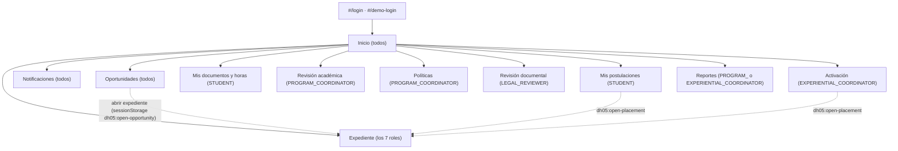
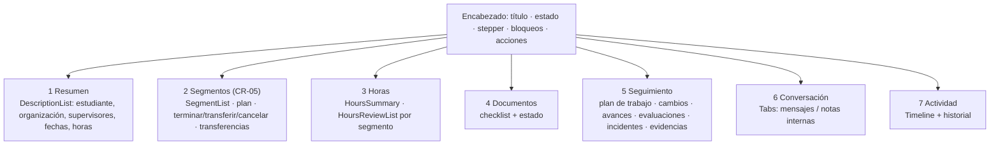

# Rediseño página por página — DH-05

> Cada propuesta conserva **todas** las funciones, llamadas a la API y permisos actuales (`canAccessSection`, `App.tsx:38`). Solo cambian la estructura, la jerarquía y los componentes de presentación. Las referencias `archivo:línea` apuntan al código real auditado en `frontend-audit.md`.

## 0. Mapa de páginas y roles

**No existe un rol "administrador"** en el frontend ni en el backend. La experiencia de "administración" la reparten PROGRAM_COORDINATOR (políticas, revisión académica y reportes) y EXPERIENTIAL_COORDINATOR (activación, segmentos y transferencias). No se propone crear ese rol.

### Diferencias de experiencia por perfil

| Perfil | Rol(es) | Pregunta principal al entrar | Página ancla |
|---|---|---|---|
| Estudiante | STUDENT | "¿En qué etapa estoy y qué me falta?" | Inicio (recorrido) → Expediente |
| Supervisor de centro | WORKPLACE_SUPERVISOR, HOST_ORG_MEMBER | "¿Qué horas y avances debo revisar?" | Inicio (bandeja) → Expediente / Horas |
| Supervisor académico | FACULTY_SUPERVISOR | "¿Qué evaluaciones y revisiones combinadas tengo pendientes?" | Inicio → Expediente / Seguimiento |
| Coordinación de programa | PROGRAM_COORDINATOR | "¿Qué aprobaciones académicas y elegibilidades esperan?" | Revisión académica |
| Coordinación experiencial | EXPERIENTIAL_COORDINATOR | "¿Qué prácticas puedo activar y qué segmentos o transferencias gestionar?" | Activación → Expediente / Segmentos |
| Revisión legal | LEGAL_REVIEWER | "¿Qué documentos esperan verificación?" | Revisión documental |

---

## 1. Inicio (`Dashboard.tsx`)

| Aspecto | Propuesta |
|---|---|
| **Objetivo** | Pasar de un tablero decorativo de tarjetas a una **bandeja de trabajo**: lo que requiere acción hoy, por rol. |
| **Usuario** | Todos. El contenido se compone según los roles. |
| **Problemas actuales** | El hero y las BentoCard muestran métricas sin acción asociada. Las cuentas con dos roles ven **dos heroes** (`Dashboard.tsx:201` y `:231`). Para el empleador hay un bucle N+1 de `listApplicationsForOpportunity`. Hay estados vacíos genéricos y eyebrows decorativas. |
| **Nueva estructura** | (1) PageHeader "Inicio" con un saludo sobrio y la fecha. (2) Para el **estudiante**: LifecycleStepper de su práctica más reciente y la siguiente acción (`studentJourney.ts`). (3) **Bandeja de pendientes** como lista única ordenada por antigüedad, con secciones por rol: activaciones pendientes, documentos por revisar, aprobaciones académicas, elegibilidades y horas por revisar. (4) Columna de apoyo con "Mis prácticas visibles" (`listVisiblePlacements`) y los últimos avisos. |
| **Jerarquía** | Siguiente acción > pendientes con antigüedad > contexto (prácticas y avisos). Las cifras van en una sola línea resumen ("3 activaciones · 2 documentos"), no en tarjetas grandes. |
| **Componentes** | PageHeader, LifecycleStepper, Section, WorkItem (fila con StatusBadge, título, antigüedad y botón "Abrir"), EmptyState ("No tienes pendientes"), Skeleton. |
| **Acciones principales** | "Abrir expediente", "Revisar documento", "Activar" y "Ver oportunidad". Cada fila lleva a su página con el contexto actual (sessionStorage). |
| **Info prioritaria** | Estado de la práctica, bloqueos (`completionBlocker`, `segmentGateBlockers`) y número de pendientes por tipo. |
| **Responsive** | Escritorio: 8 + 4 columnas. Tableta y móvil: una columna, con la bandeja primero y el contexto después. |
| **Nota** | Corrección de doble rol: se compone **un** encabezado y N secciones por rol. No se elimina ningún bloque actual; los heroes se convierten en secciones. |

## 2. Oportunidades (`Opportunities.tsx`)

| Aspecto | Propuesta |
|---|---|
| **Objetivo** | Explorar, crear y gestionar ofertas de práctica; postular (estudiante). |
| **Usuario** | Todos. Crean ofertas HOST_ORG_MEMBER y las coordinaciones según los permisos actuales. |
| **Problemas** | El formulario de creación tiene etiquetas sin asociar (`Opportunities.tsx:344/346/348/350`). Hay tarjetas extensas en lugar de una lista comparable. El estado se muestra solo por color. El formulario está siempre visible y compite con el listado. |
| **Nueva estructura** | PageHeader con la acción "Nueva oportunidad", que abre un **Drawer** con el formulario. Barra de filtros (texto, estado, programa), solo en cliente y sobre los datos ya cargados. DataTable con título, organización, programa, cupos, estado y "Abrir". En móvil se usa la lista apilada. |
| **Jerarquía** | Título y estado > organización y programa > fechas y cupos. |
| **Componentes** | DataTable, Toolbar, StatusBadge (entidad `opportunity`), Drawer, Field/Input/Select/Textarea, EmptyState con la acción "Crear la primera oportunidad" (si hay permiso). |
| **Acciones** | Crear, publicar, postular y abrir expediente. Son las mismas llamadas actuales. |
| **Responsive** | Columnas secundarias ocultas en tableta y filas apiladas en móvil. El Drawer ocupa la pantalla completa en móvil. |

## 3. Mis postulaciones (`Applications.tsx`)

| Aspecto | Propuesta |
|---|---|
| **Objetivo** | Seguir el estado de cada postulación del estudiante. |
| **Usuario** | STUDENT. |
| **Problemas** | Lista de tarjetas sin orden claro. "SUBMITTED" aparece en gris, igual que un borrador. No hay acceso directo al expediente con el estado visible. |
| **Nueva estructura** | Tabla: oportunidad, organización, fecha de envío, estado (StatusBadge `application`) y siguiente paso. La fila enlaza con el expediente (`dh05:open-placement`). |
| **Componentes** | DataTable, StatusBadge, EmptyState ("Aún no has postulado" con enlace a Oportunidades). |
| **Info prioritaria** | Estado y siguiente paso. |
| **Responsive** | Lista apilada en móvil. |

## 4. Mis documentos y horas (`Documents.tsx`)

| Aspecto | Propuesta |
|---|---|
| **Objetivo** | Que el estudiante cargue documentos requeridos y registre horas. |
| **Usuario** | STUDENT. |
| **Problemas** | Mezcla requisitos, cargas y horas en bloques de igual peso. Los errores aparecen arriba sin mover el foco. El input de archivo es nativo y no tiene estilo coherente. |
| **Nueva estructura** | Dos secciones con anclas: **Documentos requeridos** (checklist: requisito, estado, fecha y botón "Cargar" o "Reemplazar") y **Registro de horas** (formulario compacto + tabla de registros con estado de revisión). Si la práctica tiene segmentos (CR-05), el formulario de horas pide el segmento con un Select alimentado por los datos ya disponibles. |
| **Componentes** | Section, Checklist (DataTable simple), FileInput, Field, DataTable, StatusBadge (`document`, `hours`), Alert inline por formulario. |
| **Acciones** | Cargar documento y registrar horas. |
| **Info prioritaria** | Requisitos faltantes y horas acumuladas frente a las requeridas (HoursSummary). |
| **Responsive** | Formulario de una columna en móvil y tabla apilada. |

## 5. Revisión académica (`AcademicReview.tsx`)

| Aspecto | Propuesta |
|---|---|
| **Objetivo** | Aprobar o rechazar prácticas y resolver revisiones de elegibilidad. |
| **Usuario** | PROGRAM_COORDINATOR. |
| **Problemas** | Las colas de aprobación y de elegibilidad son tarjetas largas. El motivo de rechazo está en un campo suelto. El rechazo se confirma con `window.confirm`. |
| **Nueva estructura** | Tabs con ARIA completo: "Aprobación académica (n)" y "Elegibilidad (n)". Cada una es un DataTable con el panel de detalle a la derecha en escritorio (master–detail). El detalle incluye EligibilitySummary, las condiciones y los botones Aprobar/Rechazar. Rechazar abre un **ConfirmDialog** con un motivo obligatorio. |
| **Componentes** | Tabs, DataTable, SidePanel, EligibilitySummary (reutilizado), ConfirmDialog, Textarea con contador. |
| **Info prioritaria** | Estudiante, programa, días en cola y resultado de elegibilidad. |
| **Responsive** | En tableta y móvil el detalle reemplaza la lista, con "Volver a la lista". |

## 6. Políticas (`Policies.tsx`)

| Aspecto | Propuesta |
|---|---|
| **Objetivo** | Gestionar las políticas de elegibilidad y requisitos por programa (configuración sintética de la demo). |
| **Usuario** | PROGRAM_COORDINATOR. |
| **Problemas** | Etiquetas sin asociar (`Policies.tsx:205/225`). Las versiones de una política no se distinguen visualmente. |
| **Nueva estructura** | Lista de políticas (tabla: programa, versión, vigencia y estado) y detalle en una DescriptionList. El formulario de edición o creación va en un Drawer. Un aviso fijo indica que los valores son **ejemplos sintéticos** y no política institucional. |
| **Componentes** | DataTable, DescriptionList, Drawer, Field, Alert (`info`). |
| **Responsive** | Estándar de tabla y drawer. |

## 7. Revisión documental (`DocumentReview.tsx`)

| Aspecto | Propuesta |
|---|---|
| **Objetivo** | Verificar documentos cargados. |
| **Usuario** | LEGAL_REVIEWER. |
| **Problemas** | Cola en tarjetas. La referencia verificada y el motivo están en campos sin jerarquía. Hay un rechazo con `window.confirm`. |
| **Nueva estructura** | Master–detail como en la Revisión académica: cola (documento, estudiante, tipo y antigüedad) y detalle con metadatos, enlace al archivo, el campo "Referencia verificada" (monoespaciado) y Aprobar/Rechazar con ConfirmDialog. |
| **Componentes** | DataTable, SidePanel, DescriptionList, Field, ConfirmDialog. |
| **Info prioritaria** | Tipo de documento, vencimiento y antigüedad en cola. |

## 8. Activación (`Activation.tsx`)

| Aspecto | Propuesta |
|---|---|
| **Objetivo** | Activar las prácticas que cumplen todos los requisitos. |
| **Usuario** | EXPERIENTIAL_COORDINATOR. |
| **Problemas** | Carga secuencial con `await` dentro del bucle (`Activation.tsx:21`), que es lento con varias prácticas. No queda claro qué requisito bloquea cada fila. |
| **Nueva estructura** | Tabla: práctica, estudiante, organización, requisitos (indicador "4/5 cumplidos" con detalle desplegable) y la acción "Activar", deshabilitada **con motivo visible**. |
| **Componentes** | DataTable, RequirementsIndicator, Button con estado de carga y ConfirmDialog. |
| **Rendimiento** | `Promise.all` para cargar el detalle (sin cambiar los endpoints). |

## 9. Expediente (`PracticeDossier.tsx`) — página central

### 9.1 Ficha

| Aspecto | Propuesta |
|---|---|
| **Objetivo** | Una fuente única de verdad de la práctica: estado, segmentos, horas, documentos, seguimiento, conversación y actividad. |
| **Usuario** | Los 7 roles. Cada sección se muestra según los permisos actuales; no se amplía ninguno. |
| **Problemas** | Índice izquierdo de 12 elementos que no es fijo y queda vacío al hacer scroll. En móvil el índice aparece antes del detalle. El badge del encabezado se corta ("Rechazad / o") por falta de `flex-shrink: 0`. Las fechas se desplazan un día (`PlacementFollowUp.tsx:89`). Los avisos se acumulan por componente. La selección no está en la URL. |
| **Nueva estructura** | **Encabezado del expediente**: título (serif), StatusBadge, LifecycleStepper, línea de bloqueos y acciones primarias según el rol. Debajo, un índice de secciones (fijo en ≥1440 px) y el detalle en secciones de documento. |

### 9.2 Encabezado y LifecycleStepper

- **Etapas:** Postulación → Selección → Aprobación académica → Documentación → Activa → Completada → Cerrada.
- **Rechazada o Cancelada** se muestra como desvío: la etapa alcanzada queda marcada con un icono de peligro y texto.
- Los datos se derivan de `placement.state` y `application.state`, que ya están disponibles. No hace falta una API nueva.
- **Línea de bloqueos:** textos de `segmentGateBlockers` y `completionBlocker`, cada uno con un enlace a la sección correspondiente.

### 9.3 Segmentos y transferencias (CR-05, `PlacementSegments.tsx`)

| Aspecto | Propuesta |
|---|---|
| **Problemas** | El componente tiene 364 líneas y un `panel.kind` con modos booleanos para terminar, transferir y cancelar. El formulario aparece incrustado dentro del segmento y desplaza el contenido. Las transferencias se mezclan con los segmentos. |
| **Estructura** | (a) **SegmentList** ordenada: cada SegmentItem muestra "Segmento N · organización", fechas, StatusBadge (`PLANNED`, `ACTIVE`, `COMPLETED`, `TERMINATED_EARLY`, `TRANSFERRED`, `CANCELLED`), horas aprobadas/registradas y supervisor. (b) Acciones del segmento en el menú "Más acciones": Terminar anticipadamente, Transferir y Cancelar. Cada una abre su **Drawer** con un formulario propio (SegmentEndForm en variantes explícitas). (c) "Planificar segmento" es la acción primaria de la sección (SegmentPlanForm). (d) **Transferencias** en una subsección propia (tabla de origen → destino, fecha, motivo y estado). (e) **Revisión combinada** (CombinedReview) al final, visible solo cuando aplica. |
| **Info prioritaria** | Qué segmento está activo, cuántas horas faltan y si algún segmento bloquea la finalización. |
| **Accesibilidad** | Las acciones destructivas usan ConfirmDialog con un resumen de consecuencias. Los motivos son obligatorios, con un error asociado mediante `aria-describedby`. |
| **E2E** | Se conservan los textos "Segmento 1 · " y la clase `.segment-heading`, o se migran los selectores en el mismo paso (ver el roadmap). |

### 9.4 Revisión de horas (`HoursReviewList.tsx`)

- Se agrupa **por segmento**, con un subtotal por grupo.
- Cada fila muestra fecha, horas, descripción, estado (StatusBadge `hours`) y las acciones Aprobar o Rechazar (el supervisor según los permisos actuales).
- El rechazo pide un motivo en línea. No se usa `window.confirm`.
- HoursSummary arriba: barra de progreso horizontal sobria con valores numéricos visibles; el color nunca es el único portador.

### 9.5 Seguimiento y evaluaciones (`PlacementFollowUp.tsx` y `PlacementWorkPlan.tsx`)

- **Problemas:** 270 líneas que mezclan plan, cambios, avances, evaluaciones, incidentes y evidencias con un único aviso compartido. Las fechas se formatean mal.
- **Propuesta:** subsecciones independientes, cada una con su propio estado y aviso (`useAsyncAction`). Las evaluaciones van en una tabla (tipo, evaluador, fecha, resultado y estado) con su formulario en un Drawer. Los textos largos usan un ancho de 72ch.
- **Las fechas** de solo día usan el formateador único `formatDate`, que corrige el desfase.

### 9.6 Conversación (`PlacementMessages.tsx`)

- Tabs con ARIA completo (`role="tablist"`, `aria-selected`, `aria-controls` y flechas). Hoy `role="tab"` está incompleto (`:58`).
- Los mensajes se muestran como lista con autor, rol y fecha. El campo de redacción queda fijo al pie de la sección.

### 9.7 Actividad (`ActivityTimeline.tsx` y `PlacementHistory.tsx`)

- Una sola Timeline con filtro por tipo (estado, documento, horas o segmento). Se reutilizan los datos de `history.ts`.

### 9.8 Responsive del expediente

| ≥1440 | 1024–1439 | 768–1023 | <768 |
|---|---|---|---|
| Índice lateral fijo y detalle | Índice horizontal fijo bajo el encabezado | Índice desplegable | Selector "Ir a sección"; el encabezado se compacta (el stepper muestra solo la etapa actual con "3 de 7") |

### 9.9 Enlace profundo (requiere aprobación)

`#/dossier/:id` permitiría compartir y recargar el expediente. Hoy la selección viaja por sessionStorage. Es un **cambio de ruta** y, por tanto, queda fuera de esta fase, pendiente de aprobación.

## 10. Notificaciones (`NotificationInbox.tsx`)

| Aspecto | Propuesta |
|---|---|
| **Objetivo** | Revisar y marcar avisos. |
| **Problemas** | Lista sin distinción visual clara entre leídas y no leídas. Además no hay acceso global. |
| **Estructura** | Página: lista con indicador de no leída (punto + texto oculto "No leída"), fecha relativa y absoluta, y enlace al objeto. Global: panel "Avisos" en el header (mismos datos). |
| **Componentes** | List, Badge, EmptyState ("Estás al día"), NotificationBell. |

## 11. Reportes (`OperationalReports.tsx`)

| Aspecto | Propuesta |
|---|---|
| **Objetivo** | Indicadores operativos de las coordinaciones. |
| **Problemas** | Las métricas en tarjetas grandes no se pueden comparar entre sí. No hay tabla equivalente para lectores de pantalla. |
| **Estructura** | Fila resumen de métricas (MetricCard reducido, sin sombra, con cifra tabular). Por cada indicador, una tabla con los datos y, solo donde aporte, barras horizontales simples en CSS con valores visibles. No se añade ninguna librería de gráficos. |
| **Componentes** | MetricCard, DataTable, BarList (CSS). |
| **Responsive** | Métricas en 2 columnas en móvil y tablas apiladas. |

## 12. Inicio de sesión (`Login.tsx` y `DemoLogin.tsx`)

| Aspecto | Propuesta |
|---|---|
| **Objetivo** | Acceder de forma clara y accesible. |
| **Problemas** | El botón deshabilitado `#587c70` sobre blanco tiene contraste insuficiente. La composición es de landing (decoración). En la demo, los perfiles aparecen como tarjetas sin agrupación por rol. |
| **Estructura** | Panel centrado de 400 px: wordmark "Prácticas y Pasantías · DH-05", un espacio vacío para el escudo (pendiente de recursos oficiales), los campos con etiqueta visible, el error asociado y el botón principal. **DemoLogin**: un aviso de entorno sintético y los perfiles agrupados por rol en una lista seleccionable (radio group) con "Entrar como…". |
| **Componentes** | Field, Input, Button, Alert, RadioGroup. |
| **Responsive** | Ancho completo con un gutter de 16 px en móvil. |
